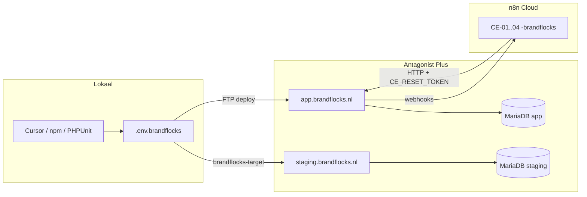

# Brandflocks — standalone infrastructuur

**Doel:** één afgesloten keten **Brandflocks → Antagonist → n8n**, zonder dagelijkse afhankelijkheid van CE (`ce.igisnext.com`), CE-staging (`staging.igisnext.com`), de map `iGiSNext/Content Engine` of Dropbox-brede losse env’s.

**Prioriteit nov 2026:** eerst **app.brandflocks.nl** stabiel — zie [APP-PRODUCTION-FIRST.md](./APP-PRODUCTION-FIRST.md). Bf-staging (`brandflocks-target`) **later**.

**Code & deploy:** altijd vanuit deze repo-map (`brandflocks/`). Niet vanuit `CE-Cursor` deployen.

---

## 1. Canonieke mappen

```
BrandFlocks/                    # Dropbox-werkruimte (design, briefings-spiegel)
├── brandflocks/                # ★ ENIGE applicatie-repo (git, deploy, scripts)
│   ├── web/                    # PHP API + build naar server
│   ├── frontend/               # React
│   ├── json/n8n/               # Workflow-export (Bron → push naar n8n)
│   ├── scripts/                # deploy, migraties, acceptatie
│   ├── briefing/spec/          # Bindende specs
│   ├── docs/                   # Checklists, BUILD-NOTES, dit document
│   ├── .env.brandflocks        # Productie app (niet committen)
│   └── .env.brandflocks-target # Staging app (niet committen)
├── docs/briefings/             # Spiegel / leeswijzer — geen tweede codebron
└── HTML/, ill/, svg/           # Prototype & design — niet op server
```

**Env:** één waarheid → `brandflocks/.env.brandflocks`. Bovenliggende `BrandFlocks/.env.brandflocks` mag een **symlink** zijn naar die file (zie `docs/README.md` in de parent-map).

**Niet meer gebruiken voor Bf-operatie:**

| Wat | Waarom |
|-----|--------|
| `brandflocks/.env.staging` (CE-staging) | Andere host, andere DB; alleen legacy sync-scripts |
| Deploy vanuit `iGiSNext/.../CE-Cursor` | Naslag + live CE-klanten |
| Tenant-sync **staging.igisnext → app** als routine | Eenmalig migreren, daarna export/import binnen Bf of handmatig |

---

## 2. Runtime-topologie (alleen Brandflocks-hosts)



| Omgeving | Env-profiel | Publieke URL | Doel |
|----------|-------------|--------------|------|
| **Productie** | `brandflocks` | `https://app.brandflocks.nl` | Pilot + klanten |
| **Bf-staging** | `brandflocks-target` | `https://staging.brandflocks.nl` | Test vóór app-deploy |
| ~~CE-staging~~ | ~~staging~~ | ~~staging.igisnext.com~~ | Niet in Bf-keten |

Check vóór elke deploy:

```bash
cd brandflocks
./scripts/check-env-isolation.sh brandflocks
./scripts/verify-standalone-infra.sh brandflocks
```

---

## 3. Secrets & integraties (per omgeving, allemaal in `.env.brandflocks*`)

| Variabele | Gebruik |
|-----------|---------|
| `CE_PUBLIC_BASE_URL` | Exact `app.brandflocks.nl` of `staging.brandflocks.nl` |
| `CE_RESET_TOKEN` | Uniek per omgeving — n8n + admin-calls |
| `CE_CREDENTIAL_KEY` | Uniek per DB |
| `ANTHROPIC_API_KEY` | PHP HBA + (apart) n8n Anthropic-credential |
| `N8N_*` + `N8N_BF_FOLDER_ID` | Alleen Brandflocks-workflows (`N8N_WEBHOOK_SUFFIX=-brandflocks`) |
| `FTP_*` / `DB_*` | Antagonist — **nooit** CE-FTP of CE-DB |

`web/includes/ce.local.php` wordt bij deploy uit het env-bestand gegenereerd — dat is wat de **server** leest (geen Dropbox-.env op productie).

---

## 4. n8n (los van CE-mappen, niet los van n8n-cloud)

1. Workflows staan in **`json/n8n/`** (deze repo).
2. Push: `./scripts/setup-brandflocks-n8n.sh` / `push-n8n-workflow.py` met `CE_N8N_TARGET=brandflocks`.
3. Workflow-URLs en base URL in nodes moeten **`app.brandflocks.nl`** zijn (niet `staging.igisnext.com`).
4. Credentials in n8n UI: MySQL → Bf-database; Anthropic → eigen key; HTTP → `X-CE-Reset-Token` uit Bf-env.

CE-workflows op dezelfde n8n-cloud blijven bestaan voor **CE**; Bf gebruikt een **eigen map** (`N8N_BF_FOLDER_ID`).

---

## 5. Data & HBA (geen CE-server nodig na onboarding)

| Actie | Standalone-pad |
|-------|----------------|
| Nieuwe tenant | `create-client.sh` / platform UI op app |
| HBA vullen | Wizard op app, of `admin/update-client` + `brandNarrative` |
| HBA kopiëren (eenmalig) | `export-tenant` / `import-tenant` **tussen Bf-hosts**, of eenmalig import uit CE-export-JSON |
| Branchebibliotheek | ZIP in `briefing/spec/hba-input/` → import-script op **Bf-DB** |

Geen structurele afhankelijkheid van pilot-tenant op `staging.igisnext.com`.

---

## 6. Migratiepad van “nu” naar volledig standalone

**Al gedaan (nov 2026):**

- App op Antagonist, eigen DB, mail Brandflocks.
- n8n Brandflocks-webhooks, acceptatie op app.
- Herobrands HBA via staging-export + app-import (geen CE-runtime).

**Nog afronden voor 100% operationeel los:**

- [ ] **Bf-staging live:** `staging.brandflocks.nl` + `.env.brandflocks-target` + deploy + rooktest (checklist: `deploy-brandflocks-checklist.md` §1b).
- [ ] **CE-02/03 n8n:** alle hardcoded `igisnext` URLs in JSON/Code-nodes naar `app.brandflocks.nl` (repo-scan: `rg igisnext json/n8n`).
- [ ] **Env op één plek:** parent `.env.brandflocks` → symlink naar `brandflocks/.env.brandflocks`.
- [ ] **Verwijder routine** `sync-tenant-to-staging.sh` uit Bf-runbooks; documenteer als “CE only”.
- [ ] **Git remote** alleen `brandflocks/` (Geen secrets in history; `gitleaks` bij fork).

**Bewust buiten scope (geen Bf-dependency):**

- `ce.igisnext.com` blijft voor bestaande CE-klanten.
- `CE-Cursor` blijft naslag en CE-development.
- Dropbox `docs/briefings/` blijft spiegel — specs canoniek in `brandflocks/briefing/spec/`.

---

## 7. Snelle health check

```bash
cd brandflocks
./scripts/verify-standalone-infra.sh brandflocks
./scripts/smoke-test.sh brandflocks    # waar ondersteund
curl -sS "https://app.brandflocks.nl/api/health" | jq .
```

---

## 8. Gerelateerde docs

| Document | Inhoud |
|----------|--------|
| [deploy-brandflocks-checklist.md](./deploy-brandflocks-checklist.md) | Stap-voor-stap deploy + staging |
| [BUILD-NOTES.md](./BUILD-NOTES.md) | Fork-geschiedenis, technische besluiten |
| [../briefing/spec/cursor-plan-fork-opschonen-brandflocks-2026-11-05.md](../briefing/spec/cursor-plan-fork-opschonen-brandflocks-2026-11-05.md) | Opschonen & los van CE-code |

*Laatst bijgewerkt: 12 november 2026*
