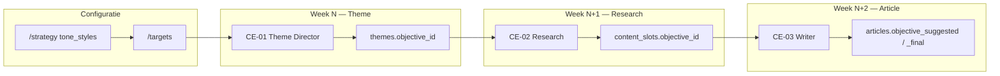

# Content Engine — bouwnotities

Levend document bij het bouwen. Bron van waarheid voor **status en inzichten**; functionele specs blijven in `briefing/Build-briefing-Content-Engine.docx` (**v11.0**, 30 jun 2026). **Strategisch kompas** bij grote wijzigingen: `briefing/product-vision.md`.

Laatste update: **19 oktober 2026 (avond)** — Ronde 6 **pilotklaar + afronden** op branch `hba-ronde-6-pilotklaar` (**origin** t/m `ca4eaa0`). Scorer **v1.12**; 5×19 poging 2/2: **13/19** stable (doel ≥16) → **geen pilotstart**. Stopbericht-artefacten: `docs/rogier-stopbericht-ronde-6-2026-10-19/` (incl. A6 na staging). Besluit **neutraal/categorietaal** + flagtelling: diagnose offline, **geen scorer-wijziging** tot Rogier. Staging deploy 19 okt (`index-BfSUgaQU.js`); geen productie.

---

## Sessie 13–15 oktober 2026 — HBA ronde 5 (v1.10 → v1.10.3) + kalibratie-overzicht

**Doel van deze BUILD-update:** alles wat sinds **september 2026** aan **HBA-testmerken / kalibratie** is gebouwd en gemeten op één plek vastleggen (het stond grotendeels alleen in commits, `docs/hba-*` en het Rogier-pakket).

### Waar we nu staan (menselijk)

| | |
| --- | --- |
| **Omgeving** | Alleen **staging** (`staging.igisnext.com`) voor kalibratie-deploys; **geen productie** v1.10 zonder Rogier/Erik. |
| **Branch** | `hba-ronde-6-pilotklaar` (vanaf `hba-ronde-4-v1.9`). |
| **Scoring-model** | Runtime blijft **`claude-sonnet-4-6`** (`HBA_MODEL_CONTENT_SCORE` / fallback). |
| **Prompt scoring** | **`v1.12`** (Rogier-besluiten 19 okt); v1.11 freeze-doc blijft in `docs/hba-v1.11-stap9-pilotversie-eindmeting.md`. |
| **Rogier** | Ijkset **v0.3**. **Stopbericht ronde 6:** `docs/rogier-stopbericht-ronde-6-2026-10-19/` (+ bijlagen valkuil/flagtelling). Eerder pakket: **`rogier-pakket-ronde-6-pilot-2026-10-19`**. |
| **Pilot (deel A)** | A6 restpunten vastgelegd (`docs/hba-v1.12-stap4-a6-restpunten.md`, shots `docs/a6-screenshots-staging-2026-10-19/`); **`geen_bron`** klantbevestiging (API + UI). Agenda-kop nog deels EN. |
| **Scorer (deel B)** | **5×19 v1.12** (poging 2/2): **13/19** stable — `docs/hba-v1.12-stap5-5x19-eindmeting.md`. Offline replay diagnose: live 13/19, met `&& !kernCat` terug **14/19** (`docs/hba-v1.12-tegenkracht-diagnose.md`). **Geen derde run.** |
| **Ijk valkuil-gate** | v1.11-ijkrun: 26 fout / 6 goed / 5 review / 9 niet gedraaid — `docs/hba-v1.11-stap6-ijkrun-uitsplitsing.md`. |

### Tijdlijn kalibratie (kort)

| Periode | Versie / ronde | Wat |
| --- | --- | --- |
| **Sep 2026** | Ronde 3 (A1–A6, D1–D4, R0) | Testset-API, blind scores, CE-04/CE-07/report/thema-koppelingen, A6-klanttaal; nulmeting **v1.3**. |
| **Okt 2026** | v1.7 → v1.8 | Hoofdoordeel + flags; PHP-hoofdoordeel-correctie beperkt (V1); stabiliteit **5×17**. |
| **Okt 2026** | v1.8.1 | Klanttaal verbeteradvies; her-score staging; **12/17** stable 5/5 (toen). |
| **Okt 2026** | **v1.9** (ronde 4) | Leidingen `self_review`, thema-conflict vóór CE-03, regelbreuk = handeling + verificatie + controlecall, testset opschonen → **16/17** stable; V0 verleidingstest groen; CE-04 hertest. |
| **Okt 2026** | **v1.10 → v1.10.3** (ronde 5) | Deel A: CE-04, premisse, hints. Deel B: research/versieregistratie (Rogier reactie), PHP merkbijdrage-cap (stap 3), scorer defs + early cap (v1.10.1), testset post 3 (v1.10.2), **5×19** + V0 (stap 6), hoofdoordeel-filter (v1.10.3). |

**Bron opdrachten:** `briefing/hba-input/hba-ronde-4-v1.9.md`, `briefing/hba-input/hba-ronde-5-v1.10.md`.

### Ronde 5 v1.10 — commits (1 per stap)

| Commit | Stap | Inhoud (samenvatting) |
| --- | --- | --- |
| `a3ca2b7` | doc | Kalibratie-overzicht + Rogier-pakket-docs (vóór deel B) |
| `d51090f` | briefing | Ijkset v0.2 + Rogier-reactie v1.10 in `briefing/hba-input/` |
| `532a3fc` | 1 (deel A) | CE-04 script-route post 3; `constraint_breach_verificatie` in JSON; admin controlecall-test 6×5 |
| `2a0c371` | 2 (deel A) | CE-03 premissecheck (`themePremisse`); V0 verleiding opnieuw |
| `a960484` | 3 (deel A) | Hints: `[…]` invulvelden + bewijsveld; publish/submit guard; oranje editor |
| `6fc0208` | 4 (eerste) | Scorer v1.10 defs + matrix-judge; posts 6/7; import 19×; 5×19 staging |
| `7dfad95` | 1 (deel B) | Research per slot-client (`ce_fetch_slot_research`); Stelwerk V0-URLs; isolatietest |
| `f4e6ed6` | 2 (deel B) | `prompt_version` + `model` op theme/research/hint/architectuurcheck |
| `d83d623` | 3 (deel B) | PHP merkbijdrage-cap kop/opening; `verwacht_flags_een_van` Duinroos 7 |
| `22af8b0` | 4 (afronding) | Prompt **v1.10.1** + early `proof_gap`-cap; kalibratie Stelwerk 6 |
| `c518de4` | 5 | Brandpunt post 3 “twee maanden geleden”; regelbreuk-uitleg = geloofwaardigheidstest |
| `9792061` | 6 | **5×19** v1.10.2 + V0/CE-04; `stabiliteit-v1.10.2.*` |
| `1bbff42` | filter | **v1.10.3** — `foe_vervaging` forceert `tegenkracht` alleen bij `op_merk`, niet bij `categorietaal` (Stelwerk 5) |

**Docs per stap:** `docs/hba-v1.10-stap1-research-koppeling.md`, … `stap10-ijkrun.md`, **`docs/hba-ijkset-koppeling-v0.3.md`**, `docs/hba-v1.10-stap1-architectuurpoort.md`, `docs/hba-v1.10-stap2-hoofdoordeel.md`, `docs/hba-v1.10-stap3-verbodslijst.md`, `docs/hba-v1.10-stap4-klanttaal.md`, `docs/hba-v1.10-stap5-pilotruns.md`, `docs/hba-t13-vs-duinroos-7.md`.

**Nog open (na afronden):** Rogier op **neutraal vs categorietaal** + valkuil-prioriteit + flagtelling (bijlagen in stopbericht-map); pilot start pas na akkoord **en** drempel ≥16/19. V01; compressie; agenda-kop nl-NL; GEO Vindbaarheid.

### Sessie 16 oktober 2026 (avond) — bouwvolgorde stap 0–2

Bron: `briefing/cursor-bouwvolgorde-besluiten-16-oktober.md`. Eén commit per stap; alleen staging.

| Commit | Stap | Inhoud |
| --- | --- | --- |
| `e8dc302` | 0 | Ijkset **v0.3** in ijkrun; `verwacht_meetlat` + `oordeel_status` / `meetlat_status` per geval |
| `059184d` | 1 | Architectuurpoort: geen harde poort, check altijd, `tegenkrachtOntbreekt` / `regelOntbreekt`, `meetlatStatus` |
| `92b2fc2` | 2 | Hoofdoordeel-volgorde + label **Positiebreuk**; prompt **v1.10.7**; Duinroos 7 = T13 |
| `f69fe82` | 3 | Architectuur **verbodslijst**: dimensie-toelichting + suggesties; retry/strip; `event_log` `architectuur_verbodslijst` |
| `0fbf67e` | 4 | Klanttaal §6: contentrollen, Remove→Verwijderen, A6 (merkdoel i.p.v. archetype, Merkelementen/Vindbaarheid NL) |
| `2548e29` | 5 | Pilotversie **v1.10.8** (freeze); runplan 5×19 + v0.3-ijkrun |
| `d8276ee` | 6 | T13 vs Duinroos 7: veldvergelijking; ijk-mapper niet gelijkgetrokken |
| `2b574e2` | doc | Koppeldocument **v0.3**; besluiten **7.1–7.7** ingevuld (enige bron) |

### Sessie 18 oktober 2026 — ronde 6 stap 1

Bron: `briefing/hba-input/hba-ronde-6-pilotklaar.md`. Prompt **v1.11**. Hoofdoordeel alleen uit flags; `docs/hba-v1.11-stap1-hoofdoordeel-code.md`. Commit **`a7f1213`**; staging deploy + smoke 6/6.

### Sessie 18 oktober 2026 — ronde 6 stap 2

Bron: zelfde briefing, stap 2. Gedeelde eis `hba-regel-letterlijk.txt`. Commit **`f722b92`**, poging 2 **`b8ac5c9`**. Staging smoke 6/6. V0-hints 5/5; Brandpunt week 41 0/5 na twee pogingen (`docs/hba-v1.11-stap2-regel-letterlijk.md`). Gestopt.

### Sessie 18 oktober 2026 — ronde 6 stap 2a

Bron: `briefing/cursor-stap2a-citaatcontrole-hints.md`. PHP-citaatcontrole, geen promptwijziging. Veld `aanspreekvorm`. Placeholders → invulvelden. Staging smoke 6/6; V0 **5/5**, Brandpunt week 41 **1/5** (`docs/hba-v1.11-stap2a-citaatcontrole.json`). Admin-patch **`cdd7627`**.

### Sessie 18 oktober 2026 — ronde 6 stap 3

Bron: zelfde briefing, stap 3. Huidig week-41-artikel is **vóór** premissecheck (geen `themePremisse`). CE-03: `aanspreekvorm_block` + `self_review.merk_beweringen`. Staging: deploy + n8n CE-03; rewrite ~48s — geen “op bestelling”/u meer, wel 2× `geen_bron` in tekst. `docs/hba-v1.11-stap3-geen-verzonnen-feiten.json`.

### Sessie 18 oktober 2026 — ronde 6 stap 4

Bron: zelfde briefing, stap 4. Thema-oordeel onder *Past dit onderwerp bij je merk?* op Onderzoek en Thema’s (versterkt/neutraal/botst). Bij regelbotsing: letterlijke regel + invalshoek. `docs/hba-v1.11-stap4-thema-advies.md`. Screenshots: `docs/a6-screenshots-staging-2026-10-18/` (CE-04 terugkoppeling zichtbaar).

### Sessie 18 oktober 2026 — ronde 6 stap 5

Klanttaal A6 in pilot-schermen. Commits **`d1447d4`**, **`b9c8e03`**. `docs/hba-v1.11-stap5-klanttaal.md`.

### Sessie 18 oktober 2026 — ronde 6 stap 6

Ijkrun v1.11 uitsplitsing per as. Commit **`f0234d2`**. `docs/hba-v1.11-stap6-ijkrun-uitsplitsing.md`, `hba-ijkrun-nulmeting-v1.11.json`.

### Sessie 18 oktober 2026 — ronde 6 stap 7

Ijkrun via wizardvelden (geen testmerk-stubs). Commit **`b7cb60b`**. `docs/hba-v1.11-stap7-wizard-ijkset-velden.md`.

### Sessie 18 oktober 2026 — ronde 6 stap 8

Stroomtest Brandpunt (onboarding 2×, 25 posts, checkpoints). Commits **`7926b25`**, **`c346356`**, **`5c552b0`**. `docs/hba-v1.11-stap8-stroomtest-brandpunt.md`, artefacten `hba-brandpunt-stroomtest-staging-2026-10-18/`.

### Sessie 18–19 oktober 2026 — ronde 6 stap 9 + levering Rogier

Eindmeting 5×19 + CE-04 + V0; pilot freeze-doc. Commits **`7c03325`**, **`c518a33`**. `docs/hba-v1.11-stap9-pilotversie-eindmeting.md`, `docs/terugkoppeling-rogier-ronde-6.md`, zip **`rogier-pakket-ronde-6-pilot-2026-10-19`** (`scripts/build-rogier-pakket-ronde-6.sh`).

### Sessie 19 oktober 2026 — Rogier-besluiten uitvoeren (v1.12)

Bron: `briefing/cursor-ronde-6-besluiten-rogier-uitvoeren.md`, `docs/hba-v1.12-ronde6-besluiten-uitvoering.md`. Prompt **v1.12**; staging deploy + import testposts; **5×19 poging 2/2** → **13/19** (geen derde run).

| Commit | Stap | Inhoud |
| --- | --- | --- |
| `808d1eb` | doc | Besluiten + bouwbriefing in repo |
| `addc5ad` | 1 | Matrix `niet_beoordeeld`; stability-logging velden |
| `2981286` | 2–4 | Merkbewering-trede, trede 2 zonder `&& !kernCat`, testset Brandpunt/Stelwerk |
| `d5a0498` | 6 | A6 klanttaal + hashtags in score/CE-03 |
| `b14b1af` | 5 | Eindmeting 13/19 + JSON/log |
| `fea1452` | build | Matrix in resultaat-doc; frontend assets |

### Sessie 19 oktober 2026 — Ronde 6 afronden (stoppen)

Bron: `briefing/cursor-ronde-6-afronden-en-stoppen.md`. **Geen** scorer-/volgorde-wijziging na diagnose; **geen** derde 5×19.

| Commit | Stap | Inhoud |
| --- | --- | --- |
| `7f1dbb7` | doc | Briefing afronden; oude briefings vervallen |
| `255ac98` | 1 | Offline tegenkracht-diagnose + replay-lib (`scripts/hba-v1.12-*`) |
| `964975b` | 2 | Backfill `hba-testmerken-stability-v1.12-5runs.json`; neutrale-posts controle |
| `262f338` | 3 | **`geen_bron`** override (confirm API, publish-flow, UI) |
| `68d216e` | 5 | Map `docs/rogier-stopbericht-ronde-6-2026-10-19/` + bijlagen |
| `ca4eaa0` | 4 | A6-screenshots na staging deploy; `docs/hba-v1.12-stap4-a6-restpunten.md` |

**Staging 19 okt:** `./scripts/deploy-ftp.sh staging`, `./scripts/push-ce03-n8n.sh staging`, CE-04 post 3 voor terugkoppeling-shot (`run-hba-r0-ce04-post3-staging.sh`).

**Backlog HBA-tooling (21 okt, niet urgent):** `run-hba-r0-ce04-post3-staging.sh` — stdout bevat `==>`-regels vóór JSON (breekt pipe naar `json.tool`); `wait=0` zonder `dry` triggert opnieuw CE-04 i.p.v. alleen poll. Poll-only: `GET …/admin/hba-ce04-post3?pollOnly=1` (zie `1dc37bb`). Blokkeert Rogier-pakket niet.

### Ijkrun nulmeting (16 okt 2026)

| | |
| --- | --- |
| **Artifact** | `docs/hba-ijkrun-nulmeting-v1.10.6.json`, `…-samenvatting.md`, **`hba-v1.10-ijkrun-rapport-roger.md`** |
| **Briefing A15/routes** | `briefing/cursor-ijkrun-a15-en-aparte-routes.md` — lege velden, telling, A15-diagnose, V01/compressie-bestanden |
| **Runner** | `501e426` — score-row voor judge; sandbox zonder wizard-daglimiet |
| **Stap 10 commits** | `b27908d` runner, `ebd2377`/`b3e357b`/`501e426` fixes |
| **Leidende run** | Her-run 3 only (runs 1–2 judge/infra onbetrouwbaar) |

**Reactie Rogier 15–16 okt:** koppeldocument = `docs/hba-ijkset-koppeling-v0.3.md` (7.1–7.7); stap 9 = `docs/hba-v1.10-stap9-compressietest.md` (geen runner; H4 ≠ compressie).

### Meetlat & tooling (staging)

| Tool | Pad / script |
| --- | --- |
| Testmerken provision + import | `web/api/admin-provision-hba-testmerk.php`, `admin-import-hba-testposts.php`, `scripts/import-hba-testposts-staging.sh` |
| Matrix (1 run) | `GET /api/admin/hba-testmerken-matrix` |
| Stabiliteit (N runs) | `GET /api/admin/hba-testmerken-stability`; backfill export `scripts/hba-v1.12-backfill-stability-export.php` |
| Diagnose replay (offline) | `scripts/hba-v1.12-tegenkracht-diagnose.php`, `scripts/hba-v1.12-replay-lib.php` |
| Ijkset nulmeting | `GET /api/admin/hba-ijkrun`, `scripts/run-hba-ijkrun-staging.py` |
| V0 verleiding | `admin-hba-v0-verleiding.php` |
| CE-04 post 3 | `admin-hba-ce04-post3.php` |
| Controlecall test | `admin-hba-constraint-breach-verificatie-test.php` |
| Rogier-pakket | `./scripts/build-rogier-hba-pakket.sh` → `docs/rogier-hba-testmerken-pakket-YYYY-MM-DD.zip` |

**Definities (versioned):** `web/api/prompts/hba-flags-definitie.txt`, `hba-regelbreuk-definitie.txt`, `hba-hoofdoordeel-definitie.txt`, `hba-verbeteradvies-definitie.txt`.

**Resultaten & verslagen:** `docs/hba-testmerken-resultaat.md`, `docs/hba-testmerken-stabiliteit.md`, `docs/stabiliteit-v1.10.2.md`, `docs/hba-testmerken-stability-v1.10.2-5runs.json`, `docs/hba-v0-testresultaat.json`, `docs/hba-v1.10-verslag-roger.md` (concept — bijwerken na ronde 5).

### Werkwijze (Rogier-rondes)

1. Stap voor stap, **één commit per stap** (message bevat stapnummer).
2. Deploy staging **alleen** na expliciet **「ja staging」** (niet productie).
3. Promptwerk staps 2–4: **Opus 5** in briefing; uitvoering via Cursor — runtime HBA blijft Sonnet 4.6.
4. Na elke ronde: verslag + `build-rogier-hba-pakket.sh` voor Rogier.

### Lokaal buiten HBA-kalibratie-commits (bewust / nog te sorteren)

Losse wijzigingen buiten ronde 5 o.a. contentrol in `hba-repository.php`, `articles.php`, frontend hooks — **niet** in kalibratie-commits tot aparte taak. Rogier-pakket opnieuw zippen: `./scripts/build-rogier-hba-pakket.sh`.

### Volgende stap (HBA / Rogier)

1. **Pilot-go** + evt. **5×19 op v1.10.3** (bevestiging dat Stelwerk 5 stabiel blijft over hele set).
2. **`docs/hba-v1.10-verslag-roger.md`** + zip bijwerken; ijkset-koppeling concept (`docs/hba-ijkset-koppeling-v0.2.md`).
3. Parallel **okt 2026-to-do**: volledige staging-case (CE + HBA + Overzicht/Rapport), model-upgrade Opus/GPT voor CE-03/Re-edit (zie § hieronder).

---

## To-do 1 oktober 2026 — tekstkwaliteit + inhoudelijkere HBA

**Doel:** posts lezen **inhoudelijk sterker** (argument, bewijs, merk, geen generieke AI-proza); HBA-aanwijzingen **concreter** (passage, tegenkracht, regel, wat ontbreekt — geen vage labels).

**Modelkeuze (Erik):**

| Rol | Model | Waar in CE |
| --- | --- | --- |
| **Tekstcreatie** (eerste draft) | **Opus 5.5** | CE-03 Stap A/B/C (`JSON/CE-03 …`, patches in `scripts/generate-ce03-workflow.py`); exacte API-slug bevestigen (bv. `claude-opus-5-5` / `claude-opus-5`) |
| **Eindredactie** | **GPT-6 Sol** | Re-edit (`ce_reedit_article_from_notes` in `web/api/article-repository.php` — nu `ce_hba_v2_call_json` = Anthropic); evt. ook sidebar **Rewrite** / CE-03 stap C als “polish” — **aparte env** i.p.v. HBA-fallback |

**HBA (zelfde dag — prompts + optioneel model):**

- `web/api/hba-v2-prompts.php` — theme/research/article-hint: eisen **citeerbare passage**, **welke regel/archetype**, **concrete rewrite-richting** (headline/CTA/passage).
- Env (`hba-model-config.php`): minstens `HBA_MODEL_ARTICLE_HINT` en `HBA_MODEL_THEMA_VERDICT` / `HBA_MODEL_RESEARCH` op sterk model; contentscore kan op lichter model blijven.
- Acceptatie: 1 staging-slot CE-03 → Re-edit → Theme/Research/Article HBA; vergelijk met huidige Sonnet-baseline.

**CE-03 prompts (naast model):**

- `patch_ce03_nl_writing_style` / tone / objective patches — scherper: research-grounding, geen hollow openings, platform-specifiek bewijs.
- Na wijziging: `generate-ce03-workflow.py` + `push-ce03-n8n.sh staging`.

**Nog open:** env-namen voor CE-03/Re-edit (`CE03_ANTHROPIC_MODEL`, `CE_REEDIT_OPENAI_MODEL`?) en kosten/latency op staging vóór productie.

**Status okt 2026:** de **testmerken-pipeline** (matrix, stabiliteit, promptversies in code, Rogier-pakket) is in grote mate wat roadmap **§6 kalibratiemodule stap 2** (prompts/drempels centraliseren) voor **scoring** al dekt — maar **zonder** admin-UI; alles via admin-endpoints + JSON. Schrijver/hints/CE-04-kalibratie liep via ronde 4–5. **Nog steeds open:** één **volledige tenant-case** op staging (CE-flow + HBA UX + Overzicht/Rapport na notitie 15), **model-upgrade** bovenstaande tabel, en **productie**-besluit pilot.

---

**Volgende stap — na jouw go (onverkort):** **pilot/Rogier** op ronde 5 (scorer **v1.10.3** op staging); parallel een **volledige case op staging** (CE-flow + HBA UX + Overzicht/Rapport); kalibratiemodule **UI/admin-koppeling** (roadmap stap 3–4) blijft backlog.

### Notitie 15 — acceptatie (Overzicht + Rapport)

Bron: `briefing/hba-input/15-bouwnotitie-overzicht-rapport-3.md` + `15b-besluit-research-liken-blauw.md`. Staging: commits `5f860a7` … `b52f5de` (+ afronding todo-stippen).

| § | Onderwerp | Status |
|---|-----------|--------|
| 1.1 | Terugkeerregel >7 dagen + link Rapport | ✅ |
| 1.2 | Max. 1 signaal (`overviewSignal`; portfolio vóór erosion) | ✅ |
| 1.3–1.4 | Vijf meters, engagement als 5e meter | ✅ |
| 1.5 | Todo’s + blauw/beige stip, research indienen vs doorkijken | ✅ |
| 1.6 | Koppelingenbalk podcast/mailbox/Trello | ✅ |
| 1.7 / 2.5 | Lege staten, geen “Je merk wordt opgebouwd” | ✅ |
| 2.1–2.4 | Diagnose, grafieken met tekst, engagement, op-strategie vs generiek | ✅ |
| 4 | Geen grafieken op Overzicht; merkcijfer-band zonder determinisme | ✅ |

**Afronding (30 sep, `briefing/cursor-notitie15-afronding.md`):** build fix; terugkeerregel = PBS-trend; klanttaal; Rapport `band` zonder exacte merkscores; lege Rapport-staat zonder flits; drempel **10 beoordeelde posts** (`HBA_SCORED_POSTS_FOR_OVERVIEW` / `CE_HBA_SCORED_POSTS_FOR_OVERVIEW`) — meters, diagnose én voortgangsbalk. **Niet deployen** tot case-run.

**Bewuste afwijkingen (Erik, sep 2026):** signaalblok en secties = horizontale lijnen (geen `ce-yellow` vlak uit 15b); leestekst zwart i.p.v. overal `ce-beige-text`. **Later verfijning (§3b):** Agenda-filter op contentrol bij signaal-actielink; voorinvulling positionering bij Theme-link. **Niet in afronding:** tone/trend-sparklines in Rapport-generator, todo-volgorde, dode Home-secties.

---

## Backlog — Herschrijf selectie (#42)

**Status:** backlog — **niet gebouwd**. Redacteur vraagt nu om per intro/alinea AI-herschrijving; nu alleen handmatig edit, HBA passage-hint (één blok) of volledige sidebar **Rewrite** (hele post via CE-03).

| # | Onderwerp | Waar het hoort | Notitie |
| --- | --- | --- | --- |
| **#42** | **Herschrijf selectie** | **Article / Feedback** (Grid #2/#3) | Redacteur **selecteert** intro of alinea (+ optionele instructie, bv. “persoonlijker”, “geen cliché-opening”) → AI herschrijft **alleen dat stuk**; rest van draft + editor-vragen ongewijzigd. Nu: sidebar **Rewrite** = volledige CE-03-run; HBA = één `passage_voor`→`passage_na` zonder vrije instructie. Scope: UI (selectie + instructie + knop), API-endpoint, lichte Claude-call (niet volledige CE-03), `write_directive` + Schrijfwijzer meenemen. Zie § Article meta — Rewrite. |

---

## Backlog — Sources Slack (#38)

**Status:** alleen backlog — **niet bouwen** tot expliciet privacy-/AVG-besluit (briefing `cursor-sources-uitbreiding-scan.md` §3.5).

Slack als bron is technisch haalbaar (OAuth, kanaalkeuze), maar bevat informeel intern verkeer zonder toestemming van alle deelnemers. Vereist: expliciet per kanaal, zichtbare lijst wat wordt meegelezen, en klantbesluit vóór implementatie. **TikTok** (Apify-scraper) bewust overgeslagen in aug 2026-sprint — alleen doen bij klantvraag + kostenbewaking.

---

## Backlog — YouTube verdieping (#39–#41)

**Status:** #41 is een **concrete integratiegat** (Check groen, Research leeg); #39/#40 zijn **aparte productbesluiten** — niet in scope van de huidige Sources-tab YouTube (kanaal-RSS, aug 2026).

| # | Onderwerp | Waar het hoort | Notitie |
| --- | --- | --- | --- |
| **#41** | **CE-02 Atom-feed parsing** | **CE-02 Research** + `generate-ce02-workflow.py` | YouTube-kanaal-RSS (`feeds/videos.xml`) levert **Atom `<entry>`**, niet RSS `<item>`. PHP Check telt wél beide (`ce_count_rss_items_in_body`); CE-02 **Fetch Source Items** parsed alleen `<item>` → groene Check (bv. `@JamieOliver`, 15 video’s) maar **0 kandidaten in research**. Fix: `<entry>` parsen (titel, `link@href`, `media:description`/`summary`), `source_type` bv. `youtube` of `rss`; test met Jamie Oliver-feed; `./scripts/push-ce02-n8n.sh`. |
| **#39** | **Gesproken inhoud / transcripties** | Niet de RSS-bron | Vereist **YouTube Data API + captions** — quota, OAuth/API-key, fragiele caption-beschikbaarheid. Apart productbesluit vóór bouw. |
| **#40** | **Eigen kanaal + kijkcijfers** | **Analytics / Report**, niet Sources | **YouTube Analytics API** met OAuth — conceptueel naast GA4 (Report CE-07, tenant-kPI's), geen follow-feed in research. |

Bron: `briefing/cursor-sources-uitbreiding-scan.md` §3.1. De Sources-tab **YouTube** blijft beperkt tot publieke kanaal-RSS (titels, beschrijvingen, links uit de feed — **niet** transcripties of Analytics).

---

## Waar we staan


| Laag                                         | Status                                                                                                                                                                                                                                                                                                                |
| -------------------------------------------- | --------------------------------------------------------------------------------------------------------------------------------------------------------------------------------------------------------------------------------------------------------------------------------------------------------------------- |
| **Navigatie (sidebar)**                      | ✅ **aug 2026:** Overview los + **Identity** / **Knowledge** / **Content** / **Settings** (`SidebarNav.tsx`); sectie-iconen `Identity.svg`, `Knowledge.svg`, `Content.svg`, `Settings.svg`; klik op sectie → eerste item + uitklappen; hoofdlabels faden na 5s; **Settings** = dark-mode chapter (`SETTINGS_NAV_KEYS`) |
| **CE-03** Artikel schrijven                  | ✅ n8n → MySQL; **31-08:** research-gate telt theme+slot research; stub/resume-pad; staging crash door ontbrekende `poster_word_*` (migratie + workflow opnieuw geactiveerd) |
| **Grid #2 Article**                          | ✅ §5.6 radiogroups, AI-badge, dual image upload; **Rewrite** (sidebar → CE-03); **Re-edit** (knop naast Submit → aantekeningen in copy verwerken); **jul 2026:** beeldvoorstel, gallery/computer-picker; **aug 2026:** nieuwe invoer in editor **blauw** t.o.v. opgeslagen tekst; Aandachtspunten met drie acties (§ Aandachtspunten-onderbouwing) |
| **Grid #3 Feedback (AI)**                    | ✅ CE-04 webhook, `article_feedback`, diff-view; label-UI (okay/delete per wijziging, image-feedback op slot); zelfde image-picker als Article                                                                                                                                                                         |
| **Agenda**                                   | ✅ Live API, statuskleuren, delete/archive, weekdatums + verlopen-week styling; **aug 2026:** actierij — actieve links zwart, niet-actieve (verlopen week) beige; **31-08:** `AgendaCalendar` LIST-layout + ritme-accent (`rhythmRoles.ts`); themed → Research; groene bevestiging na research submit |
| **Home dashboard**                           | ✅ To-do-lijst (`todos`) + Result-kolom; **aug 2026:** één **Totale engagement**-grafiek (todo-kolom 480px, GA4-stijl hover/scrub); bij HBA aan **Je merk wordt opgebouwd** (`BrandWatcherSection`) boven engagement — zelfde kolombreedte, horizontale lijn i.p.v. wit vlak; zonder HBA geen angleMix; **`strategyReady`** = HBA-architectuur klaar (`ce_hba_v2_architecture_ready` + `hba_architecture_completed_at`) of BrandValues/schrijfwijzer; Overview-cache force-refresh bij mount; **Podcast toevoegen**-todo → `/sources/new/url-rss` |
| **ContentFlow-laag (briefing 30-08)**      | ✅ **aug 2026:** `branch_record` op `branche_library` + evidence/guardrail/ritme/stem; 7-fase afleider (Claude + web search); zes seed-branches gemigreerd; identity-gate vóór scoring; **A1 Ritme** live (CE-01/01b + `content_rhythm`, Planning/Theme/Agenda); **A2** kern vs aanvullende bronnen; **A3** leren van posts + Overview 20-posts; **B1–B3** NL-namen, vaktaal, kalender LIST-layout (subtle accent, geen dikke kleurblokken); themed-slot → Research i.p.v. `/theme`. Open: **HBA-laag verdieping** (morgen), drag-and-drop herplannen, B7-templates, B10 typografie. |
| **Titelposter**                            | ✅ **aug 2026:** CE-03-posterregel + sjabloon **Kernwoord** (`poster_word_main`/`poster_word_struck`); migraties `add_titelposter.sql` (prod 31-08) + `add_titelposter_word_pair.sql` (staging). **UI titelposter-generator verborgen** op Article (verwarrend naast HBA). CE-03 staging (`G00xCae5m8fTQ4KX`) + productie (`uXPINdIVb6RO7aj8`). |
| **HBA v2 — Identity tabs**                 | ✅ **aug 2026:** drie Identity-tabs — **Merkarchitectuur** (`/brandarchitecture`) · **Merkelementen** (`/styleguide`) · **Doelen** (`/targets`); briefing `cursor-identity-tabindeling.md`; `docs/HBA-V2-ARCHITECTURE.md` |
| **BrandElements (voorheen StyleGuide)**    | ✅ Schrijfwijzer, tone_styles, editor_styles altijd; BrandValues alleen zonder HBA; bij HBA verwijzingsregel naar BrandArchitecture; route `/styleguide` behouden |
| **Campaign planner**                         | ✅ `/campaign` planner + `/campaigns` overzicht; plan in DB, **start + einddatum** (3 pills), meta-sidebar, Agenda **Campaign**-actie; **Campaigns** in **Content**-sectie sidebar                                                                                                                                     |
| **Human submit (CE-04.1bis)**                | ✅ n8n mail + token + reviewpagina                                                                                                                                                                                                                                                                                     |
| **CE-04.1quater inline edits**               | ✅ API + ReviewEditsPanel (accept/reject)                                                                                                                                                                                                                                                                              |
| **Plaats / Publish WP (4.4.2)**              | ✅ WP op `igisnext.com` + REST-koppeling; **aug 2026:** **Joomla 4/5** publish (`joomla-publish-repository.php`); **CMS-pulldown** op Integrations (WordPress / Joomla / static FTP, wissel wist andere CMS-credentials); statische HTML-publish via FTP; velden `website_cms`, `joomla_*` op `clients`                                                                                                                                 |
| **LinkedIn publish (Publiceer)**             | ✅ OAuth per tenant, tekst + artikelafbeelding, API-versie-fallback; persoonlijk profiel; **bedrijfspagina** nog backlog (Community Management API)                                                                                                                                                                    |
| **Sources API + tabs**                       | ✅ Live API + UI; **Mailbox IMAP-sync** naar `newsletter_items` (jul 2026); **aug 2026:** **Delete** FK-safe; **Google Calendar** OAuth; **WAF/bot-blokkade (403):** Check probeert `/feed/`-fallback + **Google News** `site:domein` (`ce_probe_rss_google_news_fallback`); lokale bestandspaden afgewezen; bronformulier **Back** i.p.v. Undo; mapstructuur + folders op Sources; **Blogs**-bron + blogoverzicht-parser; **Document / YouTube / Asana / Drive** (aug 2026, scan `cursor-sources-uitbreiding-scan.md`); **Source inspiration** — AI stelt 5 bronnen voor (bestaande sources + strategie + HBA) via `POST /api/sources/inspiration`, knop op Sources, **Toevoegen** prefilt formulier; **Slack** → backlog (#38, privacybesluit eerst) |
| **Archive**                                  | ✅ Lijst + read-only artikel + post/confirm-flow; promo budget; **publishLinks** (Blog → / LinkedIn → / X →); URL-check (groen/rood/blocked); WP-URL auto-save + backfill                                                                                                                                              |
| **Objectives (targets)**                     | ✅ **v1 live** — `/targets` (nav **Objectives**, Identity); uitklapbare objectives; kolombreedte 500px; slider max = resterend % tot 100%; **Verwijder** i.p.v. Undo; Save/Undo; planning-metrics → `/planning`                                                                                                        |
| **Planning**                                 | ✅ **aug 2026** — `/planning`: horizon, posts/week, bronchecks/week (`PlanningMetricField`); Save/Undo; bron voor CE-01 horizon                                                                                                                                                                                        |
| **Search (Findability)**                     | ✅ **aug 2026** — `/search` (nav **Findability**): GEO-vragen (ex-LLM) + SEO-vragen (max 5 elk); kolom `question_kind`; `SearchQuestionsEditor`; Report LLM-vindbaarheid blijft GEO                                                                                                                                    |
| **CE-01 Theme Director**                     | ✅ n8n + **maandag phase-gating scheduler** (v9.0)                                                                                                                                                                                                                                                                     |
| **CE-02 Research**                           | ✅ n8n workflow live; RSS + Trello + **Apify/scraper** + **Blogs-overzicht** + **Document/Asana/Drive** (via CE API); YouTube-tab → kanaal-RSS in Check (**groen**), maar **Research leeg** tot CE-02 Atom `<entry>` parsing (#41); **aug 2026:** eigen LinkedIn-bron niet in research-kandidaten; **invalshoek** per item (5 unieke); **aug 2026 (17):** snippet ≥80 tekens + titel verplicht; `stance`/`reliability` in CE-02 (migratie + n8n push nog vereist) |
| **Sources Scraper / Apify**                  | ✅ `scrape_runs`, budget per bron, echte Apify-check, CE-02 integratie                                                                                                                                                                                                                                                 |
| **CE-01b Theme → Slot**                      | ✅ slot `themed`, geen directe CE-03                                                                                                                                                                                                                                                                                   |
| **Fastlane**                                 | ✅ Scherm `/fastlane` (briefing layout) + `POST /api/fastlane` → themes/research/slot + CE-03                                                                                                                                                                                                                          |
| **Report (CE-07)**                           | ✅ n8n + scherm `/report` (`ce07-performance-report`, workflow `vZH7ZJZMM03sIKOQ`)                                                                                                                                                                                                                                     |
| **Account**                                  | ✅ Scherm `/account` + login MVP `/login`; **aug 2026:** Account-hoofdstuk **dark mode**; **tenant-logo** upload + sidebar (`TenantLogoField`: 200×94.5px veld, logo max 200×60px, onderkant = titelbaseline Overview/Account); fallback iGiSNext; wachtwoord vergeten; publish mode-hints; HBA-toggle (`hbaEnabled`)  |
| **Integrations**                             | ✅ **aug 2026** — `/integrations` hub (Settings): groepen Input/Publish/Analytics; status via `GET /api/integrations/status`; **Sources**-pill primair waar van toepassing; klanttaal (Theme/source i.p.v. CE-02/bron); GA4 + LinkedIn + WordPress/Joomla/FTP + Apify; staging-banner blauw in dark mode |
| **FieldHint + support-escalatie**            | ✅ **aug 2026** — `FieldHint` + registry `fieldHelp.ts` (WP, Joomla, FTP, GA4, IMAP, Apify, LinkedIn URN); **Help me verder** → `/support?ask=&from=`; eerste chatbericht met veldcontext; `POST /api/support-chat/escalate` mailt Erik + klant; briefing `cursor-fieldhint-support.md` |
| **Gallery (beeldbibliotheek)**               | ✅ `/gallery` — upload, **Titel** (`alt_text`), tags, delete; gekoppeld aan Article image-picker; **nav aug 2026:** onder **Content** (na Campaigns, vóór Archive)                                                                                                                                                     |
| **Theme / Sources onboarding**               | ⚠️ deels — backlog-nav + lege Sources + Home nextAction; **onboarding-run na Sources** nog te bouwen; **theme handmatig starten** ✅ (jul 2026)                                                                                                                                                                        |
| **Agenda fase-labels**                       | ✅ Theme / Research / Article links naast titel (§8.3.5)                                                                                                                                                                                                                                                               |
| **Archive zoekmodus**                        | ✅ Pulldown Article/Report, Title or date, Search/Back                                                                                                                                                                                                                                                                 |
| **CE-03 Stap D**                             | ✅ n8n zelfcontrole + `articles.self_review` + Aandachtspunten op Article; **aug 2026 (17):** prompt gebruikt echte `stance`/`reliability` (geen gegokte *medium*); sidebar-acties: bronsuggestie, ad-hoc onderbouwing, voorzichtiger formuleren (§ Aandachtspunten-onderbouwing) |
| **CE-03 Editor Questions**                   | ✅ MessageFatigue — 4 artikel-specifieke redacteur-vragen in rood onder draft (`REDACTEUR — vul aan:`)                                                                                                                                                                                                                 |
| **Report UI (§5.8bis)**                      | ✅ Artikeltellingen, engagement-paren, Pulldown, Save; **KPI-highlighting** op `brand_goal_category` (kolom blijft in DB; instellen via API/backfill — **UI verwijderd uit Strategy**, doelen → Targets); secundaire metrics onder **Meer detail**                                                                     |
| **Support — Kosten per tenant**              | ✅ `/support/costs` rekentool; kolombreedte 500px; meta-stijl checkboxes; tarieven 2×2 met label+pill; **Save/Undo** + localStorage per tenant; workflow-runs verborgen in UI; **Yoast auto-koppeling** nog backlog (#37)                                                                                              |
| **iGiSNext identity (design)**               | ✅ **aug 2026** — `docs/igisnext-identity.md` + CSS; pulldown + pill second **1px outline**; pill/pulldown **18px** t.o.v. lijn/element (`identity.constants.ts`); `/design` showcase |
| **LinkedIn Scan (acquisitie-tool)**          | ✅ **aug 2026** — losstaande PHP-app `linkedin-analyse/` op `linkedin-analyse.igisnext.com`; Apify + narrative + GrowthElements e-mailrapport; CE identity UI; forgot password; scan-historie; backup `backups/linkedin-analyse-latest.zip` — zie `linkedin-analyse/BUILD.md` |
| **Platform console (`/platform`)**           | ✅ **aug 2026:** fase 1–3 live — tenant-overzicht, finance, service, admin-acties, n8n per omgeving, isolatietest; **tenant aanmaken/verwijderen** (admin, commit `c4297c1`); zie § *Platform dashboard* / § *Platform fase 3* |
| **HBA kalibratie — testmerken (staging)**    | ✅ **ronde 5 uitgevoerd (15 okt):** prompt **v1.10.3**, **19** posts, **5×19** (v1.10.2) + V0/CE-04; kalibratie **6/7** + Brandpunt post 3 OK; Stelwerk 5-regressie **v1.10.3** gefixt (gerichte 5×4 groen). **Geen v1.10 productie.** Pilot/Rogier: mail + reactie-doc. Zie § *Sessie 13–15 okt* + § *HBA kalibratie — testmerken pipeline*. |


Productie: [https://ce.igisnext.com/](https://ce.igisnext.com/)

---


## Inzichten tijdens het bouwen


### Editorial status — twee parallelle werelden

De briefing gebruikt DB-statussen (`pending_review`, `feedback_received`, `approved`). De UI gebruikt korte labels (`pending`, `feedback`, `approved`). Mapping zit in `web/api/mappers.php`.

**Gedrag (bewust gekozen):**

- **Submit (human)** → Pending op agenda; geen CE-04 AI-call.
- **ai-review** → CE-04 Claude-webhook → Feedback + open `article_feedback`.
- **Pending wint** op agenda boven Feedback (submit sluit open AI-feedback).
- Testartikel kan `pending` in DB hebben terwijl de redacteur nog “aan het schrijven” is — dat is oude testdata, geen UI-bug.


### Headline — AI vs redactie


| Kolom            | Bron                   |
| ---------------- | ---------------------- |
| `headline`       | CE-03 AI-baseline      |
| `headline_human` | Redactie-edits (PATCH) |


Weergave: `ce_article_headline()`. Nooit AI-baseline overschrijven bij save.

### Article UI (Grid #2)

- Titel + body + hashtags in **één pink kader** (`ArticleCard`).
- Onderaan: **save** los; **submit / ai-review** met korte uitleg (`ArticleReviewPanel`).
- Alleen bij status `pending`: “Ingediend — wacht op hoofdredacteur.”
- Knoppen: Artboard 20 — main = groen fill, second = transparent + groen rand, tekst blauw `#033DFF` / groen `#52FFA8`.


### Tone & Angle (briefing v11.0)

- **Tone** en **Angle** zijn onafhankelijke assen in Grid #2 meta.
- **Tone** (jul 2026): **5 opties** — b to b, b to c, internal, partners, personal. **archetype** en **adversary** alleen nog onder **Angle** (`frontend/src/constants/metaOptions.ts`, `mappers.php`).
- Angle: archetype, adversary, general.


### Article meta — Rewrite (jul 2026)

Meta (Tone, Angle, Image ratio, Platform) wordt **niet** automatisch toegepast op de tekst bij alleen een radiobutton-wissel. Redacteur kiest meta → knop **Rewrite** onder de meta-kolom (Article + Feedback): **PATCH** (meta + optioneel headline/body op Article) → `POST /api/articles/{slotId}/rewrite` → CE-03 opnieuw.


| Laag         | Gedrag                                                                                                                                                                                                                                  |
| ------------ | --------------------------------------------------------------------------------------------------------------------------------------------------------------------------------------------------------------------------------------- |
| **PHP**      | `ce_build_article_write_directive()` + `ce_tone_mandatory_rules()` → kolom `articles.write_directive`; webhook meta via `ce_ce03_webhook_meta_from_slot()`. Status `feedback` → `draft` vóór CE-03.                                     |
| **Strategy** | Dynamische tone-lijst per tenant in `clients.tone_styles` (naam + schrijfstijl); namen sturen Article → Tone + CE-03. Standaardnamen (b to b, personal, …) houden verplichte pronoun-regels.                                            |
| **CE-03**    | `write_directive` leidend in Claude Step B (system + user); Format Data fallback voor mandatory tone rules. Deploy: `./scripts/push-ce03-n8n.sh` (`.env` parsing in Python i.p.v. `source` in bash).                                    |
| **Frontend** | `waitForRewrittenArticle()` pollt tot `articles.id` wijzigt (CE-03 DELETE+INSERT). **Niet** `?writing=1` + “content leeg” — bij rewrite blijft oude rij tot CE-03 klaar is, waardoor polling anders nooit startte (bug 23 jul, gefixt). |


Diagnose (tijdelijk): `GET /api/admin/debug-article?slotId=…` (`full=1` voor volledige `content_ai` / `write_directive`).

**Backlog #42 — Herschrijf selectie:** per intro/alinea herschrijven met vrije instructie (niet volledige Rewrite). Zie § Backlog — Herschrijf selectie.

### Apify / Scraper (briefing v11.0)

- Broncategorie **Scraper** in Sources: Apify-token (encrypted), actor/task ID of webhook URL, budget per compute unit + max units per run.
- `scrape_runs` tabel logt elke CE-02-run: status, units, kosten, items_count.
- **Check** op Sources: echte Apify `/v2/users/me`-probe (niet meer altijd groen).
- **CE-02**: Get Sources includeert `category = 'scraper'`; Fetch Source Items roept `POST /api/sources/{id}/scraper-run` aan (auth: `X-CE-Reset-Token`) — PHP decrypt token, budget-guard, Apify actor of webhook, log run.
- Scraper **Delete** vraagt extra bevestiging (scrape-geschiedenis blijft in DB).


### Kosten per tenant — rekentool (jul 2026)

- **Route:** `/support/costs` (link vanaf Support).
- **API:** `GET /api/tenant-costs?month=YYYY-MM&posts_per_week=N&projected=0|1`.
- **Layout:** main-kolom **500px** (`GRID2_REVIEW_MAIN_WIDTH`, zelfde als Strategy/Targets/Account); geen beige kaders rond secties.
- **Werkelijk:** Apify uit `scrape_runs.cost_eur`; artikelen/thema’s/reports uit DB per tenant+maand. **SQL-fix (jul 2026):** `articles` heeft geen `created_at` in productie → activiteit via `COALESCE(published_at, review_sent_at, s.updated_at)` (`ce_tenant_cost_article_activity_expr()`).
- **Schatting:** Claude (CE-01/02/01b/03/04/07 + campaign), n8n executions, dataverkeer GB/artikel; tarieven beïnvloeden totalen direct in UI.
- **Overige diensten:** `CheckboxOption` — zelfde zwarte ronde indicator als meta-kolom `RadioOption` (`frontend/src/components/ui/RadioOption.tsx` → `CheckboxOption` + `ce-visually-hidden` i.p.v. native checkbox).
- **Tarieven (aanpasbaar):** 2×2 grid — label links (2 regels, semibold) + **smalle pink pill** (72px, patroon `PlanningMetricField` op Targets); **Save / Undo** onderaan pagina; opgeslagen in **localStorage** (`ce-tenant-cost-rates:{clientId}`) — tarieven worden **niet** meer overschreven bij maand/ritme-refresh (voorheen reset elke API-fetch).
- **Verborgen in UI:** sectie Workflow-runs (schatting) — berekening blijft in `calculateTenantCosts()`.
- **Projectie:** checkbox projectie op ritme; bij 0 artikelen in maand → automatisch op `posts_per_week`.
- Bestanden: `web/api/tenant-cost-repository.php`, `frontend/src/pages/TenantCostsPage.tsx`, `frontend/src/utils/tenantCosts.ts`.
- **Backlog:** tarieven persistent in DB (nu localStorage); Anthropic usage logging in n8n; werkelijke n8n execution count; **multi-tenant admin-overzicht → § Beheerder / Ops-dashboard (#35)**; **Yoast-koppeling → #37**.


### Yoast-koppeling kosten (backlog — niet nu bouwen)

**Doel:** Yoast SEO Premium automatisch meenemen in **Kosten per tenant** wanneer een tenant **WordPress** gebruikt — generiek per tenant, geen handmatige checkbox.

**Huidige situatie:** Yoast staat in de dienstencatalogus (€ 8,25/maand) maar is **standaard uit**; geen server-detectie, geen koppeling met `wordpress_`* in Account/Integrations.

**Scope (richting v1):**


| Onderdeel      | Notitie                                                                                                                                                                |
| -------------- | ---------------------------------------------------------------------------------------------------------------------------------------------------------------------- |
| **Detectie**   | Bij tenant met WordPress gekoppeld: plugin-check via REST (`/wp-json/wp/v2/plugins` of Yoast REST) óf expliciet veld in Account/Integrations (“Yoast Premium actief”). |
| **Kosten-API** | `ce_tenant_cost_report()` zet `yoastPremiumEur` automatisch aan als detectie positief; frontend checkbox volgt server (override optioneel).                            |
| **Geen WP**    | Tenants zonder WordPress (Joomla, alleen LinkedIn, …) — Yoast **niet** meerekenen.                                                                                     |
| **Diagnose**   | Uitbreiding `admin-wp-diagnose` of tenant-cost endpoint: `yoastDetected`, `yoastVersion`, bron (auto vs handmatig).                                                    |


**Status:** **Backlog #37** — vastgelegd voor later; **geen implementatie in huidige sprint.**

**Referentie:** `tenant-cost-repository.php`, `TenantCostsPage.tsx`, `admin-wp-diagnose.php`.

### Support-chatbot — onboarding-assistent (jul 2026)

- **Route:** sectie "Onboarding-assistent" op `/support`; API `GET|POST /api/support-chat` (achter login).
- **Scope:** alleen Content Engine-onboarding — API-keys (Trello, WordPress app password), OAuth-koppelingen (GA4, LinkedIn), sources (RSS, mailbox), schermen en de wekelijkse cyclus. Off-topic → verwijzing naar [support@igisnext.com](mailto:support@igisnext.com).
- **Injection-bescherming:** vaste system prompt (user-invoer nooit in system); expliciete regels tegen rolwijziging/instructie-overrides; geen code-uitvoering, geen geheimen; inputlimieten (1500 chars/bericht, max 16 berichten history, alleen user/assistant-rollen, control chars gestript); geen tool use; `max_tokens` 700, `temperature` 0.2.
- **Spend-cap:** **€5 per tenant** (totaal) — tabel `support_chat_usage` (client_id PK, tokens, `cost_eur`, `message_count`); tarieven gelijk aan `tenantCosts.ts` (€2,75/M in, €13,75/M out). Bij bereikt budget: HTTP 429 + nette melding; UI toont gebruikt/limiet en disabled input. Override via `CE_SUPPORT_CHAT_BUDGET_EUR`.
- **Config:** `ANTHROPIC_API_KEY` in `.env` (deploy schrijft `anthropic_api_key` naar `ce.local.php`); model via `CE_SUPPORT_CHAT_MODEL` (default `claude-sonnet-4-6`). **Zonder key** geeft endpoint nette foutmelding.
- **FieldHint (aug 2026):** contextuele veldhulp op Integrations/Sources (`FieldHint.tsx`, `fieldHelp.ts`); **Help me verder** opent Support met vooringevulde vraag + `fieldKey`-context op eerste bericht; **Stuur mijn vraag door naar Erik** via `POST /api/support-chat/escalate`.
- Bestanden: `web/api/support-chat-repository.php`, `web/api/support-chat.php`, `web/api/support-chat-escalate.php`, `frontend/src/components/SupportChatBox.tsx`, `frontend/src/config/fieldHelp.ts`, `frontend/src/components/ui/FieldHint.tsx`.
- **Backlog:** message-logging voor kwaliteitsverbetering; maandelijkse budget-reset i.p.v. totaal; chatkosten meenemen in `/support/costs`.


### Identity — drie tabs (aug 2026)

Definitief: `briefing/cursor-identity-tabindeling.md`.

| Tab | Route | Component | HBA uit | HBA aan |
| --- | --- | --- | --- | --- |
| **BrandArchitecture** | `/brandarchitecture` | `BrandArchitecturePage` → `MerkarchitectuurSection` | nav verborgen | wizard 8 stappen + overzicht |
| **BrandElements** | `/styleguide` | `StrategyPage` | BrandValues + schrijfregels | verwijzing + schrijfregels |
| **Objectives** | `/targets` | `TargetsPage` → `ObjectivesSection` | sliders | sliders |

- **Layout:** grid2 + `GRID2_REVIEW_MAIN_WIDTH` (500px); wizard via `StrategyField` / `Pulldown`.
- **Wizard auto-save:** elke **Volgende** → `PATCH /strategy` (`brandNarrative`, incomplete OK); **Vastleggen en beginnen** → + `POST /hba/architecture/complete`.
- **Objectives:** één save-pad op `/targets`; HBA-prompts lezen geen objective-%; zie briefing §2.1.
- **Deeplinks:** `/identity` → `/brandarchitecture`; `/strategy` → `/styleguide`.
- **Verwijderd:** `IdentityObjectivesSection`, `IdentityPage`, `BrandNarrativeFields`.


### Account-hoofdstuk — dark mode (aug 2026)

- **Trigger:** Settings-sectie (`SETTINGS_NAV_KEYS`: Account, Integrations, Support, Logout); `GridShell` zet `html.ce-theme-account-dark` + `data-theme=account-dark`.
- **Kleuren:** achtergrond `#463b35`; `--color-ce-black` → wit; `--color-ce-blue` → `#52ffa8`; **roze** (`--color-ce-pink`) ongewijzigd.
- **Roze invulvelden:** copy blijft `#2e2014` (niet wit/groen); placeholders beige `#ada695`.
- **Logo:** Account-dark toont **altijd** het platform-logo `iGiSNext_Blue-dark.svg` (`Logo variant="platform" tone="dark"`) — **geen klantlogo** op Support/Account/Integrations/Logout. Content-hoofdstuk: tenant-logo of iGiSNext Blue-main als fallback. Canoniek: `docs/igisnext-identity.md` § Logo.
- **Nav-iconen:** donkere SVG's via `filter: brightness(0) invert(1)`.
- **Transitie:** 1,5s fade bij wissel light ↔ Account-dark (`prefers-reduced-motion` respecteert).
- Bestanden: `frontend/src/index.css`, `GridShell.tsx`, `SidebarNav.tsx`, `Logo.tsx`, `frontend/public/svg/iGiSNext_Blue-dark.svg`.


### HBA uit — editorial gedrag (aug 2026)

- **Home:** `strategyReady` zonder HBA = BrandValues (`brand_goal`) en/of schrijfwijzer ingevuld; geen angleMix op Overview; geen `BrandWatcherSection`.
- **Article / Feedback / Fastlane:** Angle-sectie verborgen; default/coerce `general`; `write_directive` forceert `general` in PHP wanneer HBA uit.
- **BrandElements:** BrandValues (`brandstory`) + schrijfregels; objectives via `/targets` met %-sliders.
- **Opslaan:** `StrategyPage` stuurt geen `brandNarrative` mee als HBA uit; toggle wist geen `brand_narratives`-rijen.


### HBA v2 — backend + stille bewaker (aug 2026)

- **Tabellen:** `brand_narratives`, `branche_library`, `hba_theme_verdicts`, `hba_research_verdicts`, `hba_article_hints` (migraties `add_hba_v2_meedenker.sql`, `add_hba_research_verdicts.sql`).
- **Model-config (v1, aug 2026):** zes functie-sleutels + fallback — `web/api/hba-model-config.php`, briefing `cursor-hba-model-allocatie.md`. Env op staging én productie:
  - `HBA_ANTHROPIC_MODEL` — fallback (default `claude-sonnet-4-6`)
  - `HBA_MODEL_WIZARD_HINTS`, `HBA_MODEL_ARCHITECTUUR_CHECK`, `HBA_MODEL_BRANCHE_AFLEIDER`, `HBA_MODEL_THEMA_VERDICT`, `HBA_MODEL_ARTICLE_HINT`, `HBA_MODEL_CONTENT_SCORE` — leeg = fallback; Fable 5 geweigerd
  - Migratie `add_hba_model_columns.sql` — kolom `model` op theme/research verdicts + article hints; `hba_scores.model_used` blijft voor contentscore
  - **v2 (na testprotocol):** Sonnet 5 = `claude-sonnet-5`, Opus 5 = `claude-opus-5` per sleutel zetten
- **API:** `web/api/hba-v2.php`, `hba-v2-repository.php`, `hba-repository.php` — o.a. `/hba/progress`, `/hba/theme-verdicts`, `/hba/research-verdicts`, `/hba/derive-architecture`, `/hba/architecture/complete`.
- **Overview/Report:** `BrandWatcherSection` / `BrandProgressCard` — opbouwfase (ring 20 artikelen), PBS-score, trend; compact op Home, expanded op Report.
- **Productie HBA-tenants (aug 2026):** HeroBrands.nl, iGiSNext, Come Into Bloom (`hba_enabled=1`).
- **Staging vs productie:** HBA-data niet automatisch gesynchroniseerd — staging kan lege `brand_narratives` hebben terwijl productie wel data heeft.

### HBA — licentiebronnen (ontbrekend)

**Wat niet beschikbaar is** — geen volledige licentie-aanlevering van Hero Brands / Rogier Heijning:

| Bron | Inhoud | Status in CE |
| --- | --- | --- |
| **Bouwaddendum** | Hfd. 3 architectuur-check, hfd. 4 branche-afleider | ❌ niet ontvangen — niet gebouwd |
| **Bouwkit** | Wizardstappen 1–7 | ❌ niet ontvangen — wizard is CF-eigen implementatie (8 stappen, `MerkarchitectuurSection`) |
| **Branche-bibliotheek** | Volledige officiële bibliotheek | ❌ niet ontvangen — alleen **6 gecureerde rijen** in seed (`web/api/hba-branche-seed.php`) |

**Gevolgen:**

- Architectuur-check (addendum H3) en gefaseerde branche-afleider (addendum H4) staan als **voorstel** in `briefing/cursor-hba-architectuurcheck-branche-afleider.md`, niet als live feature.
- Systeemprompts in `web/api/hba-v2-prompts.php` zijn **CF-additief** (Research/Theme/Article), niet letterlijk uit de gelicentieerde bouwkit.
- Branche-keuze in de wizard is een **gesloten pulldown** over die 6 seed-rijen; onbekende branches (bv. onderwijs bij LinkedIn-scan) hebben geen officiële bibliotheek-entry.
- Tekstextracten in `briefing/hba-kit-extract/` dienen alleen als **interne AI-briefings**, geen vervanging van bovenstaande licentiebronnen.

**Regel bij verdere HBA-bouw:** geen prompts of UX claimen als “uit bouwkit/addendum” zolang de volledige documenten ontbreken. Bij aanlevering: eerst in `briefing/hba-input/` plaatsen, daarna pas implementatie.

### HBA kalibratie — testmerken pipeline (sep–okt 2026)

**Doel:** scoring, regelbreuk, schrijver en hints **objectief** meten op drie fictieve merken vóór pilot/ productie — Rogier Heijning als inhoudelijke gate.

**Testdata:** `briefing/hba-input/HBA_testmerken/*.json` → staging-tenants via import; verwachtingen per post (`verwacht_hoofdoordeel`, flags, `ambigu`); kalibratieposts **Stelwerk 6** / **Duinroos 7** = oude V0-foutteksten (ronde 5).

**Scoring-pad:** `hba-testmerken-repository.php` → `ce_hba_score_*` / `hba-prompt.php` + `hba-repository.php` (merkbijdrage-cap, finalize) → matrix/stabiliteit; **beperkte** PHP-hoofdoordeel-filter v1.10.3 (`ce_hba_apply_hoofdoordeel_filter`: alleen `foe_vervaging` → `tegenkracht` bij leeg/`op_merk`/`neutraal`).

**Leidingen (schrijver, v1.9+):** `self_review` (o.a. `themePremisse`, regelbreuk); CE-03 conflictvraag PREMISSE; CE-04 regel + citaat; article-hint met invulvelden (v1.10). Frontend: oranje markering open `[…]`; API weigert submit/publish (`articles.php`).

**Stabiliteit:** “stable goed” = 5/5 runs zelfde oordeel vs verwachting; rapport in `docs/hba-testmerken-stabiliteit.md`. Functionele flags (CTA na merkdeel) gefixt v1.9 (`7538e86`).

**Klantpreview testposts:** `/article/{articleId}?hbaKlant=1` — zie `docs/hba-r5-klantpreview-urls-staging.md` / verslag v1.10.

**Inzichten (meet-fouten, geen bugs per se):**

- Blog-posts in JSON (`website_blog`) worden in matrix vaak als **linkedin** gescoord → andere meetlat (S4 in `hba-testmerken-resultaat.md`).
- Architectuurcheck **Verzorger = branche-archetype** dubbel: geen extra code-drempel in scorer (alleen impliciet via flags).
- **Merkbijdrage-cap:** PHP op kop/opening (stap 3) + early `proof_gap`-cap (v1.10.1); model mag `foe_vervaging` op bijzin zetten — hoofdoordeel-filter v1.10.3 mag **categorietaal** niet meer overschrijven (Stelwerk 5).
- Scorer en schrijver kunnen **uit elkaar lopen** op ambigue kalibratieposts; judge = flags + BC-cap, niet alleen hoofdoordeel.

**Niet in scope testmerken:** echte klant-tenants op productie; kalibratiemodule-UI; automatische deploy naar productie.

### Findability — GEO + SEO (aug 2026)

- **Route:** `/search` (nav **Findability**, Knowledge-sectie).
- **GEO-vragen:** ex-LLM-probleemvragen (`question_kind = geo`, max 5) — input voor CE-LLM-Visibility + Report.
- **SEO-vragen:** nieuw (`question_kind = seo`, max 5) — aparte lijst, zelfde editor-patroon.
- **API:** `llm-repository.php` auto-schema kolom `question_kind`; `GET/POST/PATCH/DELETE /api/llm-questions` met `kind`-filter.
- Bestanden: `SearchPage.tsx`, `SearchQuestionsEditor.tsx`, `utils/llmQuestions.ts`.


### Planning (aug 2026)

- **Route:** `/planning` (nav **Planning**, Knowledge-sectie).
- **Velden:** planning horizon (weken), posts per week, bronchecks per week — verplaatst van `/targets` en Account.
- **UI:** `PlanningMetricField` (2-regel label + pink pill); Save/Undo.
- **API:** `PATCH /api/account` (`planningHorizonWeeks`, `postsPerWeek`, `sourceChecksPerWeek`).


### Navigatie — Identity / Knowledge / Content / Settings (aug 2026)

Sidebar omgebouwd van **Home / Extra / Account** naar vier inhoudelijke categorieën.
Volledige analyse: `briefing/navigatie-aantekeningen.md`. Implementatie: `SidebarNav.tsx`.

**Structuur (live):**


| Sectie        | Items (volgorde)                                                     | Routes                                                                              |
| ------------- | -------------------------------------------------------------------- | ----------------------------------------------------------------------------------- |
| **Overview**  | Overview (los, geen dropdown)                                        | `/`                                                                                 |
| **Identity**  | BrandArchitecture (HBA) → BrandElements → Objectives | `/brandarchitecture`, `/styleguide`, `/targets` |
| **Knowledge** | Sources → Themes → Research → Findability → Planning                 | `/sources`, `/theme`, `/research`, `/search`, `/planning`                           |
| **Content**   | Fastlane → Article → Campaigns → Agenda → Gallery → Archive → Report | `/fastlane`, `/article`, `/campaigns`, `/agenda`, `/gallery`, `/archive`, `/report` |
| **Settings**  | Account → Integrations → Support → Logout                            | `/account`, `/integrations`, `/support`, actie                                      |


**Hernoemingen t.o.v. oude nav:**

- Objective → **Objectives**; Theme → **Themes**; Search → **Findability** (GEO/SEO-vragen, geen zoekbalk).
- Typo **Reseach** → Research (opgelost).

**UX:**

- Sectie-header: label + icoon (`/svg/Identity.svg` e.d.) + pijl; klik opent sectie én navigeert naar eerste item.
- Hoofdlabels (Overview + sectienamen) faden na 5s weg; icoon blijft; hover toont label weer (`useMainLabelFade`).
- Actieve subpagina onderstreept rechts uitgelijnd.

**Dark mode:** alleen **Settings**-schermen (`SETTINGS_NAV_KEYS` = Account, Integrations, Support, Logout) — niet Identity/Knowledge/Content.

**Nog niet in nav (bewust):** BrandValues (los scherm), Team (multi-user) — zie productvisie-backlog.

**Bestanden:** `SidebarNav.tsx`, `App.tsx` (routes), `frontend/public/svg/{Overview,Identity,Knowledge,Content,Settings}.svg`, `GridShell.tsx` (`isSettingsChapterNav`).

### Integrations-scherm (aug 2026)

Scherm `/integrations` (`IntegrationsPage.tsx`, Settings-sectie) — hub voor koppelingen met **statuspillen**, groepering en één plek om te koppelen/testen:

- **Input** — Google Calendar · Mailbox · Apify-scraper · Trello (URL/RSS blijft op Sources, geen kaart).
- **Publish** — WordPress · Joomla · statische site (FTP) · LinkedIn.
- **Analytics** — GA4 (OAuth + Property ID op bron).
- **Status-API** — `GET /api/integrations/status` (`integrations-status-repository.php`): per integratie connected/unavailable + klantteksten; platform Apify-token fallback.
- **UX (aug 2026):** waar onboarding zegt "ga naar Sources" is **Sources** groene pill primair, **Koppel** outline; labels **Sources** i.p.v. Bronnen; copy Theme/source i.p.v. intern jargon (CE-02, bron).
- **Google Analytics (GA4)** — koppeling zat in de Analytics-bron op Sources
(`SourceForm.tsx` / `SourcesFormPage.tsx`). Blijft daar ook nog werken
(nodig om een nieuwe Analytics-bron aan te maken + Property ID in te
vullen), maar Integrations toont nu de status en biedt "Koppel"/"Opnieuw
koppelen" zonder naar Sources te moeten. Geen backend-wijziging nodig —
hergebruikt `fetchAllSources` + bestaande `sources/analytics/oauth/*`
endpoints.
- **LinkedIn** — koppeling zat in Account onder "Extra bestemming
toevoegen". De connect/disconnect-knoppen zijn **verplaatst** naar
Integrations; Account toont nu alleen nog een read-only statuszin met
link naar Integrations (bedrijfspagina-ID en aan/uit blijven op Account,
dat is publish-configuratie, geen koppeling). Backend-redirect
`ce_linkedin_oauth_frontend_redirect()` wijst nu naar `/integrations`
i.p.v. `/account`.
- **Let op (bekende beperking):** de GA4-OAuth-callback redirect altijd terug
naar de Sources-editpagina van die bron (`ce_analytics_oauth_frontend_redirect`,
ongewijzigd) — niet naar Integrations, ook als je daar vandaan op
"Koppel"/"Opnieuw koppelen" klikte. Bewust zo gelaten om de
aanmaak-in-één-stap-flow op Sources (nieuwe bron opslaan + meteen koppelen)
niet te breken.
- Nav: onder **Settings** (`SETTINGS_NAV_KEYS`); dark-mode chapter samen met Account/Support/Logout.


### Rolling CE-flow (briefing v9.0 — fase-gating per maandag)

- **Week N:** CE-01 → `themes` (`proposed`) + rationale; geen CE-02.
- **Week N+1:** scheduler → CE-02 per eligible theme; redacteur like/forget + **Submit Theme** → CE-01b → `content_slots` (`themed`); geen CE-03.
- **Week N+2:** scheduler → CE-03 per `themed`/`research_done` slot (niet fastlane) → `articles` (`draft`).
- **Fastlane:** slaat week-gating over; direct CE-03 bij Write article.
- Implementatie: `scripts/generate-ce01-workflow.py` (If Schedule → CE-02/CE-03 phase triggers).


### Theme-pagina (Grid meta)

- Read-only voorstellen via `ArticleFormatBox` (titel in pink kader, geen pencil).
- Eigen thema: `ThemeCustomCard` — zelfde titel+pencil patroon als `ArticleCard` (`inline-flex`, `gap-[6px]`).
- Reviewkolom op **meta x-pos** (290px), niet inline 220px flex.
- Eén week tegelijk (max 3); **backlog-nav** via `?week=` + `GET /api/themes` meta (`pendingTotal`, `weeks`).
- Submit markeert niet-gekozen voorstellen als `feedback=deleted`; **Submit Theme** onderaan (groen).
- **CE-01 refill (jul 2026):** **3 voorstellen** per week (`proposal_count: 3` in webhook + n8n); als redacteur alle voorstellen verwijdert en submit → deletes persisteren + `generateThemes()` triggert nieuwe CE-01-run.
- **Eigen theme URL:** beige lijn onder URL-veld (`ThemeCustomCard`).


### Handmatige publish — beeld & opslaan (jul 2026)

**Publish modes:** `manual_with_review`, `manual_without_review` (Account → Publication mode). Zie ook § Handmatig publiceren + LinkedIn.


| Onderdeel              | Gedrag                                                                                                                                                                                                                                                                                                                                                                                 |
| ---------------------- | -------------------------------------------------------------------------------------------------------------------------------------------------------------------------------------------------------------------------------------------------------------------------------------------------------------------------------------------------------------------------------------- |
| **Geen default-beeld** | Geen test-placeholders bij handmatige modes — leeg upload-kader tot redacteur kiest; bestaande placeholder-URL's gewist bij laden (`ce_strip_test_images_from_row`, `ce_client_uses_manual_image_upload`). Automatic behoudt sandbox/test-fallback.                                                                                                                                    |
| **Beeldvoorstel**      | Na CE-03: korte **Engelse zoektermen** (komma's) onder artikeltekst — geen dubbelzinnige NL-woorden (bijv. *sleutelpersoon* → Pexels "keys"); weergave **blauw**; geen afmeting-suffix. Thema-heuristiek in `image-advice-repository.php`; legacy adviezen regenereren bij `GET /api/articles/{slotId}`. Hint: *Plak de Engelse zoektermen in Pexels, Pixabay of Google Afbeeldingen.* |
| **Image upload UI**    | **Upload image** → tussenstap **Gallery** / **Computer**; gallery = raster met **titel** + thumbnail; computer = file picker. **Vervang afbeelding** gecentreerd op preview; **Delete image** onder kader. API: `POST …/image` (upload of `galleryImageId`), `DELETE …/image?variant=square                                                                                            |
| **Gallery-pagina**     | Bewerkbaar veld **Titel** (`alt_text` via PATCH); bestandsnaam beige eronder; tags; delete. Titel = weergavenaam in picker (`galleryImageTitle()`).                                                                                                                                                                                                                                    |
| **Opslaan-feedback**   | `Opslaan…` **→ groen** `Opgeslagen` (8s fade) via `useSaveNotice` + `SaveNotice` op Targets (planning + objectives), Strategy, Account, Article, Feedback, Report, TenantCosts. Planning: auto-save 800ms debounce; statische tekst *Wijzigingen worden automatisch opgeslagen* verwijderd.                                                                                            |


**Bestanden:** `web/api/image-advice-repository.php`, `web/api/test-image.php`, `web/api/articles-image.php`, `web/api/article-repository.php` (`ce_attach_gallery_image_to_article`, `ce_delete_article_image`), `frontend/src/components/ImageUpload.tsx`, `ArticleImageAdvice.tsx`, `frontend/src/hooks/useSaveNotice.ts`, `frontend/src/utils/gallery.ts`.

### Onboarding theme-fix (jul 2026)

**Briefing:** `briefing/cursor-onboarding-theme-fix.md`

**Probleem:** nieuwe tenant wacht op maandag-scheduler CE-01 → 0 thema's na setup.

**Fix (live):**


| Onderdeel    | Implementatie                                                                  |
| ------------ | ------------------------------------------------------------------------------ |
| Default week | `ce_default_active_theme_week()` — huidige maandag als er nog geen planning is |
| Home         | Todo **Theme starten** → `/theme` (geen aparte generate-kaart)                 |
| Theme        | Knop **Genereer theme-voorstellen** → `POST /api/themes/generate`              |
| CE-01        | Webhook via `ce_trigger_ce01_theme_director(client_id, [cycle_week])`          |
| Guard        | Geen dubbele generatie als week al proposed themes heeft                       |
| Alias        | `POST /api/themes/generate-now` = zelfde handler                               |


**Getest Eva (**`eva@igisnext.com`**, client** `18fad202-…`**):** handmatige CE-01 → theme week 31; Home toont Theme beoordelen. Admin: `POST /api/admin/theme-refill` met reset token.

**Nog open:** objectives in onboarding-guard; horizon-vol = knop verbergen.

### Targets (objectives) — jul 2026

**Briefing:** `briefing/cursor-objectives.md` · **Migratie-referentie:** `scripts/migrations/add_objectives_table.sql`, `briefing/add_objectives_migration.sql`

**Wat live is (v1):**


| Onderdeel        | Status                                                                                                                                                                                                               |
| ---------------- | -------------------------------------------------------------------------------------------------------------------------------------------------------------------------------------------------------------------- |
| Route `/targets` | ✅ Nav **Objectives** (Identity-sectie)                                                                                                                                                                               |
| Layout           | ✅ Kolombreedte **500px** (`GRID2_REVIEW_MAIN_WIDTH`)                                                                                                                                                                 |
| Planning metrics | ✅ Verplaatst naar `/planning` (aug 2026)                                                                                                                                                                             |
| Objectives UI    | ✅ Uitklapbaar per entry: aandeel-% slider (**max = resterend % tot 100**), prompt instructie, schrijfstijl-pulldown                                                                                                  |
| Schrijfstijl     | ✅ **Tone-namen uit Strategy** (`useToneOptions` / `clients.tone_styles`) — niet meer vaste lijst                                                                                                                     |
| Opslaan          | ✅ Per objective Save; **Verwijder** (API DELETE) i.p.v. Undo; **Add objective** onder laatste veld; totaalregel pas zichtbaar bij > 0%                                                                               |
| API              | ✅ `GET/PUT /api/objectives`, `PATCH/DELETE /api/objectives/:id`; `web/api/objectives-repository.php`                                                                                                                 |
| DB               | ✅ Tabel `objectives` (label, description, percentage, sort_order, **writing_style**); FK-kolommen **voorbereid** op `themes`, `content_slots`, `articles` (`objective_suggested`, `objective_final`) via auto-schema |


**Nog niet gebouwd:** Article meta Objective, Theme-label op voorstellen, Sources-mappen (#33), CE-01/02/03/07 n8n, Report objective-verdeling, Google Place ID op Account.

#### Integratiekaart — Targets in Theme → Research → Article

Objectives zijn de **verdeling van media-output** (percentages) + **prompt-instructie** + **schrijfstijl per doelstelling**. Ze moeten de hele editorial keten doorlopen:




| Fase         | Scherm      | Datamodel                                                                             | CE-flow                                                                                                                             | UI (gepland)                                                                  |
| ------------ | ----------- | ------------------------------------------------------------------------------------- | ----------------------------------------------------------------------------------------------------------------------------------- | ----------------------------------------------------------------------------- |
| **Config**   | `/targets`  | `objectives.`*, `clients.planning_horizon_weeks`, `posts_per_week`                    | —                                                                                                                                   | ✅ live                                                                        |
| **Theme**    | `/theme`    | `themes.objective_id`                                                                 | **CE-01:** objectives + % in prompt; elk thema-voorstel krijgt `objective_id`; bronnen uit objective-map + Algemeen (#33)           | 🔲 label/badge op voorstel (“Brand awareness · 40%”)                          |
| **Research** | `/research` | `content_slots.objective_id` (van theme via **CE-01b**)                               | **CE-02:** signalen filteren op `sources.objective_id` (NULL = Algemeen) + gekozen objective                                        | 🔲 read-only objective in meta-kolom                                          |
| **Article**  | `/article`  | `articles.objective_suggested` (CE-03 Stap C), `articles.objective_final` (redacteur) | **CE-03:** `objective_label`, `objective_description`, `objectives.writing_style` in rationale + body; Stap C kiest beste objective | 🔲 **Objective** als vijfde meta-radiogroup (dynamisch uit `/api/objectives`) |
| **Report**   | `/report`   | snapshot objective-mix vs gepland %                                                   | **CE-07:** Google Reviews + objective-breakdown                                                                                     | 🔲 sectie “Objective-verdeling”                                               |


**Fallback-gedrag (briefing):**

- Geen objectives ingesteld → CE-01/Article meta tonen objective-veld **niet**; huidige flow blijft werken.
- Objective op slot: `COALESCE(content_slots.objective_id, themes.objective_id)`.
- Article keuze: redacteur overschrijft AI met `objective_final`; anders `objective_suggested`.

**Relatie Strategy vs Targets:**


| Veld                                   | Strategy         | Targets                                                |
| -------------------------------------- | ---------------- | ------------------------------------------------------ |
| Archetype, adversary, schrijfwijzer    | ✅                | —                                                      |
| Tone-namen + schrijfstijl-omschrijving | ✅ `tone_styles`  | Pulldown gebruikt **zelfde namen**                     |
| Doelstellingen + media-aandeel         | —                | ✅ `objectives`                                         |
| Planning horizon / posts per week      | Account (legacy) | ✅ **Planning** (`/planning`) — bron voor CE-01 horizon |


**Bouwvolgorde objectives-integratie:** zie #34 hieronder.

### Sources onboarding (0 bronnen)

- Lege lijst: introkaart + **Add RSS feed**; Add Sources dropdown blijft.
- Home **nextAction**: Strategy → Sources (0) → Theme backlog → agenda/artikel.

**Nog te bouwen — onboarding-run na Sources**

Zodra de gebruiker **minstens één bron** heeft ingevuld (en Strategy klaar is), moet er een **eenmalige onboarding-run** worden getriggerd die de **hele rolling agenda** vult — themes, research-slots en verder in de CE-keten — over de volledige `planning_horizon_weeks`, niet alleen de huidige week.

- **Waarom:** CE-01 vult standaard alleen ontbrekende weken binnen de planning-horizon; zonder bronnen zijn voorstellen mager of placeholders. Na Sources zijn trending signals beschikbaar, maar bij `publish_mode` **handmatig** (`manual_with_review` / `manual_without_review`) wacht de klant anders op de maandag-scheduler en blijft de pipeline leeg of incompleet.
- **Gedrag:** één keer per client (flag, bijv. `onboarding_ce_run_at` of detectie: sources > 0 én geen themes/slots in horizon); daarna normale rolling flow via scheduler.
- **Technisch (richting):** webhook CE-01 met `refill_cycle_weeks` voor alle horizon-weken; optioneel direct CE-02/CE-03 phase-triggers voor week N+1/N+2 (zelfde logica als maandag-scheduler in `generate-ce01-workflow.py`); admin/refill-endpoint (`POST /api/admin/theme-refill`) is al voorbereid voor handmatige herstelruns.
- **UX:** na laatste source-save of expliciete Home-knop (“Start planning”); Home **nextAction** kan wijzen naar Theme zodra run klaar is.


### Onboarding programma (backlog — jul 2026)

Geïntegreerd traject voor **nieuwe tenants**, bovenop losse schermen (Strategy, Sources, Theme) en Home `nextAction`. Doel: van lege tenant naar gevulde rolling agenda zonder handmatige CE-kennis.

**Fases (concept):**


| Stap | Scherm / actie     | Klaar als                                                    |
| ---- | ------------------ | ------------------------------------------------------------ |
| 1    | Account + login    | wachtwoord gezet, contact ingevuld                           |
| 2    | Strategy           | archetype, adversary, schrijfwijzer + tone_styles opgeslagen |
| 2b   | Targets            | objectives (aandeel % = 100), planning horizon, posts/week   |
| 3    | Sources            | minstens 1 actieve bron (RSS/scraper/mailbox)                |
| 4    | Account publiceren | WP + optioneel LinkedIn gekoppeld                            |
| 5    | **Kickstart**      | onboarding-run (CE-01 horizon + evt. CE-02/03)               |
| 6    | Theme review       | eerste week thema's beoordeeld + Submit                      |
| 7    | Eerste artikel     | draft op Agenda, redacteur kent flow                         |


**UX (nog te bouwen):**

- **Onboarding-hub** — route `/onboarding` of uitbreiding Home To-do: stappen met vinkjes, % voortgang, “Volgende stap”-knop.
- **Voortgang in DB** — flag per stap (`clients.onboarding_progress` JSON of aparte kolommen); `onboarding_ce_run_at` voor kickstart.
- **Kickstart-knop** — “Start planning” na Sources; toont status (bezig/klaar/fout) + link naar Theme.
- **Begeleiding** — korte copy per stap (productvisie: doel, doelgroep, kanalen); geen losse Support-tekst.
- **Handmatige publish_mode** — kickstart mag CE-flow triggeren ook zonder automatic publish.

**Technisch (deel van #16):**

- `POST /api/onboarding/kickstart` of hergebruik `admin/theme-refill` + scheduler-triggers met tenant-auth.
- Home `ce_build_home_todos()` leest onboarding-progress i.p.v. alleen heuristiek (0 sources, lege strategy).

**Documentatie:** intern runbook voor iGiSNext (tenant aanmaken → onboarding → eerste review); klant-facing checklist in Support of PDF.

**Relatie productvisie:** beantwoordt expliciet vragen 1–10 uit `briefing/product-vision.md` tijdens onboarding i.p.v. impliciet in Strategy-velden.

### Mailbox / nieuwsbrieven (Sources — jul 2026)

- IMAP-sync bij **Check** op mailbox-bron → `newsletter_items` → CE-02 leest mee als `source_type = mailbox`.
- Velden: e-mail, wachtwoord, **IMAP-host** (default `mail.{domein}`); auto-detect voor Gmail, Outlook, iCloud, NL-providers.
- Productie-incident opgelost: oude `newsletter_items`-tabel miste `client_id` → inserts faalden stil; schema-migratie in `mailbox-helper.php`.
- Admin-diagnose: `GET/POST /api/admin/mailbox-sync` + `X-CE-Reset-Token`.


### Google Calendar (Sources — aug 2026)

- Nieuwe brontype **Calendar** in Sources: OAuth via **zelfde Google Cloud-app als GA4** (`GOOGLE_CLIENT_ID` / `GOOGLE_CLIENT_SECRET`); scope `calendar.readonly`; redirect URI gedeeld met Analytics (`/api/sources/analytics/oauth/callback` — detecteert calendar vs analytics via sessie).
- UI: **Inloggen met Google** → agenda-pulldown (primair gemarkeerd); Check = sample upcoming events; kolommen `calendar_oauth_`*, `calendar_id`, `calendar_name`.
- **Google Calendar API** moet ingeschakeld zijn in het Cloud-project (zelfde project als GA4, id `1032126780556`); anders rode foutmelding in UI.
- Foutmeldingen direct zichtbaar (niet achter FieldHint-i-bolletje); knop "Agenda's opnieuw laden" verwijderd na live-test (autoload na koppelen + bij openen bron).
- **Nog open:** events sync naar `research_items` / CE-02 (#23); OAuth consent screen productie (#23b).
- Bestanden: `calendar-oauth-helper.php`, `sources-calendar-*.php`, `SourceForm.tsx`, `SourcesFormPage.tsx`.


### Agenda (§5.5)

- Paginatitel: **Agenda _ {vandaag}** (bijv. `Agenda _ 1 July 2026`).
- Weekheaders: **Week {n} _ {start} - {einde}** (ISO-week, `Europe/Amsterdam`); API levert `todayLabel`, `currentWeek`, `weekRange` per groep.
- **Weekgroepering:** slots worden gegroepeerd op `themes.cycle_week` (ISO-week uit datum), niet alleen op `content_slots.phase_key`. Voorkomt verkeerde week als `phase_key` een funnel-slug is (`educate`, `convert`, …) i.p.v. weeknummer.
- **Fase-label** links naast titel: **Theme** | **Research** | **Article** (`phaseLabel` uit slot/article) — altijd beige.
- Editorial status (Draft, Pending, Feedback, Approved, Published, …) blijft in actierij rechts; **kleur per status** (`StatusLabel`: zwart / blauw / rood / groen).
- **Actierij (huidige week):** klikbare acties (**Edit**, **Campaign**, **View**, …) en scheidingstekens `|` → **zwart** (`statusRowActionClass`); **Delete** en **Archive** altijd zwart (`statusRowArchiveClass`).
- **Verlopen week** (weeknummer < huidige week): titel + **niet-actieve** acties beige (`statusRowDimmedStaticClass`); **Delete** en **Archive** blijven zwart en klikbaar. Gekleurde statuslabels (Approved, Feedback, Published) behouden kleur ook in verlopen week; Draft/Pending worden beige.
- **Busy state:** `AgendaPage` blokkeert alleen de actieve rij (`busySlotId === row.slotId`), niet de hele agenda.
- Jaarovergang: week 52 telt als verleden als huidige week ~1–2 is (`isPastAgendaWeek`).
- **Delete** (`POST /api/agenda/{id}/delete`): volledige verwijdering uit agenda via `ce_delete_slot_fully` (slot + gekoppelde data). Ook beschikbaar bij status **Published** en in verlopen weken. Gepubliceerde WP-post op igisnext.com blijft staan.
- **FK-safe delete:** vóór `articles` verwijdert `ce_delete_slot_report_links()` gekoppelde `performance_reports` (`scope_article_id`) en zet `linkedin_posts.article_id` op NULL — anders `SQLSTATE[23000]` bij slots met rapportkoppeling.


### Home dashboard (Overview)

- Twee kolommen: **To-do** (links, **480px**) + **Result** (rechts, 240px); gap 40px (`OVERVIEW_TODO_COLUMN_WIDTH` in `grid.constants.ts`).
- **HBA opbouwfase (todo-kolom, boven engagement):** bij `hba_enabled` — **Je merk wordt opgebouwd** (`BrandProgressCard` → `BrandWatcherSection`): ring 20 artikelen, status merkarchitectuur/thema's; horizontale lijn i.p.v. wit vlak; data via `GET /hba/progress`.
- **Trend (todo-kolom):**
  - **Totale engagement** — cumulatief totaal (GA4-views + LinkedIn likes/comments), 8 weken (`engagementTrend`); interactieve area-chart met hover/scrub (`HomeEngagementTrend`); breakdown in API (`engagementBreakdown`).
- `todos`**:** dynamische takenlijst uit pipeline-status — Strategy, Sources, Theme, Research, Feedback, Draft, Pending, Publish, Engagement (`ce_build_home_todos()` in `home-repository.php`).
- `nextAction`**:** één primaire vervolgstap (onboarding → theme → feedback/draft → pending).
- **Result-kolom:** posts/week, gepubliceerd deze week/maand, angle-mix (HBA), website views (GA4), LinkedIn engagement, **bronnenmix** (`sourcesReview`).
- UI: `HomePage.tsx`, `BrandProgressCard.tsx`, `BrandWatcherSection.tsx`, `HomeEngagementTrend.tsx`, `HomeTodoRow` + `HomeResultSection` in `StatusRow.tsx`.


### Admin agenda-repair (incidentherstel)

- Endpoint: `POST /api/admin/agenda-repair` (auth: `X-CE-Reset-Token`).
- **Backfill** `content_slots.phase_key` vanuit gekoppeld theme `cycle_week`.
- `fixWeekAssignments`**:** handmatig theme + slot naar juiste `cycleWeek` (YYYY-MM-DD) zetten.
- `resubmitThemeIds`**:** theme opnieuw indienen / slot lokaal aanmaken via `ce_create_slot_from_theme()` als CE-01B-webhook faalt (`origin='normal'`).
- Gebruik: herstel na data-incident of misplaatste slots — **niet** voor reguliere productie-flow.


### WordPress publiceren (4.4.2 — igisnext.com)

- **Doel:** blogposts op hoofddomein `https://igisnext.com/{slug}/`, overzicht op `/blog/` (niet meer `ce.igisnext.com/blog`).
- **Config:** `WORDPRESS_SITE_URL=https://igisnext.com`, user `content-engine` (Application Password), `WORDPRESS_AUTHOR_ID=1` (Eva de Jong).
- **Setup:** `scripts/setup-igisnext-wordpress-ce.sh` + `scripts/ce-wp-once-setup.php`; FTP hoofdaccount `erik@igisnext.com` → `public_html` (cPanel document root).
- Deploy schrijft `wordpress_*` naar `ce.local.php` via `deploy-ftp.sh`.


### Joomla publiceren (live aug 2026)

**Doel:** Naast WordPress optioneel **blogposts op Joomla CMS** publiceren — generiek per tenant, vanuit dezelfde **Publiceer**-knop (handmatig + automatic mode).

**Status:** **Live** — backlog #36 opgepakt. Integrations: enkele **CMS-pulldown** (WordPress / Joomla / static FTP); bij wissel worden credentials van andere CMS'en gewist.

| Onderdeel | Notitie |
| --- | --- |
| **Integrations** | `WordPressPublishFields.tsx` — pulldown `websiteCms`; velden per CMS; Joomla: site-URL, API-token, categorie-ID |
| **Backend** | `joomla-publish-repository.php`, routing in `publish-repository.php`; `ce_client_website_cms_kind()` kiest actieve CMS |
| **DB** | `website_cms`, `joomla_site_url`, `joomla_api_token`, `joomla_category_id` (`add_joomla_publish.sql`, `add_website_cms.sql`, idempotent) |
| **Diagnose** | `GET /api/admin/cms-diagnose` + platform `…/cms-diagnose` (WP + Joomla) |

**Nog open:** featured image via Joomla API, multi-language sites, volledige E2E-test op klant-Joomla.

**Referentie:** `publish-settings-repository.php`, `WordPressPublishFields.tsx`, `IntegrationsPage.tsx`.

### Wachtwoord vergeten (tenant login)

- Routes: `/forgot-password` (e-mail invoeren) → mail met link → `/reset-password/{token}` (nieuw wachtwoord, 1 uur geldig).
- API (publiek): `POST /auth/forgot-password`, `GET/POST /auth/reset-password`.
- Lookup op `clients.contact_email`; meerdere tenants op één e-mail → meerdere links in één mail.
- Tabel `password_reset_tokens` (sha256-hash, auto-create); mail via `ce_send_mail()` (`web/api/mail-helper.php`).
- Afzender: `CE_MAIL_FROM` in `.env` of `mail_from` in `ce.local.php`.
- Zelfde bevestigingstekst of e-mail wel/niet bekend is (geen account-enumeratie).
- **Admin-fallback:** `scripts/reset-login-password.sh [staging|production] 'nieuw-wachtwoord'` → `POST /admin/set-password` met `CE_RESET_TOKEN`.


### Feedback-pagina (Grid #3 — polish)

- Diff per regel met **okay | delete** onder elke wijziging (stabiele `changeId`s via tracked document / Word-model).
- Label-vormgeving: lijnen boven/onder feedbackblok (zoals design-screenshot).
- **Image feedback** op slot-niveau (hydrate na reload; delete-proof t.o.v. CE-03).
- Labels blijven behouden bij handmatige tekstedits (`updateDocFromEditedContent`).
- Body inline edit: **platte tekst** in `contentEditable` (geen diff-spans — voorkomt Grid #2-sprong).
- `content_human` **pas na accept** — reviewer POST slaat alleen `review_edits` op; PATCH `review-edits` accepted/rejected schrijft body; tussentijdse article PATCH blokkeert `content` bij open edits.
- ArticlePage redirect naar `/article/{id}/feedback` bij status `feedback` of pending review-edits.


### Tenant-logo (sidebar + Account)

- **Sidebar:** `GridShell` default `logoVariant='tenant'` — klantlogo uit Account-upload; fallback **iGiSNext** (`Logo.tsx`); refresh na upload/delete via `TENANT_LOGO_CHANGED_EVENT`. **Uitzondering Account-dark:** altijd iGiSNext Blue-dark (platform), geen tenant-logo — zie § Account-hoofdstuk.
- **Veld (**`TenantLogoField`**):** 200×94,5px (breedte = iGiSNext-referentie `max-w 200px`); veld groeit omhoog; **onderkant veld = titelbaseline** pagina-header (36px = `py 4px` + `leading 32px` op Overview/Account), niet onderkant 63px-cel.
- **Logo-afbeelding:** max **200×60px** (`tenantLogoMaxHeight = 94,5 × 0,8²`); `object-contain`, onderaan rechts; elke aspectratio (HBA, IQ Coaches, iGiSNext, …) dezelfde regels.
- **Account-preview:** zelfde `TenantLogoField` (bordered), omhoog getrokken via `TENANT_LOGO_LAYOUT.accountMarginTop`.
- **Login:** platform-logo (`logoVariant='platform'`), ongewijzigd.
- Bestanden: `TenantLogoField.tsx`, `Logo.tsx`, `grid.constants.ts` (`TENANT_LOGO_LAYOUT`, `TENANT_LOGO_BASELINE`), `AccountPage.tsx`, `GridShell.tsx`.


### Archive zoekmodus (§5.8.4)

- **Scroll-weergave:** weeklijst + Search-knop.
- **Zoekweergave:** pulldown Article/Report, veld **Title or date**, Search + Back; resultaten pas na Search.
- API: `GET /api/archive?q=` filtert items én reports.


### CE-03 Stap D — zelfcontrole (§4.3.4bis)

- Vierde Claude-call in CE-03: artikel toetsen tegen research.
- Output in `articles.self_review` JSON: `weakest_claim`, `unsupported_assumption`, `missed_counterpoint`.
- Article meta: inklapbaar **Aandachtspunten**-blok (alleen zichtbaar bij concrete punten).
- Geen blocker — redacteur kan negeren.
- **Diagnose Bieze (aug 2026):** lege `Untitled`-research was niet de enige oorzaak — vaak bestaat research wél maar **dekt claims niet**; Stap D gokte *medium* zolang `reliability`/`stance` ontbraken in DB. Admin: `GET /api/admin/debug-research?client=bieze` (reset-token).

### Aandachtspunten-onderbouwing (briefing `cursor-aandachtspunten-onderbouwing.md`)

**Status aug 2026:** grotendeels live in app + API; **CE-02/CE-03 n8n** opnieuw genereren + migratie `stance`/`reliability` op productie-DB nog handmatig.

| Onderdeel | Wat |
| --- | --- |
| **Research-kwaliteitsdrempel** | Geen titel / `Untitled` / snippet &lt; 80 tekens → geen bruikbaar item. CE-02 filtert kandidaten; bij &lt; 3 bruikbare items na research-submit **geen CE-03** — melding op Research. `web/api/research-quality.php`. |
| **`stance` + `reliability`** | Kolommen op `research_items`; CE-02 vult per item; Stap D-prompt en research-summary gebruiken echte waarden. Migratie: `web/migrations/add_research_stance_reliability.sql`. |
| **Zoek een bron hiervoor** | Gerichte broninspiratie op claim (`POST /api/sources/inspiration` + `claimContext`) — structureel voor volgende artikelen, niet directe onderbouwing. |
| **Onderbouw deze claim** | Ad-hoc zoekresultaten (max 3) met letterlijk citaat; acceptatie → `research_items` met `source_type = adhoc_web`. API: `POST /api/articles/{slotId}/claim-evidence`. |
| **Formuleer voorzichtiger** | LLM herschrijft één zin zachter (o.a. gezondheidsclaims). API: `POST /api/articles/{slotId}/soften-claim`. |
| **UI** | `ArticleSelfReviewSection.tsx` — drie pill-knoppen per aandachtspunt; labels NL (Zwakste claim / Ongefundeerde aanname / Gemist tegengeluid). |

**Nog open:** n8n CE-02/CE-03 push na generator-wijziging; productie-migratie `stance`/`reliability`; optioneel merkregel voeding in HBA `regels`.


### CE-03 Editor Questions (MessageFatigue — briefing)

- **Doel:** persoonlijke verdiepingsvragen die AI niet kan beantwoorden — concrete cijfers, anekdotes, tegengeluiden uit het bedrijf (`briefing/MessageFatigue.txt`).
- **Flow:** na Stap B (draft) roept n8n **Claude Editor Questions** aan → 4 artikel-specifieke vragen → Validate Data plakt ze onder `content_ai`:
  ```
  ---
  REDACTEUR — vul aan:
  → [vraag 1]
  → [vraag 2]
  …
  ```
- **UI:** `ArticleCard` rendert regels met `→` in **rood** (`renderArticleWithEditorQuestions`); bij publish/WordPress worden ze gestript (`ce_strip_editor_questions_block`).
- **Fallback:** als CE-03-stap faalt of legacy artikel zonder block → generieke vragen via `ce_fallback_editor_questions()` (PHP + frontend + Validate Data).
- **Paden:** `scripts/generate-ce03-workflow.py` (node `Claude Editor Questions`), `web/api/editor-questions.php`, `frontend/src/utils/editorQuestions.tsx`.
- **Deploy:** `./scripts/push-ce03-n8n.sh` — jul 2026 opnieuw gepusht; API verrijkt ontbrekende blocks bij `GET /api/articles/{slotId}`.


### Report (§5.8bis)

- Dagelijkse breakdown-grafiek + drie headline-blokken (Articles strategy / generic / Difference).
- **KPI-highlighting (jul 2026):** bovenaan **Belangrijkste KPI's voor je doel** — 2–3 metrics op basis van `brand_goal_category` in DB (`reportKpiHighlights()`); **instellen via API/backfill** (Pulldown verwijderd uit Strategy jul 2026 — doelen → `/targets`); zonder categorie: hint + defaults. Secundaire metrics (GA4-detail, LinkedIn-weekly, radar, medians, engagement-paren) onder inklapbare **Meer detail** — niets verborgen, minder ruis.
- **LLM-vindbaarheid:** los van Generate Report — `GET /api/llm-visibility` toont laatste maandmeting vs vorige maand; vragen komen uit Strategy (`llm_probleemvragen`); maandelijkse check via n8n **CE-LLM-Visibility** (workflow `eNSviUmr7c7GFh5I`, cron `0 6 1 * `*).
- Trendlijn `engagement_diff_pct` over laatste 6 rapportperiodes (`ReportTrendChart`).
- Angle/Tone radar; engagement-paren (total + average); Insight + Download/Save/Back.
- `performance_reports.article_count_*` kolommen voor artikeltellingen.


### Campaign planner (briefing `CE-campagneplanning-cursor-brief.md`)

- **Aparte routes:** `/campaign` (planner) + `/campaigns` (overzicht + detail); Fastlane blijft enkel-post op `/fastlane`.
- **Invoer (mockup):** pink kader (title + motivation) → rij **Amount of articles** | **Start date** → **Submit** + **Undo**.
- **Startdatum:** `campaigns.start_date`; post week N → `scheduledDate` = start + (N−1) weken → `phase_key` op Agenda.
- **Meerdere campagnes tegelijk:** ja — elke Generate maakt een aparte `campaigns`-rij; geen limiet op actieve campagnes per klant.
- Flow: **Submit** → review (`CampaignPostCard`) → **Add** / **Add all** via `createFastlaneArticle()` → CE-03.
- Plan persistent: verdwijnt niet bij wegnavigeren; hervatten via `/campaigns` → **Continue planning** of `/campaign?campaignId=…`.
- Inline edit: `CampaignPostEdit` + **meta-sidebar** (Tone, Angle, Image ratio, Platform) via `ArticleMetaSidebar`.
- Meta defaults: `normalizeCampaignPost()`; n8n-`angle` als AI-suggestie.
- API: `POST /api/campaign-plan` (sla op + `campaignId`); `GET/PATCH /api/campaigns`; `campaign_id` op `content_slots` bij Add.
- **Agenda-koppeling:** actie **Campaign** in statusrij (`Edit | Delete | Draft | Campaign | Archive`) — link naar `/campaigns/:id`; geen campagneregel onder titel.
- **v2 n8n:** `client_id` + `Get Client Strategy` → merkbewuste prompt (`Build Prompt`).
- n8n: `scripts/generate-ce-campaign-workflow.py`, push via `scripts/push-ce-campaign-n8n.sh`.
- E2E: `./scripts/test-campaign-e2e.sh`.


### Archive (§5.8)

- Lijst: Agenda-stramien (`LIST_SECTION` + `ArchiveRow`, “View Article”).
- Routes: `/archive/:slotId` (read-only), `/archive/:slotId/post`, `/archive/:slotId/confirm`.
- Agenda **Archive** → postformulier → bevestigen → gearchiveerd (niet meer bewerkbaar).
- Backend: `promo_budget`, URL-check, `GET /archive/:slotId`, archive met metadata.
- **Detail read-only:** meta-sidebar ingeklapt + readonly; **REDACTEUR**-block uit body (`stripEditorQuestionsBlock`); Interaction score met promo budget (incl. €0).
- **Publish-URL's:** kolom `publish_urls` (JSON: blog/linkedin/x); bij WP-publish automatisch `link` opslaan; backfill via WP post-ID (`ce_hydrate_article_publish_url`); API `publishLinks` → UI **Blog →** / **LinkedIn →** / **X →** (geen volledige URL).
- **Post-formulier** (Agenda → Archive): geen labels boven velden; placeholders `Date published`, `Promo budget €`, `URL article`; datum alleen (geen tijd); Notes via placeholder in pink kader.
- `social_post_url` kolom voor primaire publiceer-URL (legacy + WP link).
- **URL-check** (`POST /api/archive/check-url`): HEAD → GET fallback + browser UA; groene stip = bereikbaar; rood = echte 404/410; 403/429/999 (+ social-404) → groen + tekst **automated check blocked**; auto-check bij vooringevulde URL (blog uit `publishLinks`).


### Fastlane (§5.8ter)

- Zelfde grid als Article: `mainLayout="grid2"` + `ArticleMetaSidebar`.
- **Theme of the article**: 40px pink pill (`FieldSingle`), blauwe titel/placeholder, pencil direct naast tekst (zelfde afstand als Article).
- Research URLs: zwarte placeholder; rationale optioneel in meta (pink box + beige hint eronder).
- **Write article** + **Undo** (wist velden, blijft op `/fastlane` — geen terug naar Agenda); image upload + tone/angle/ratio/platform in API vóór CE-03.
- Rationale: geen aparte pink box; hint onder label; textarea groeit mee (`RationaleField`).


### Research — Like/Forget (jul 2026)

- Like/Forget wijzigt alleen **lokaal draft** tot **Submit**; geen API-save per radioklik (voorkomt onbedoelde verwerking).
- Queue-modus (sidebar → Research): alleen als er geen `slotId` in de route zit; Fastlane/Agenda-slot blijft single-slot.
- **Eigen LinkedIn uitgesloten (aug 2026):** posts van de tenant-eigen LinkedIn-bron (`sources.category = linkedin`) verschijnen niet op Research — voorkomt content-loop (eigen posts als inspiratie). Engagement-ingest (`linkedin_posts`) blijft. Filter in PHP (`ce_research_item_is_own_linkedin()` in `mappers.php`) + CE-02 slaat linkedin-bron over bij scraper-fetch. Bestaande rijen in `research_items` worden bij tonen gefilterd.


### Campaign planner — periode (jul 2026)

- Invoer: drie pills op één rij — **Amount of articles | Start date | End date**; validatie eind ≥ start; datum-placeholder verdwijnt bij focus (`FieldSingle` + `dateFocused`).
- DB: `campaigns.end_date`; migration `scripts/migrations/add_campaign_end_date.sql`.
- **Campaigns**-link in Content-sectie sidebar → `/campaigns`.


### Reviewpagina (jul 2026)

- Instructietekst boven Approved/Feedback-knoppen verwijderd (schoner scherm).


### Theme — bron-URL (§5.4)

- **Probleem:** `source_article_url` verwees soms naar Google News RSS-feed (`news.google.com/rss/search?…`) i.p.v. uitgever-artikel.
- **PHP:** `ce_is_feed_or_search_url()`, `ce_resolve_publisher_url()` (Google News redirect), fallback naar eerste `research_items.url` (`ce_resolve_theme_source_article_url()` in `mappers.php`).
- **CE-01:** geen feed-URL in trending signals; Claude-instructie: alleen directe artikel-URLs; feed-URLs geweigerd bij insert.
- **CE-02:** RSS-parser haalt artikel-link uit `<description>` i.p.v. feed/search-URL.
- **Frontend:** `resolveThemeArticleUrl()` in `utils/themeUrl.ts`.


### AI review vs human review (briefing §4.4)


| Pad           | Trigger                                   | Resultaat                                                |
| ------------- | ----------------------------------------- | -------------------------------------------------------- |
| **ai-review** | `N8N_CE04_WEBHOOK_URL`                    | AI-commentaar in `article_feedback`, status Feedback     |
| **submit**    | `N8N_CE04_HUMAN_WEBHOOK_URL` (CE-04.1bis) | Mail + token-link, status `pending_review`, reviewpagina |


De huidige CE-04 n8n-workflow is **alleen** het AI-pad. Human mail is een **aparte** n8n-subflow (1bis).

### Reviewpagina (§4.4.1bis–ter)

- Publiek, geen login — beveiligd met `articles.review_token`.
- Route: `/review/:token` (React SPA).
- API: `GET/POST /api/review/:token`.
- Reviewer: tekst bewerken → **Approved** of **Feedback**.
- Wijzigingen → `article_review_edits` (fragmenten; MVP: één blok bij tekstverschil).
- **Approved ≠ publiceren** — redacteur doet daarna zelf “Plaats” (§4.4.2).


### Wat lastig te testen is (nu)

1. ~~**End-to-end human review** zonder n8n 1bis + echte mail.~~ → gebruik `test-ce04-human-review-flow.sh` voor reviewer POST-flow.
2. **Agenda Pending** vs “nog bezig schrijven” — verwarrend bij test-slots met oude status.
3. **Upstream** (Sources → Theme → CE-03) — slots bestaan al handmatig in DB.
4. **Publish / Archive** — UI live; WP vereist `WORDPRESS_`* in `.env`.

**Workaround voor dev:** na human submit bevat API `reviewUrl`; reviewpagina direct openen zonder mail.

### Design vs briefing

- **Identity (canonical):** `docs/igisnext-identity.md` + `docs/igisnext-identity.css` — goedgekeurde tokens en componenten voor mens én agent; Cursor rule `.cursor/rules/igisnext-identity.mdc`.
- **CE-app UI:** `frontend/` + `.cursor/rules/content-engine-design.mdc` + live showcase `/design` (`DesignSystemPage.tsx`).
- **PHP standalone tools** (bijv. LinkedIn Scan): `@import igisnext-identity.css` + minimale pagina-layout; kopie sync vóór deploy.
- `web/article.php` = legacy deploy-shell; niet als design-referentie.
- Stramien-PNG's = layout; PDF/design-pagina's = labels en content.
- **Grote wijzigingen** (features, schermen, onboarding): eerst `briefing/product-vision.md` — tien strategische basisvragen + toekomstprioriteiten (doelgroep, contentpijlers, KPI-koppeling, …). Cursor-regel: `.cursor/rules/product-vision.mdc`.


### Weeknummer

ISO-week via `Europe/Amsterdam` (`ce_week_start()`). Geen hardcoded `CE_WEEK_START` tenzij expliciet voor tests.

---


## Volgende bouwvolgorde (briefing §8.3.6)

1. ~~**Account** (§5.1bis).~~
2. ~~**Login guard** + Report charts/PDF.~~
3. ~~**Article UI**: platform/radiogroups, image ratio (§5.6).~~
4. ~~Home dashboard + Support.~~
5. ~~CE-04 human n8n end-to-end test (mail + review flow).~~
6. ~~Sources Trello-tab; phase_key op themes; onboarding polish.~~
7. ~~**Campaign planner** (~~`/campaign`~~, CE-CampaignPlanner, E2E).~~
8. ~~**Theme review backlog** (15 proposed); **Sources onboarding** (0 bronnen).~~
9. ~~**Agenda fase-labels** (Theme / Research / Article) op datamodel-status — §8.3.5.~~
10. ~~**Archive zoekmodus** (~~`archive searchType+.png`~~); overige archive-PNG’s indien nodig.~~
11. ~~**CE-03 Stap D self-check** (briefing v11); **Report-revisie** (§5.8bis).~~
12. **Feedback-pagina stabiliseren** (Grid #3) — klant-klaar maken; zie open risico's.
13. **Human review E2E** in productie valideren (`scripts/test-ce04-human-review-flow.sh`).
14. **Productvisie-gaten** — doelgroep, contentpijlers; ~~KPI-koppeling~~ **deels live jul 2026** (`brand_goal_category` + Report-highlighting); zie backlog hieronder.
15. **Mailbox provider-pulldown** (Sources) — zie Sources-backlog.
16. **Onboarding-run na Sources** — eenmalige CE-run (CE-01 + rolling horizon; evt. CE-02/CE-03) zodra bronnen zijn ingevuld, ook als Account op handmatig staat; zie § Sources onboarding.
17. **Onboarding programma** — gestructureerd traject voor nieuwe tenants (checklist, voortgang, kickstart-knop); zie § Onboarding programma.
18. **Write comments optie** — *interne redactie* (Article/Feedback Grid #3): reviewer kan zelf commentaar toevoegen naast AI-review — **niet** LinkedIn. Zie #28 voor social comments.
19. ~~**Extra tenants [erik@igisnext.com**](mailto:erik@igisnext.com)~~ — **jul 2026:** `iGiSNext Sandbox 2` (`540bc0a0-93a4-d5e0-ac75-15549340b1b9`) + `iGiSNext Sandbox 3` (`7fd22e98-8e43-d54d-d5a0-cecf447d5bc6`), zelfde login e-mail; `./scripts/create-client.sh`; admin delete: `./scripts/delete-client.sh`.
20. **LinkedIn-promotiebudget terugkoppelen** — spend uit LinkedIn Ads (niet scrapen); koppelen aan Archive/Report (`articles.promo_budget` nu handmatig). Zie § LinkedIn Ads-budget.
21. **Pexels — beeld direct importeren** — onderdeel van **Image gallery** (stock-laag); zie #27 en § Pexels-beelden.
22. **Spellingcontrole** — in redactieflow (Article, Feedback, evt. Strategy-velden): browser spellcheck en/of taalspecifieke check (NL) vóór submit/review; geen silent auto-correct zonder zichtbare markering.
23. ~~**LinkedIn bij handmatig publiceren (na approved)**~~ — **deels live jul 2026:** Account extra bestemming + OAuth per tenant + **Publiceer** (WP + LinkedIn); zie § LinkedIn publish — multi-tenant. **Nog open:** #31 bedrijfspagina.
24. **LinkedIn bedrijfspagina koppelen** — posten als **company page** i.p.v. persoonlijk profiel: LinkedIn **Community Management API** / `w_organization_social` productgoedkeuring; Account-veld `organizationUrn`; OAuth opnieuw koppelen na goedkeuring; admin van de pagina vereist.
25. **Sources: Google Calendar** — **deels live aug 2026:** OAuth + agenda-kiezen + Check; **nog open:** events sync naar research (CE-02). Vereist Google Calendar API enabled + scope op consent screen. Zie § Google Calendar + Sources-backlog.

23b. **Google OAuth app-verificatie** — OAuth consent screen publiceren voor productie (niet alleen test users): privacy policy op domein, domeinverificatie, demo-video, scope-justificatie voor `analytics.readonly` + `calendar.readonly`; ~3–10 werkdagen Google review. Tot die tijd: test users in Google Cloud Console.
24. **Reports archiveren** — Report **Save** echt koppelen (nu stub-melding); `performance_reports` archiefstatus; vindbaar via Archive-zoek (Reports); actieve Report-lijst zonder gearchiveerde. Zie § Reports archief.
25. **Campaign planner — periode & ritme** — start/einde campagne en **posts per week** duidelijk in UI (header + postkaarten met concrete datums); afstemmen op Account `posts_per_week` / planning horizon; nu vooral startdatum + “Week N”. Zie § Campaign planner UX.
26. **Campaign planner — URL’s** — research/bron-URL’s per post (invoer + opslaan in plan); meegeven bij Add → `createFastlaneArticle` / `researchUrls` (nu leeg). Zie § Campaign planner UX.
27. **Image gallery + bron-prioriteit** — **deels live jul 2026:** laag 2 (bedrijfsbank) in Article picker + `/gallery` met titels; **nog open:** tag-match op `image_advice`, lagen 1/3/4/5/6, configureerbare volgorde, automatic-modus resolver. Zie § Image gallery.
28. **LinkedIn comment editor** — reageren op comments **op eigen gepubliceerde posts** + ontdekken van relevante LinkedIn-posts (search/feed) om **vanuit het merk** te engagen. Zie § LinkedIn engagement (comments).
32. **LinkedIn doelaccounts volgen + comments (ContentFlow-promotie)** — lijst van LinkedIn-profielen/pagina's om te **volgen**; nieuwe posts van die personen in een queue; vanuit CE comment-drafts (tone/strategy) om **Content Engine / ContentFlow** onder de aandacht te brengen; goedkeuring vóór plaatsen. Zie § LinkedIn engagement — comments.
29. **Nieuwsbrief-editor** — eigen nieuwsbrieven schrijven, bewerken en (optioneel) versturen vanuit CE; hergebruik strategy/tone; inbox-sync blijft **bron** voor research. Zie § Nieuwsbrief-editor.
30. **Thema-filter: doelgroep-AI-vragen** — theme-selectie (CE-01) expliciet laten leunen op vragen die de **doelgroep aan ChatGPT/Perplexity** stelt; transparant tonen *waarom* een theme gekozen is. Zie § Thema-intelligentie.
33. **Sources — mapstructuur per objective + algemeen** — bronnen ordenen in mappen: één **Algemeen** (voor alle doelstellingen) + per objective een eigen map; CE-01/CE-02 lezen alleen bronnen uit de map van het gekozen objective (+ algemeen). Zie § Sources-backlog en `briefing/cursor-objectives.md` § Sources-mappen.
34. **Objectives in editorial flow** — CE-01 objective in thema-prompt + `themes.objective_id`; CE-01b → slot; CE-02 bronfilter; CE-03 prompt + `objective_suggested`; Article meta Objective-radiogroup; Theme/Research read-only labels. Zie § Targets — integratiekaart.
35. **Platform-architectuur + beheerdersdashboard** — **fase 1–3 + tenant lifecycle live aug 2026** op `https://ce.igisnext.com/platform`. Zie § Platform-architectuur en § *Platform dashboard*.
36. ~~**Joomla CMS publiceren**~~ — **live aug 2026** — CMS-pulldown + Joomla publish; zie § Joomla publiceren.
37. **Yoast-koppeling kosten** — **backlog, niet nu bouwen** — Yoast Premium automatisch in kostenoverzicht bij WordPress-tenant (detectie of Account-veld); zie § Yoast-koppeling kosten.
38. **Platform: support-mail binnenhalen** — IMAP op support@-mailbox → `service_tickets` (of chat-achtige rij) met tenant-match op afzender-e-mail (`clients.contact_email` / `reviewer_email`); cron of webhook; geen volledige helpdesk. Zie § Platform dashboard · Service.
39. **Herschrijf selectie (#42)** — Article/Feedback: gemarkeerde intro of alinea + optionele instructie → AI herschrijft alleen dat stuk (niet volledige CE-03 Rewrite). Zie § Backlog — Herschrijf selectie.

---


## Platform-architectuur — omgevingen, observability, dashboard

**Canonieke spec:** `briefing/cursor-platform-architectuur.md`, met de gemaakte keuzes in
`briefing/cursor-platform-architectuur-antwoorden.md`. Bij conflict wint het brief boven deze
sectie. Wat hieronder staat is de bouwstatus plus de drie stukken die uit de oude
§ Ops-dashboard behouden zijn (pipeline-status, anomaliesignalen, geen secrets in UI).

**Naamgeving:** de tabel heet `event_log`, niet `ops_events` — breder toepasbaar dan
alleen ops-events.

### Gebouwd (fase 1, aug 2026)


| Onderdeel                                 | Waar                                                                                                                                                                                                                                                                                                                                                  |
| ----------------------------------------- | ----------------------------------------------------------------------------------------------------------------------------------------------------------------------------------------------------------------------------------------------------------------------------------------------------------------------------------------------------- |
| `CE_ENV` (`local`/`staging`/`production`) | `ce_env()` in `bootstrap.php`; per omgeving een eigen `.env` / `.env.staging` / `.env.production`. Deploy schrijft `ce_env` in `ce.local.php`. Default is `production` — fail-closed, zodat een ontbrekende vlag de guards niet uitschakelt.                                                                                                          |
| **Deploy per omgeving**                   | `./scripts/deploy-ftp.sh [local|staging|production]`. Productie vraagt bevestiging en waarschuwt bij niet-gecommitte wijzigingen; de commit-hash staat in de uitvoer. Geen harde tag-eis — later als `--require-tag`.                                                                                                                                 |
| `event_log`                               | `web/api/event-log-repository.php` + `scripts/migrations/add_event_log.sql`. `ce_log_event($pdo, severity, category, event, message, context)` faalt nooit hard: een kapotte logregel mag geen request breken.                                                                                                                                        |
| **PII-sanitizer**                         | `ce_event_log_sanitize_message()` filtert e-mailadressen, `Bearer`-headers en token-achtige strings; `ce_event_log_sanitize_context()` laat alleen IDs, statuscodes en endpoint-namen door. Nodig omdat foutmeldingen van externe API's zelf soms een e-mailadres of token bevatten.                                                                  |
| **Foutmail**                              | Bij `severity=error` mail naar `CE_SUPPORT_EMAIL` met dedupe: zelfde `event` + `client_id` maximaal 1× per uur (`notified_at`). Zonder cooldown maakt één kapotte webhook de meldingen onbruikbaar. Niet op `CE_ENV=local`.                                                                                                                           |
| **Retentie**                              | `info` 30 dagen, `warn`/`error` 12 maanden — `POST /api/admin/events` (bedoeld voor een dagelijkse cron).                                                                                                                                                                                                                                             |
| **Guard destructieve endpoints**          | `ce_require_destructive_confirmation()` op `reset-content`, `reset-client-content` en `delete-client`: op productie is naast `X-CE-Reset-Token` ook `"confirmEnvironment": "production"` verplicht. Een geweigerde poging landt als `warn` in `event_log`.                                                                                            |
| **Migraties**                             | `GET/POST /api/admin/run-migration` + `./scripts/run-migration.sh [env] <bestand>|--all`. Via PHP/PDO omdat `DB_HOST=localhost` de database van buitenaf onbereikbaar maakt.                                                                                                                                                                          |
| **DB-backup**                             | `GET /api/admin/db-dump` (streamt schema + data via PDO, `wpce_`* overgeslagen) + `./scripts/backup-db.sh`. Retentie 14 dagelijks + 8 wekelijks, bestemming buiten het cPanel-account. Terugzetten lokaal: `./scripts/restore-db.sh <bestand> local`, of `CE_RESTORE_DOCKER=<container> ./scripts/restore-db.sh <bestand> local`. Staging op afstand: alleen met **tijdelijk** Remote MySQL (§ *Runbook: Remote MySQL staging*) — standaard dicht. |
| **Smoke-test**                            | `./scripts/smoke-test.sh [env]` — draait automatisch na deploy. `wp-diagnose` alleen voor een tenant met `wordpress_site_url` gevuld; een tenant zonder WP levert `SKIP`, geen `FAIL`.                                                                                                                                                                |
| **Omgevingsbanner**                       | `EnvironmentBanner.tsx` — leest `environment` uit `/api/health`; staging/lokaal zichtbaar. **aug 2026:** tenant-routes tonen **CF_Staging** (groene bol), `/platform/*` toont **CF_Platform** (witte bol); tabtitel/favicon vóór React-load (`index.html` inline script).                                                                                                                                                                                                            |
| **Staging-seed**                          | `./scripts/sync-staging-from-production.sh` — productie-**schema** plus een verzonnen demo-tenant. Bewust geen kopie van productiedata.                                                                                                                                                                                                               |
| **Staging live (aug 2026)**               | `https://staging.igisnext.com` — DB `igisnext_cf_staging`, FTP `erik-staging@staging.igisnext.com`, document root `/home/igisnext/staging.igisnext.com/erik-staging`. Smoke-test 5 pass. Demo-tenant via `POST /api/admin/create-client`. Config: `.env.staging` (niet `.env.staging.example`). Zie § *Staging live — lessons learned*. |
| **Isolatie + deploy guards**              | `check-env-isolation.sh`, geen terugval van expliciete omgeving naar `.env`; `deploy-ftp-probe.sh [env]`.                                                                                                                                                                                                                                              |


**Aanroeppunten** `ce_log_event()`**:**


| Categorie | Event                                                                | Waar                                                                                  |
| --------- | -------------------------------------------------------------------- | ------------------------------------------------------------------------------------- |
| `publish` | `wp_publish_failed`                                                  | `ce_publish_article_to_wordpress()`                                                   |
| `publish` | `linkedin_publish_failed`                                            | `ce_publish_extra_destination()`                                                      |
| `n8n`     | `n8n_webhook_failed`                                                 | CE-01 (`ce_trigger_ce01_theme_director`), CE-04 + CE-04-human (`articles-submit.php`) |
| `n8n`     | `n8n_execution_failed`                                               | `poll-n8n-failures.sh` → `admin/poll-n8n-failures` (cron dagelijks)                   |
| `oauth`   | `oauth_expired`, `oauth_refresh_failed`                              | `ce_linkedin_oauth_valid_access_token()`                                              |
| `scraper` | `scraper_failed`, `scraper_budget_exceeded`, `scraper_token_missing` | `scrape-repository.php`                                                               |
| `mailbox` | `mailbox_sync_failed`                                                | `ce_mailbox_sync_newsletters()`                                                       |
| `schema`  | `migration_applied`, `migration_failed`                              | `admin-run-migration.php`                                                             |
| `auth`    | `destructive_blocked`                                                | `ce_require_destructive_confirmation()`                                               |


### Nog te doen


| Fase      | Onderdeel                                                                                                                                                                                                                                                                                                                                                                                                                                 |
| --------- | ----------------------------------------------------------------------------------------------------------------------------------------------------------------------------------------------------------------------------------------------------------------------------------------------------------------------------------------------------------------------------------------------------------------------------------------- |
| ~~**1a**~~ | ~~Staging-hosting inrichten~~ — **af aug 2026:** `staging.igisnext.com`, DB `igisnext_cf_staging`, eigen FTP-user, SSL (HTTP DCV), smoke-test groen. Zie § *Staging live*.                                                                                                                                                                                                                                                               |
| ~~**1a**~~ | ~~Productie-deploy fase 1~~ — **af aug 2026:** event_log, guards, `admin/db-dump`, migraties, platform fase 2 live op `ce.igisnext.com`. Backup via `backup-db.sh production` werkt. |
| ~~**1a**~~ | ~~Cron zetten~~ — **af aug 2026:** `install-cron.sh production` op Mac (**10:00**), `cron-daily.sh` = backup + event retentie + n8n poll. Zie § *Runbook: cron dagelijks*. |
| ~~**1a**~~ | ~~Restore productiedump testen~~ — **af aug 2026:** dump → `ce_restore_test` in Docker `ce_test_db` (24 tabellen, 7 clients). Zie § *Runbook: restore test*. |
| ~~**1b**~~ | ~~WordPress-database scheiden~~ — **af aug 2026:** `wpce_*` verplaatst naar `igisnext_wp_ce`, `blog/wp-config.php` op WP-user `igisnext_wp_ce-EH`. CE-database schoon (`separated: true`). |
| ~~**2**~~ | ~~`platform_users` + `/platform` dashboard v1~~ — **af aug 2026:** aparte sessie, tenant-overzicht, event_log, kosten, pipeline-signalen. Zie § *Platform dashboard*. |
| ~~**2**~~ | ~~`tenant_activity_daily` voor gebruikstrends~~ — **af aug 2026:** tabel + tracking (login, publish, theme-submit, errors); kolom *Login* in platform-dashboard. Migratie: `add_tenant_activity_daily.sql`. |
| ~~**2**~~ | ~~n8n failed-execution poll~~ — **af aug 2026:** `POST /api/admin/poll-n8n-failures`, `poll-n8n-failures.sh`, onderdeel van `cron-daily.sh`. Dedupe via `executionId` in `event_log`. |
| ~~**2**~~ | ~~Platform tenant detail (nav + main)~~ — **af aug 2026:** tenant in sidebar met status-dot; detail in middenkolom (gebruik, config, pipeline, fouten, admin-acties, service). |
| ~~**3**~~ | ~~Support-chat loggen + service-tickets~~ — **af aug 2026:** `support_chat_messages`, `service_tickets`, Platform-sectie Service; retentie chat 12m via `prune-support-service.sh`. |
| **3b**    | **Support-mail binnenhalen (#38)** — inkomende mail support@ automatisch koppelen aan tenant + ticket; nu handmatig ticket in Platform. |
| **later** | Externe uptime-ping op `/api/health` — het eigen `event_log` ligt plat als de site plat ligt. Sentry/Datadog pas bij ~10+ tenants.                                                                                                                                                                                                                                                                                                        |


### Runbook: WordPress-database scheiden (fase 1b)

Alleen de CE-blog op `ce.igisnext.com/blog` (`wpce_*`-prefix). Klant-WordPress-sites
praten via REST met per-tenant credentials — die raken deze migratie niet.

**1. Database in cPanel** — *MySQL Databases*: nieuwe lege database (bijv.
`igisnext_wp_ce`), nieuwe gebruiker met `ALL PRIVILEGES` op **alleen** die database.
Niet de CE-app-gebruiker hergebruiken.

**2. Env** — in `.env.production`:

```
WP_DB_NAME=igisnext_wp_ce
WP_DB_USER=...
WP_DB_PASS=...
```

**3. Deploy** — `./scripts/deploy-ftp.sh production` (schrijft `wp_db_*` naar
`ce.local.php` voor het status-endpoint).

**4. Migratie** (token via `CE_RESET_TOKEN`):

```bash
./scripts/separate-wordpress-database.sh status production
./scripts/separate-wordpress-database.sh dry-run production
./scripts/separate-wordpress-database.sh migrate production
./scripts/separate-wordpress-database.sh patch-wp-config production
```

**5. Verificatie** — `https://ce.igisnext.com/blog/` laadt; CE-backups slaan `wpce_*`
al over (`admin/db-dump`). Optioneel: `./scripts/export-production-schema.sh` — schema
zonder WP-tabellen.


### Runbook: pilot klant-WP + automatic mode

**Pilot-tenant (intern):** `iGiSNext Sandbox 3` (`7fd22e98-8e43-d54d-d5a0-cecf447d5bc6`) —
`publish_mode = automatic`, WP naar `igisnext.com`, beeldbibliotheek gevuld. Automatic
publish live sinds aug 2026 (posts op igisnext.com, slots → Archive).

**Echte klant:** zelfde stappen, maar **altijd tenant-eigen** WP-credentials in
Integrations (geen platform-fallback uit `ce.local.php`). Klanten vullen zelf in via
**Integrations → WordPress** en gebruiken **Test verbinding** vóór de eerste publish.

**Readiness:**

```bash
./scripts/pilot-automatic-publish.sh status production
./scripts/pilot-automatic-publish.sh status production "HeroBrands.nl"
./scripts/setup-pilot-tenant.sh production "HeroBrands.nl" \
  --gallery-from 7fd22e98-8e43-d54d-d5a0-cecf447d5bc6 \
  --wp-site https://herobrands.nl \
  --wp-user content-engine \
  --wp-pass 'xxxx xxxx xxxx xxxx'
```

`setup-pilot-tenant.sh` zet `publish_mode = automatic`, kopieert min. 1 gallery-beeld
(`copyGalleryFromClientId`) en optioneel WP-velden via admin API.

Checklist per tenant:

| # | Vereiste | Waar |
|---|----------|------|
| 1 | `wordpress_site_url`, user, app-wachtwoord | Integrations → WordPress |
| 2 | REST-auth groen | `GET /api/admin/wp-diagnose?client_id=…` |
| 3 | `publish_mode = automatic` | Account → Publicatiemodus |
| 4 | Min. 1 beeld | Sources → Images |
| 5 | CE-03 auto-publish in n8n | `auto_publish_url` + token bij automatic clients |

**Handmatige pipeline-run (test):**

```bash
./scripts/pilot-automatic-publish.sh pipeline production 7fd22e98-8e43-d54d-d5a0-cecf447d5bc6
```

Verwacht: `publish[].ok: true`, `postUrl` op klant-WP, slot `archived`.


### Runbook: cron dagelijks (backup + event_log)

**Waar draait cron?** Op je **Mac** (niet op cPanel). `backup-db.sh` haalt de dump via
HTTPS op (`GET /api/admin/db-dump`) en schrijft naar `CE_BACKUP_DIR` — standaard de
Dropbox-map naast het project (`../ce-db-backups`). Zo liggen backups buiten het
hosting-account.

**Eenmalig installeren:**

```bash
chmod +x scripts/cron-daily.sh scripts/prune-event-log.sh scripts/poll-n8n-failures.sh scripts/install-cron.sh
./scripts/install-cron.sh production --yes
crontab -l   # controle
```

Standaardschema: **10:00** elke ochtend (`0 10 * * *`) — Mac staat 's nachts uit.
Ander tijdstip:

```bash
./scripts/install-cron.sh production --schedule "15 4 * * *" --yes
```

**Handmatig testen (zonder te wachten op cron):**

```bash
./scripts/cron-daily.sh production
./scripts/backup-db.sh production
./scripts/prune-event-log.sh production
./scripts/poll-n8n-failures.sh production
```

**Logs:** `~/ce-cron-logs/ce-cron-production.log` (append) + per-run
`ce-cron-production-YYYYMMDD-HHMMSS.log`. Overschrijf met `CE_CRON_LOG_DIR` in `.env.production`.

**Retentie:**

| Wat | Regel |
|-----|--------|
| DB-dumps | 14 dagelijks + 8 wekelijks (maandag) — `backup-db.sh` |
| `event_log` | info 30 dagen, warn/error 365 dagen — `prune-event-log.sh` |
| Cron-logs | laatste 30 runs per omgeving — `cron-daily.sh` |

**Mac moet aan staan** rond het geplande tijdstip (standaard 10:00) — anders mist een run (geen catch-up). Bij langdurig
uit: handmatig `./scripts/cron-daily.sh production` draaien.

**Staging (optioneel):**

```bash
./scripts/install-cron.sh staging --schedule "45 3 * * *" --yes
```

**Verwijderen:**

```bash
crontab -l | awk '/BEGIN CE-Cursor \(production\)/,/END CE-Cursor \(production\)/{next} {print}' | crontab -
```


### Runbook: restore test (fase 1a)

Backup zonder restore is een aanname. Test **naar lokaal Docker**, nooit naar productie
via script.

**Voorbereiding (eenmalig):**

```bash
cp env.local.example .env.local
docker exec ce_test_db mariadb -uroot -pcetest -e \
  "CREATE DATABASE IF NOT EXISTS ce_restore_test CHARACTER SET utf8mb4 COLLATE utf8mb4_unicode_ci;
   GRANT ALL ON ce_restore_test.* TO 'ce_test'@'%'; FLUSH PRIVILEGES;"
```

**Restore:**

```bash
DUMP="../ce-db-backups/daily/ce-production-YYYYMMDD-HHMMSS.sql.gz"
CE_RESTORE_DOCKER=ce_test_db ./scripts/restore-db.sh "$DUMP" local
# Bevestig met typen: ce_restore_test
```

**Verificatie:**

```bash
docker exec ce_test_db mariadb -uce_test -pcetest ce_restore_test \
  -e "SELECT COUNT(*) FROM clients; SHOW TABLES;"
```

Verwacht: **24 tabellen** (zelfde als dump-samenvatting), clients > 0.

**Getest aug 2026:** `ce-production-20260809-181135.sql.gz` → 24 tabellen, 6 clients.


**Smoke-test:** `./scripts/smoke-test.sh production` — `wp-diagnose` draait voor eerste
tenant met `wordpress_site_url` (via `list_clients=1`).


### Runbook: Remote MySQL staging (tijdelijk)

**Standaard:** Remote MySQL in cPanel staat **dicht**. De staging-app praat via `DB_HOST=localhost` op de server; dat hoeft niet open naar internet.

**Tijdens actieve ontwikkelperiode (sep 2026):** Remote MySQL **aan** voor één developer-IP, zodat vanaf de Mac een volledige staging-restore kan zonder phpMyAdmin. **Sluiten uiterlijk ~6 oktober 2026** (één week na 29 sep) — verwijder het IP in cPanel → *Remote MySQL* en zet geen brede ranges (`%`) open.

| | |
| --- | --- |
| Waar | cPanel → **Remote MySQL** → *Access Hosts* |
| Database | `igisnext_cf_staging` (user uit `.env.staging`, bv. `igisnext_cf-stg`) |
| IP | Alleen het **huidige** thuis-/kantoor-IP (glasvezel kan wisselen — controleer vóór restore) |
| Hostnaam client | `staging.igisnext.com` (poort 3306) |

**Backup vóór risicovolle stappen:** `./scripts/backup-db.sh staging` → `../ce-db-backups/daily/ce-staging-*.sql.gz`.

**Restore staging vanaf Mac** (werkt alleen als Remote MySQL open staat). `restore-db.sh staging` gebruikt `DB_HOST=localhost` uit `.env.staging` en is bedoeld **op de server**, niet op je laptop — daarom expliciet via host:

```bash
# Waarden uit .env.staging
U='…'   # DB_USER
P='…'   # DB_PASS
N='igisnext_cf_staging'
DUMP="../ce-db-backups/daily/ce-staging-YYYYMMDD-HHMMSS.sql.gz"

gunzip -c "$DUMP" | docker exec -i -e MYSQL_PWD="$P" ce_test_db \
  mariadb -h staging.igisnext.com -u "$U" "$N"
```

Daarna: `./scripts/smoke-test.sh staging`. Verwacht o.a. themes/slots/articles weer gevuld na een per ongeluk `POST /api/admin/reset-content` (token-only op staging, geen `confirmEnvironment`).

**Alternatief zonder open 3306:** phpMyAdmin op de host, import van een uitgepakte dump; of alleen pijplijntabellen via een eenmalig migratiebestand (zwaarder, wel geoefend sep 2026).

**Productie:** Remote MySQL voor productie **niet** openzetten voor development. Productie-restore blijft handmatig (phpMyAdmin / hosting-support), zoals in `restore-db.sh` staat.

**Veiligheid na sluiten:** geen open poort 3306; routine = deploy + smoke + `backup-db.sh`, geen directe SQL vanaf buitenaf.


### Git vs omgevingen (naamgeving)

Drie begrippen die vaak door elkaar lopen:

| Term | Wat het is | Voorbeeld |
| ---- | ---------- | --------- |
| **`main`** | Git-branch — waar de **code** staat (commits) | `git commit`, `git push origin main` |
| **Staging** | **Testserver** — hier ontwikkelen en verifiëren | `staging.igisnext.com`, `.env.staging` |
| **Production** | **Live server** — echte tenants | `ce.igisnext.com`, `.env.production` |

Er is **geen** aparte git-branch `staging` of `production`. Eén codebase op `main`, twee
(or meer) deploy-doelen:

```
main (git)  ──deploy──►  staging.igisnext.com     ← ontwikkelen / testen
         │
         └──deploy──►  ce.igisnext.com            ← live
```

| Actie | Effect |
| ----- | ------ |
| `git commit` | Code vastleggen in git — **niet** automatisch live |
| `git push` | Code naar GitHub — **niet** automatisch live |
| `./scripts/deploy-ftp.sh staging` | Upload + build naar **staging** |
| `./scripts/deploy-ftp.sh production` | Upload + build naar **live** |

**`.env`-bestanden** (secrets staan **niet** in git):

| Bestand | Gebruik |
| ------- | ------- |
| `.env.production` | Live — deploy productie leest dit (`ce.local.php`, `db.local.php`) |
| `.env.staging` | Staging |
| `.env.example` / `.env.staging.example` | Templates in git |

Typische flow: wijzig code op `main` → deploy staging → smoke-test + isolatietest → deploy
production.


### Runbook: staging inrichten

Alles in dit runbook gebeurt één keer. Zolang `.env.staging` niet bestaat weigeren
`deploy-ftp.sh`, `run-migration.sh`, `backup-db.sh`, `smoke-test.sh` en
`sync-staging-from-production.sh` te draaien met een `staging`-argument — bewust, want
terugvallen op `.env` betekent naar productie deployen met een staging-vlag, en dan zet
`ce_env='staging'` de destructieve guard op productie juist **uit**.

**1. Database + eigen gebruiker** — cPanel → *MySQL Databases*. Maak database
`igisnext_ce_staging` en een **nieuwe** gebruiker (bijv. `igisnext_cf-stg`) met een eigen wachtwoord, en geef die `ALL PRIVILEGES` op alleen die database. Hergebruik de
productiegebruiker niet: die houdt rechten op `igisnext_ce`, dus één verkeerde migratie
raakt alsnog live data. De app heeft `CREATE`/`ALTER` nodig voor migraties en auto-heal.

**2. Subdomein** — cPanel → *Subdomains*: `staging.igisnext.com`. Noteer de document
root die cPanel toont; die heb je in stap 3 nodig.

**3. FTP-gebruiker met eigen directory** — cPanel → *FTP Accounts*. Maak een account met
als directory precies de document root uit stap 2. Dit is de belangrijkste stap: productie
draait met `FTP_REMOTE_PATH=/` op een gebruiker die in de CE-root staat, dus een
staging-deploy met diezelfde login overschrijft de live site. Een eigen FTP-gebruiker kan
er technisch niet bij. Staging-subaccounts op cPanel gebruiken vaak **plain FTP** (poort 21,
`FTP_PROTOCOL=ftp`), geen FTPS. Test met `./scripts/deploy-ftp-probe.sh staging`.

**Valkuil document root:** cPanel maakt FTP-accounts soms in een **submap** van het
subdomein (bijv. `/home/…/staging.igisnext.com/erik-staging/`). Upload landt daar; het
subdomein wijst naar de parent → 404 op alles. Fix: document root van het subdomein wijzen
naar die submap, **of** FTP-account opnieuw aanmaken met directory = subdomein-root.

**Valkuil URL:** staging draait op `staging.igisnext.com`, **niet** `staging.ce.igisnext.com`.

**4. Configuratie** —

```bash
cp .env.staging.example .env.staging   # vul de waarden uit stap 1–3 in
./scripts/check-env-isolation.sh staging
```

Die check vergelijkt `.env.staging` met `.env` en weigert bij een gedeelde database,
FTP-doel, base-URL, reset-token, WordPress-site of n8n-webhook. Laat webhooks leeg tot
`./scripts/setup-staging-n8n.sh` gedraaid is — daarna suffix `-staging` en eigen URL's.
`WORDPRESS_*` leeg houden blijft het veiligst.

**5. Schema en demo-tenant** —

```bash
./scripts/sync-staging-from-production.sh
```

Het script vraagt je het schema één keer via phpMyAdmin te importeren (`docs/schema.sql`),
registreert daarna de migratiestand en maakt een geanonimiseerde demo-tenant aan. Het
wachtwoord daarvan wordt één keer getoond — zet het in je wachtwoordmanager. Bewust géén
productiedata: zodra klant-tokens en e-mailadressen op een tweede plek staan, is het
datalek-oppervlak verdubbeld.

**6. Deploy en controle** —

```bash
./scripts/deploy-ftp.sh staging   # draait de isolatiecheck nog een keer, vóór de build
```

Daarna hoort `GET /api/health` `"environment": "staging"` te geven en de app een
omgevingsbanner te tonen. `smoke-test.sh` draait automatisch na de deploy.

**7. Nog te regelen na de eerste deploy** — registreer de staging-callbacks bij Google en
LinkedIn (`https://staging.igisnext.com/api/sources/analytics/oauth/callback` en
`/api/account/linkedin/oauth/callback`), anders faalt OAuth op staging. Zet het subdomein
op `noindex`, zodat de loginpagina niet in Google verschijnt.

### Staging live — lessons learned (7 aug 2026)

| Onderdeel | Waarde |
|-----------|--------|
| URL | `https://staging.igisnext.com` |
| Database | `igisnext_cf_staging` / user `igisnext_cf-stg` |
| FTP | `erik-staging@staging.igisnext.com` → `/home/igisnext/staging.igisnext.com/erik-staging` |
| Config | `.env.staging` (geheimen **niet** in `.env.staging.example`) |
| SSL | AutoSSL HTTP DCV op `staging.igisnext.com`; wildcard `*.staging.igisnext.com` niet nodig |
| Demo-login | `demo@staging.invalid` — wachtwoord staat in wachtwoordmanager (aangemaakt via admin API aug 2026) |
| n8n / WP | webhooks leeg tot `./scripts/setup-staging-n8n.sh`; WP leeg — veilig default |

**Smoke-test (aug 2026):** 5 pass, 0 fail, 1 skip (`wp-diagnose`).

**Backup staging (aug 2026):** `./scripts/backup-db.sh staging` →
`../ce-db-backups/daily/ce-staging-20260807-154526.sql.gz` (23 tabellen, demo-tenant).

**Productie-backup (aug 2026):** `./scripts/backup-db.sh production` →
`../ce-db-backups/daily/ce-production-20260809-191108.sql.gz` (496K, 27 tabellen incl. platform-tabellen).

### Lokaal geverifieerd tegen MariaDB (7 aug 2026)

Fase 1 raakt SQL en back-ups; dat is niet iets om op productie voor het eerst uit te
proberen. Alles hieronder is getest op een wegwerp-`mariadb:10.11` in Docker met
`docs/schema.sql` erin geladen — dus tegen het **echte** schema, en tegen het **juiste
dialect**: productie is MariaDB, geen MySQL (`DEFAULT current_timestamp()` en
`int(10) unsigned` in de export zijn MariaDB-signaturen). Herhaalinstructie staat in
`scripts/migrations/README.md`.


| Onderdeel                  | Resultaat                                                                                                                                                                                                                                                                                                                                                    |
| -------------------------- | ------------------------------------------------------------------------------------------------------------------------------------------------------------------------------------------------------------------------------------------------------------------------------------------------------------------------------------------------------------ |
| `add_event_log.sql`        | Draait schoon. `context JSON` wordt in MariaDB een `longtext` met `json_valid()`-CHECK; zowel de JSON-payload als `NULL` passeren die constraint.                                                                                                                                                                                                            |
| `ce_log_event()`           | Schrijft weg; PII-sanitizer haalt e-mailadres en `Bearer`-token uit de message, `headline` uit de context; `clientId` verhuist naar de kolom en leeg wordt `NULL`. Floats overleven de JSON-heenreis (`3.5` blijft `float`).                                                                                                                                 |
| Dedupe/cooldown            | 10 van 10 gevallen goed: per `event`+`client_id` geïsoleerd, platform-brede events raken tenants niet, `UPDATE … ORDER BY … LIMIT 1` markeert exact één rij, en na 61 minuten mag er weer gemaild worden.                                                                                                                                                    |
| `ce_fetch_events()`        | Filters op severity/category/client/limit kloppen; een onzinnige severity wordt genegeerd in plaats van dat het 0 rijen oplevert. Quotes en `OR 1=1` in filters geven 0 rijen zonder SQL-fout.                                                                                                                                                               |
| `ce_prune_event_log()`     | `info` van 40 dagen oud weg, `warn` van 40 dagen blijft, `error` van 400 dagen weg.                                                                                                                                                                                                                                                                          |
| `/api/admin/run-migration` | 401 zonder of met verkeerd token. Padtraversal (`../../../etc/passwd`) en een puntkomma in de bestandsnaam geven 400; onbekend bestand 404. Bij een falende migratie stopt de reeks en wordt niets geregistreerd.                                                                                                                                            |
| Back-up → restore          | **Byte-identiek.** Dump met quotes, backslashes, newlines, emoji, `'); DROP TABLE clients; --` en `NULL` teruggezet in een verse database: `CHECKSUM TABLE` gelijk op `clients`, `event_log` en `schema_migrations`. Retentie snijdt correct terug naar 14 dagelijks + 8 wekelijks. Een dump zonder samenvattingsregel (afgekapte download) wordt geweigerd. |
| `restore-db.sh`            | Weigert productie, meldt een ontbrekend bestand apart van een ontbrekend argument. Nieuw: `CE_RESTORE_DOCKER=<container>` gebruikt de client ín een Docker-container, zodat `brew install mysql-client` niet nodig is.                                                                                                                                       |
| `smoke-test.sh`            | Alle checks vuren: health, asset-hash (detecteerde correct een ontbrekende `index.html`), migratiestand, `wp-diagnose` → `SKIP` zonder WordPress-tenant, en een waarschuwing bij recente fouten.                                                                                                                                                             |


**Bijproduct:** vijf retroactieve migraties waren niet idempotent en braken op
`1060 Duplicate column name`. Op productie onzichtbaar (al geregistreerd), maar `--all` op
een verse database liep vast — precies wat `sync-staging-from-production.sh` doet. Gerepareerd
met `ADD COLUMN IF NOT EXISTS`; alle 13 migraties draaien nu schoon en een tweede `--all` is
een no-op. Details in `scripts/migrations/README.md`.

### Pipeline-status (blok voor het dashboard)

Per tenant: laatste theme-week, open feedback, **stuck slots** (draft lang zonder CE-03,
pending review zonder verstuurde mail), lege gallery bij `automatic` mode.

### Anomaliesignalen (nog niet gebouwd)


| Signaal      | Voorbeeld                                                                               |
| ------------ | --------------------------------------------------------------------------------------- |
| **Workflow** | CE-03/CE-04 n8n execution `error`; CE-01B webhook timeout (slot themed zonder article). |
| **Publish**  | Auto-publish mislukt 2× achtereen; WP/LinkedIn OAuth expired.                           |
| **Kosten**   | Tenant >80% maandbudget chatbot; Apify scrape over max units; onverwachte Claude-spike. |
| **Data**     | Geen themes na onboarding-run terwijl er bronnen zijn; agenda leeg terwijl horizon > 0. |
| **Infra**    | Health check fail; Anthropic credits op (support-chat + CE-03/04).                      |


De eerste laag hiervan is nu gedekt: `event_log` + foutmail vangt publish, n8n-webhook,
OAuth, scraper en mailbox. Wat resteert zijn de *afgeleide* signalen (2× achtereen, >80%
budget, verwacht-maar-afwezig), die een periodieke check nodig hebben.

### Platform dashboard (fase 2, aug 2026)

**URL:** `https://ce.igisnext.com/platform` — zelfde grid als tenant-app (270px nav | main).

**Navigatie (links):** Overview · Tenants (sublijst) · Finance · Settings (Logout + Tenant-app).

**Status-dot** (iGiSNext-tokens, zie `platformStatus.tsx`):

| Bal | Token | Betekenis |
| --- | ----- | --------- |
| Groen | `bg-ce-green-fill` | Geen fouten (7d), geen pipeline-signalen |
| Blauw | `bg-ce-blue` | Aandacht — WP/automatic incompleet of >14d niet ingelogd |
| Rood | `bg-ce-red` | Fouten in `event_log` of pipeline-signalen |

Legenda op Overview. Backend-status `orange` → blauwe dot in UI.

**Schermen (main-kolom):**

| Route | Inhoud |
| ----- | ------ |
| `/platform` | Platform-cijfers, status-legenda, recente fouten (7d) |
| `/platform/tenant/new` | **Admin:** nieuwe tenant (bedrijfsnaam, e-mail, wachtwoord, posts/week) |
| `/platform/tenant/:clientId` | Gebruik, configuratie, pipeline, tenant-fouten, service, **admin: verwijderen** |
| `/platform/finance` | Kosten totaal + per tenant |
| `/platform/settings` | Omgeving, laatste migratie (acties alleen in nav) |

**Auth:** `/platform/login`, forgot/reset-password (`platform_password_reset_tokens`), login accepteert ook tenant-wachtwoord bij zelfde e-mail (`platform-users-repository.php`).

**Backend (fase 2):**

| Onderdeel | Bestanden |
| --------- | --------- |
| Activiteit | `tenant_activity_daily`, `tenant-activity-repository.php`, hooks login/publish/theme/errors |
| n8n poll | `n8n-poll-repository.php`, `admin-poll-n8n-failures.php`, `poll-n8n-failures.sh`, in `cron-daily.sh` |
| Platform reset | `platform-password-reset-repository.php`, migratie `add_platform_password_reset_tokens.sql` |

**Frontend:** `PlatformLayout.tsx`, `PlatformSidebarNav.tsx`, views onder `frontend/src/pages/platform/`.

**Pilot (aug 2026):** HeroBrands.nl + Growth Elements op `publish_mode=automatic`; WP-credentials nog door klant in Integrations.

**Backup na platform fase 2:** `ce-db-backups/daily/ce-production-20260809-191108.sql.gz` (496K, 27 tabellen incl. `platform_users`, `tenant_activity_daily`, `platform_password_reset_tokens`).

### Platform fase 3 (aug 2026)

| # | Item | Status |
| --- | --- | --- |
| 10 | Tenant-detail + admin-acties (CMS-diagnose, theme-refill, mailbox/scraper-sync) | ✅ live |
| 11 | Support chat-log + service tickets | ✅ live (#38 mail-import = backlog) |
| 12 | WP eigen DB | ✅ fase 1b |
| **13** | **Aparte n8n-webhooks per omgeving** | ✅ staging + productie live |
| **14** | **Cross-tenant isolatietest** | ✅ script; staging + productie 10/10 |
| **15** | **Tenant aanmaken / verwijderen (platform UI)** | ✅ live aug 2026 (`c4297c1`) |

**Volgende stap (na fase 3):** backlog **#38** support-mail binnenhalen; optioneel provisioning-knop
(copy setup van template-tenant) in platform.

#### #13 — n8n per omgeving

Zelfde n8n-instance (`erikjihaa.app.n8n.cloud`) mag; staging gebruikt **andere webhook-paden**
(`ce01-theme-director-staging` i.p.v. `ce01-theme-director`) en workflow-namen met suffix
`[staging]`. PHP leest URL's al uit `.env` → `ce.local.php` bij deploy — geen codewijziging
in triggers nodig.

| Script | Doel |
| ------ | ---- |
| `scripts/n8n_env.py` | Suffix, env laden, workflow patchen |
| `scripts/push-*-n8n.sh [env]` | Push naar productie **of** staging |
| `scripts/push-all-ce-n8n.sh staging` | Alle CE-flows + print webhook-URL's |
| `scripts/setup-staging-n8n.sh` | Isolatiecheck → push staging → URL's tonen |
| `scripts/print-n8n-webhook-urls.py` | Regels voor `.env.staging` |
| `check-env-isolation.sh` | Weigert gedeelde webhooks; checkt `N8N_WEBHOOK_SUFFIX` |

**Staging n8n activeren (eenmalig):**

```bash
cp .env.staging.example .env.staging   # vul N8N_API_KEY + N8N_WEBHOOK_SUFFIX=-staging
./scripts/setup-staging-n8n.sh       # push workflows, toon URL's
# plak URL's in .env.staging → ./scripts/deploy-ftp.sh staging
```

**Release productie (ongewijzigd):** `./scripts/push-all-ce-n8n.sh production` — geen suffix.

Scheduled flows (LinkedIn/Sources sync) krijgen bij staging-push de `CE_PUBLIC_BASE_URL` en
`CE_RESET_TOKEN` uit `.env.staging`, zodat ze staging.igisnext.com aanroepen i.p.v. productie.

#### #14 — cross-tenant isolatie

Script `./scripts/test-tenant-isolation.sh [staging|production]`:

- Maakt/hergebruikt twee test-tenants (`isolation-a@…`, `isolation-b@…`)
- Logt in met aparte sessies en probeert elkaars slots, sources, reports te lezen/wijzigen
- Verwacht 404 op foreign resources; agenda/reports-lijsten mogen geen foreign ids tonen

Bij deploy draaien na smoke-test:

```bash
./scripts/test-tenant-isolation.sh staging
```

**Fixes aug 2026 (gevonden door #14):** `ce_fetch_source`, `ce_update_source` en
`ce_fetch_report` filteren nu op `client_id` van de ingelogde tenant.

Optioneel in `.env.staging`: `CE_ISOLATION_EMAIL_A`, `CE_ISOLATION_PASSWORD_A`, idem `_B`.

#### #15 — tenant aanmaken / verwijderen (platform UI)

Platform-admins hoeven niet meer via shell + `CE_RESET_TOKEN` te werken voor lifecycle-acties.

| Actie | API | Auth | UI |
| ----- | --- | ---- | -- |
| **Aanmaken** | `POST /platform/tenants` | platform admin | Tenants → **+ Nieuwe tenant** (`/platform/tenant/new`) |
| **Verwijderen** | `POST /platform/tenants/:id/delete` | platform admin | Tenant-detail → sectie *Tenant verwijderen* |

Herbruikt `ce_create_client()` en `ce_delete_client()` uit `account-repository.php` /
`content-reset.php`. Verwijderen vereist exacte `confirmCompanyName`; op productie ook
`confirmEnvironment: "production"` (zelfde guard als admin-endpoints). Events:
`tenant_created` / `tenant_deleted` in `event_log`.

**Scripts blijven beschikbaar** (CI/cron): `./scripts/create-client.sh`,
`./scripts/delete-client.sh` → `/api/admin/create-client` en `/api/admin/delete-client`
(reset-token, niet vanuit browser).

**Frontend:** `PlatformCreateTenantView.tsx`, `PlatformTenantDeleteSection.tsx`,
`createPlatformTenant()` / `deletePlatformTenant()` in `platform.ts`.

#### #10–#11 detail (live aug 2026)

- Admin-knoppen op tenant-detail: `PlatformTenantView.tsx` → `platform-actions-repository.php`
- Service-sectie: `PlatformServiceSection.tsx`, tabellen `support_chat_messages` + `service_tickets`
- Retentie chat/tickets: `prune-support-service.sh` in `cron-daily.sh`
- Tenant idle logout 60 min (niet Platform): `useTenantIdleLogout.ts`, `session-repository.php`

### Toegang tot het dashboard

- Route `/platform` — alleen `platform_users`, niet zichtbaar in de tenant-sidebar.
- **Login:** `/platform/login` (aparte sessie; wist tenant-sessie en omgekeerd). Forgot/reset: `/platform/forgot-password`, `/platform/reset-password/:token`.
- Eerste user: `./scripts/create-platform-user.sh erik@igisnext.com Erik 'wachtwoord' admin production`
- **Nieuwe tenant (UI):** platform admin → Tenants → **+ Nieuwe tenant**; of `POST /platform/tenants`.
- **Tenant verwijderen (UI):** tenant-detail → typ bedrijfsnaam → bevestigen; of `./scripts/delete-client.sh` (CLI).
- **Activiteit:** `tenant_activity_daily` — login, publish, theme-submit en errors per dag; dashboard toont *dagen sinds login*.
- **n8n-poll:** dagelijks via cron → mislukte executions naar `event_log` (`n8n_execution_failed`).
- **Geen secrets in de UI.** Wel de status: *geconfigureerd / ontbreekt / verlopen*.
- Destructieve acties (delete client, reset content, theme-refill met `force`) alleen voor
rol `admin`, altijd met bevestigingsdialoog.


### Bestaande bouwstenen (hergebruiken)


| Onderdeel      | Nu                                                                                                                                                                                         |
| -------------- | ------------------------------------------------------------------------------------------------------------------------------------------------------------------------------------------ |
| Kosten         | `/support/costs` + `tenant-cost-repository.php`                                                                                                                                            |
| Admin API's    | `admin-wp-diagnose`, `admin-agenda-repair`, `admin-debug-article`, `admin-theme-refill`, `admin-mailbox-sync`, `admin-events`, `admin-poll-n8n-failures`, `admin-run-migration`, `admin-db-dump` (`X-CE-Reset-Token`) |
| Support-status | `ce_fetch_support_info()`                                                                                                                                                                  |
| Chatbudget     | `support_chat_usage` per tenant                                                                                                                                                            |
| Health         | `GET /api/health` — nu ook `environment` en `lastMigration`                                                                                                                                |


### Nog niet in scope

- Volledige APM (Datadog, Sentry).
- Klant-facing statuspagina.
- Automatische fixes — alleen melden plus handmatige repair-knoppen.
- ~~`service_tickets`: intern, handmatig~~ — **af aug 2026:** handmatige tickets + chat-log in Platform → Service.
- **Support-mail auto-import (#38):** nog niet — mail naar support@ komt niet automatisch in Platform.
- Klant-facing tickets / helpdesk — bewust niet; reactietijd-verwachting vermijden.

---


## Reports archief (backlog)

**Huidige stand:** CE-07 genereert rapporten; Archive-zoek toont alle `performance_reports`; Report-pagina **Save** zet alleen lokale tekst “Report opgeslagen in het archief.” — **geen API/DB**.

**Doel:**


| Onderdeel  | Richtlijn                                                                                            |
| ---------- | ---------------------------------------------------------------------------------------------------- |
| Datamodel  | Kolom bv. `archived_at` / `status` op `performance_reports` (per `client_id`).                       |
| API        | `POST /api/reports/{id}/archive` (of PATCH); `GET /api/reports` filtert standaard niet-gearchiveerd. |
| UI Report  | Save → archive + bevestiging; optioneel “Archiveer” in rapportlijst.                                 |
| UI Archive | Bestaande Report-zoekresultaten tonen gearchiveerde rapporten; View Report / PDF blijft werken.      |
| CE-07      | Geen wijziging verplicht; archief is redactioneel na generatie.                                      |


---


## Campaign planner UX (backlog)

**Periode & posts/week (#25):**


| Onderdeel              | Richtlijn                                                                             |
| ---------------------- | ------------------------------------------------------------------------------------- |
| Input                  | Startdatum + optioneel einddatum (of afleiden uit postCount + `posts_per_week`).      |
| Resultaat-header       | “Campagne 12 mrt – 9 apr 2026 · 1 post/week” (of werkelijk ritme uit Account).        |
| Postkaarten            | Naast “Week N”: geplande publicatiedatum (`scheduledDateForCampaignPost` bestaat al). |
| Overzicht `/campaigns` | Zelfde periode-samenvatting op lijst/detail.                                          |


**URL’s (#26):**


| Onderdeel       | Richtlijn                                                                          |
| --------------- | ---------------------------------------------------------------------------------- |
| UI              | Per post in edit/kaart: één of meer URL-velden (RSS/artikel/bron).                 |
| Plan JSON       | `researchUrls[]` (of `sourceUrls`) in `generated_plan` + `CampaignPost` type.      |
| Fastlane        | `enqueueCampaignPost` vult `researchUrls` i.p.v. `[]` → Research/CE-02 heeft bron. |
| n8n (optioneel) | CE-CampaignPlanner kan URL-suggesties meeleveren; handmatig overschrijfbaar.       |


---


## Handmatig publiceren + LinkedIn

**Status jul 2026:** Grotendeels **live** — zie § LinkedIn publish (multi-tenant). Onderstaande backlog-tabel beschrijft de oorspronkelijke scope; wat af is gemarkeerd.

**Doel:** In modus **handmatig met/zonder tegenlezer** (`manual_with_review` / `manual_without_review`): zodra status **approved** is en de redacteur publiceert, naast WordPress ook optioneel **LinkedIn** — één klik op **Publiceer**.

**Scope (richting):**


| Onderdeel      | Notitie                                                                                                                                                       |
| -------------- | ------------------------------------------------------------------------------------------------------------------------------------------------------------- |
| UI             | ✅ Account → extra bestemming LinkedIn (toggle); Article **Publiceer** met bestemmings-feedback; hint-bolletjes (FieldHint).                                   |
| Backend        | ✅ `POST /api/articles/{slot}/publish-wp` → `ce_publish_article_destinations` (WP + extras); LinkedIn Posts API + OAuth **per client** (`clients.linkedin_`*). |
| Modus          | ✅ Werkt bij handmatig publiceren (approved → publish); republish: WP overgeslagen, LinkedIn opnieuw mogelijk.                                                 |
| Guard          | ✅ OAuth ontbreekt / verlopen / API-fout → rode melding onder Publiceer; WP-post-ID vs CE-status gescheiden.                                                   |
| Bedrijfspagina | ⏳ **Backlog** — `organizationUrn` in Account + scope `w_organization_social`; LinkedIn productgoedkeuring vereist (§ LinkedIn publish).                       |


**Referentie:** `briefing/cursor-publish-modes.md`; productvisie `platform_publish_mode`.

---


## LinkedIn publish — multi-tenant (jul 2026)

**Vraag:** Werkt de LinkedIn-poststructuur voor **diverse tenants**?

**Kort antwoord:** **Ja, per tenant (client)** — zolang elke klant in **Account** eigen WordPress-gegevens, LinkedIn-OAuth en (optioneel) extra bestemmingen heeft ingevuld. Eén **platform**-LinkedIn Developer-app (`LINKEDIN_CLIENT_ID` / `.env`); tokens en profiel-URN staan **per rij in** `clients`, niet globaal.

### Isolatie per tenant


| Laag                   | Gedrag                                                                                                                                             |
| ---------------------- | -------------------------------------------------------------------------------------------------------------------------------------------------- |
| **Client-koppeling**   | `content_slots.client_id` → `ce_client_id_for_slot()` bij publish; artikel hoort altijd bij één tenant.                                            |
| **LinkedIn OAuth**     | Kolommen `linkedin_oauth_`*, `linkedin_member_urn`, `linkedin_member_name` op `clients`; encryptie via `ce_credential_encrypt`.                    |
| **OAuth-flow**         | `ce_linkedin_oauth_start($clientId)` slaat `client_id` in sessie; callback schrijft tokens naar **die** client.                                    |
| **Post-inhoud**        | Titel + platte tekst (HTML stripped) + hashtags uit artikel; afbeelding square/landscape via `ce_article_primary_image_url` → LinkedIn Images API. |
| **Extra bestemmingen** | JSON `publish_extra_destinations` per client; LinkedIn auto-toevoegen als OAuth connected maar rij ontbrak.                                        |
| **WordPress**          | Eveneens per client (`wordpress_`* in Account) — zelfde publish-knop, andere bestemming.                                                           |


### Platform vs tenant

- **Gedeeld:** LinkedIn app credentials in `.env` / `ce.local.php`; redirect URI `https://ce.igisnext.com/api/account/linkedin/oauth/callback`.
- **Per tenant:** Wie post (member URN), refresh tokens, WP-user, blog-URL, FTP, toggles LinkedIn/magazine.
- **Sessie:** Ingelogde user + `ce_client_id` in sessie bepalen welk Account-scherm en welke OAuth-koppeling geldt — tenant wisselen = andere client, andere tokens.


### Testresultaten (iGiSNext sandbox, jul 2026)


| Test                        | Resultaat                                                                                                                                |
| --------------------------- | ---------------------------------------------------------------------------------------------------------------------------------------- |
| WordPress publish           | ✅ Post op `igisnext.com` (REST, user `erik`, auteur-ID resolved)                                                                         |
| LinkedIn OAuth              | ✅ Gekoppeld als Erik Hoogendorp (persoonlijk profiel)                                                                                    |
| LinkedIn post               | ✅ Share URN + feed-URL na API-versie-fallback (426 → maandversies proberen)                                                              |
| Afbeelding                  | ✅ Upload via Images API + `content.media` in post payload                                                                                |
| Extra bestemming leeg in DB | ✅ Opgelost: auto-persist + republish-pad als WP al live                                                                                  |
| Bedrijfspagina igisnext     | ⏳ Niet live — scope `w_organization_social` + LinkedIn product review; UI-veld `organizationUrn` klaar                                   |
| Multi-tenant code review    | ✅ Geen hardcoded client in publish-pad; diagnostiek `GET /api/admin/wp-diagnose` toont o.a. `linkedinConnected` + extras per `client_id` |


### Bekende beperkingen

- **LinkedIn feed-layout:** Tekst boven, afbeelding eronder — door LinkedIn zelf, niet instelbaar via API.
- **Eén profiel per tenant:** Eén OAuth-koppeling per client; geen meerdere LinkedIn-profielen per tenant zonder uitbreiding.
- **Company page:** Posten als **organisatie** vereist goedgekeurde Community Management / org-scope — zie backlog todo *LinkedIn bedrijfspagina koppelen*.
- **OAuth-sessie:** Twee tenants tegelijk OAuth starten inzelfde browser-sessie kan state verwarren (zeldzaam).


### Bestanden (referentie)

`web/api/linkedin-oauth-helper.php`, `publish-settings-repository.php`, `publish-repository.php`, `account-linkedin-oauth-*.php`, `frontend/src/pages/AccountPage.tsx`, `frontend/src/components/ui/FieldHint.tsx`.

---


## Pexels-beelden (backlog)

**Doel:** In Grid #2 Article (en evt. Feedback) stockfoto’s **direct** kiezen i.p.v. alleen upload — sluit aan op `image_url_square` / `image_url_landscape` en bestaande ratio’s.

**Integratie (Pexels API):**


| Onderdeel   | Richtlijn                                                                                                                                                                      |
| ----------- | ------------------------------------------------------------------------------------------------------------------------------------------------------------------------------ |
| API-key     | Gratis account → key in `.env` / server-side proxy (niet in frontend bundle).                                                                                                  |
| Endpoints   | `/v1/search?query=…` (thema/headline); optioneel `/v1/curated`.                                                                                                                |
| Render      | JSON bevat `src.medium`, `src.large`, `src.original` — URL in `` / bestaande preview; **geen** verplichte download naar CE-storage (wel optioneel cache voor publish/WP). |
| Attribution | Zichtbaar in UI: “Photos provided by [Pexels](https://www.pexels.com)” (Pexels-voorwaarde).                                                                                    |
| Rate limits | 200 req/uur, 20k/maand — zoek UI debouncen; bij schaal limiet verhogen aanvragen.                                                                                              |
| Verboden    | Geen Pexels-concurrent; geen verkoop onbewerkte foto’s.                                                                                                                        |


**Technisch:** PHP-proxy of n8n is optioneel; voorkeur **CE API-route** die key bewaart en search proxied. Na selectie: PATCH article met gekozen URL (zelfde pad als handmatige upload). **Niet** als losse knop bouwen — integreren in § Image gallery (prioriteitslaag stock).

---


## Image gallery (backlog)

**Doel:** Niet alleen “kies een bron”, maar **slimme prioriteitenvolgorde** per tenant/post — merk-eigen beeld eerst, stock/AI als laatste redmiddel. UI: gallery/modal op Article (Grid #2), evt. Campaign + automatic publish.

**Jul 2026 — deels live:** laag 2 (**bedrijfsbeeldbank**) — `/gallery` + Article picker (Gallery/Computer-stap, titel, koppeling via `galleryImageId`); handmatige upload + delete; **nog geen** tag-match op `image_advice`, geen lagen 1/3/4/5/6 in picker.

**Standaard prioriteit (instelbaar per klant, drag/order in Account of Sources):**


| #   | Laag                       | Bron (richting)                                                                                                         |
| --- | -------------------------- | ----------------------------------------------------------------------------------------------------------------------- |
| 1   | 📁 Eigen projectfoto's     | Campagne/slot/project-map; tags gekoppeld aan `campaign_id` of theme.                                                   |
| 2   | 🏢 Eigen bedrijfsbeeldbank | `client_images` / Sources Images-tab (`briefing/cursor-publish-modes.md`).                                              |
| 3   | 🎨 Brand assets            | Logo's, templates, vaste merkvisuals (aparte collectie of tags op beeldbank).                                           |
| 4   | 🌐 CMS-afbeeldingen        | WordPress media library (`WORDPRESS_*`), hergebruik bestaande site-assets.                                              |
| 5   | 📸 Stockfoto               | Pexels (+ optioneel Unsplash); attribution verplicht.                                                                   |
| 6   | 🤖 AI-afbeelding genereren | Laatste fallback; briefing publish-modes noemde DALL-E bewust buiten scope — aparte guard + geen default zonder opt-in. |


**Slimme logica:**

- Bij openen gallery: **eerste laag met treffers** tonen (match op headline/tags/`image_advice`/theme); doorklikken naar lagere lagen.
- Bij **automatic** `publish_mode`: zelfde resolver vóór publish (nu: recentste `client_images` only).
- Metadata: bronlaag + externe URL opslaan op article (audit + Report).
- Handmatige upload blijft altijd mogelijk (override).

**Relatie bestaande items:** #20 Pexels = laag 5; Sources Images = laag 2; WP-publish = laag 4.

---


## LinkedIn engagement — comments (backlog)

**Nog niet op de lijst vóór jul 2026** — alleen **#17 Write comments** (interne review). Dit item is **social engagement op LinkedIn**, los van CE-04 feedback.

**Doel:** Editor/inbox in Content Engine om merk-presence op LinkedIn te beheren: antwoorden op comments, proactief reageren op externe posts, en **doelaccounts volgen** om ContentFlow te promoten.


| Stream                        | Functie                                                                                                                                                                                                                                                                                                                                               |
| ----------------------------- | ----------------------------------------------------------------------------------------------------------------------------------------------------------------------------------------------------------------------------------------------------------------------------------------------------------------------------------------------------- |
| **Eigen artikelen**           | Posts gekoppeld via `social_post_url` / LinkedIn URN; lijst openstaande comments; draft + post reply (tone/`writing_guide`); status “beantwoord”.                                                                                                                                                                                                     |
| **Ontdekken**                 | LinkedIn-zoek of curated feed (keywords, doelgroep, concurrenten — strategie-afhankelijk); posts waar het merk waarde kan toevoegen; queue “reageren” met goedkeuring vóór posten.                                                                                                                                                                    |
| **Doelaccounts volgen (#32)** | Configureerbare lijst LinkedIn-profielen en/of bedrijfspagina's (doelgroep, peers, thought leaders); feed van **nieuwe posts** van die accounts; per post: AI-comment-draft (Strategy/tone) met **promotiehoek Content Engine / ContentFlow** — geen spam, wel herkenbare meerwaarde; redacteur keurt goed vóór plaatsen; log “gereageerd op post X”. |


**Doelaccounts — UX (richting):**


| Onderdeel    | Richtlijn                                                                                            |
| ------------ | ---------------------------------------------------------------------------------------------------- |
| Config       | Account of Strategy: “LinkedIn accounts om te volgen” (URL of URN, label, optioneel notitie waarom). |
| Feed         | Home-uitbreiding of scherm **Engagement → Volgen**: chronologische posts van gevolgde accounts.      |
| Comment-flow | Draft (CE-03-achtig kort, max ~300 tekens) → preview → **Plaats comment** (OAuth tenant).            |
| Grenzen      | Rate limits LinkedIn API; max comments per dag; geen auto-post zonder menselijke goedkeuring.        |


**Technisch (richting):**

- LinkedIn API (Community Management / Social Actions — producttoegang en OAuth per tenant, zelfde familiestroom als #22 publish).
- **Member post feed / organization feed** of polling op gevolgde URNs — exacte endpoints afhankelijk van API-productgoedkeuring (zelfde blocker als bedrijfspagina #31).
- Tabel `linkedin_follow_targets` (client_id, profile_urn, label, active) + `linkedin_engagement_queue` (post_urn, draft_comment, status).
- Geen Apify-scrape als primaire route voor comments (API + rate limits).
- UI: nieuw scherm of Report/Home-uitbreiding “Engagement”; niet verwarren met Grid #3 comment-labels.

**Relatie:** #22 = post plaatsen; #19 = ads *spend*; #28 = comments op eigen posts + ontdekken; #32 = **volgen + reageren op posts van anderen** (ContentFlow-promotie); Sources LinkedIn = engagement *in* + **niet** research (aug 2026); dit = *uit* (reacties).

---


## Nieuwsbrief-editor (backlog)

**Huidige stand:** Mailbox-bron sync’t **inkomende** nieuwsbrieven naar `newsletter_items` → CE-02 research. Geen scherm om **eigen** nieuwsbrieven te maken of uit te sturen.

**Doel:**


| Onderdeel | Richtlijn                                                                                                                         |
| --------- | --------------------------------------------------------------------------------------------------------------------------------- |
| Editor    | Schrijf-/layout-UI (headline, secties, CTA, preview); tone/`writing_guide`/doelgroep uit Strategy.                                |
| Varianten | Hergebruik content uit Article/agenda-slots of losse “newsletter issue”-entiteit.                                                 |
| Versturen | Integratie ESP (Mailchimp, Brevo, …) of SMTP/API — OAuth/API-key per tenant in Sources; v1 kan export HTML + handmatig versturen. |
| Archief   | Opgeslagen drafts + verzonden issues; koppelbaar aan Report (opens/clicks later).                                                 |
| Research  | Blijft gescheiden: binnenkomende mail via Mailbox ≠ uitgaande editor.                                                             |


**Productvisie:** kanaal/vorm (vraag 6–7) — nieuwsbrief naast LinkedIn-posts.

---


## Thema-intelligentie — doelgroep-AI-vragen (backlog)

**Huidige stand:** CE-01 Theme Director combineert o.a. RSS, mailbox, scraper, Trello en strategy-velden; **geen** expliciete laag “welke vragen stelt mijn doelgroep aan ChatGPT/Perplexity?”. Doelgroep in Strategy is nog **impliciet** (productvisie-gat #2).

**Doel (onderscheidend):** Thema’s filteren en rangschikken vanuit **audience intent** — de vragen/prompts die jouw doelgroep aan AI-assistenten stelt — als vertrekpunt naast nieuws en liked research.


| Onderdeel      | Richting                                                                                                                                                                                                                       |
| -------------- | ------------------------------------------------------------------------------------------------------------------------------------------------------------------------------------------------------------------------------ |
| **Signals**    | Periodiek verzamelen: seed-queries uit doelgroep-profiel (`brand_goal`, later expliciet doelgroepveld); API’s waar toegestaan (Perplexity/ChatGPT-geïnspireerde research, trend-tools, of handmatige query-lijst in Strategy). |
| **CE-01**      | Prompt + scoring: match theme-titel/rationale tegen top audience-vragen; weiger weak/generic themes.                                                                                                                           |
| **UI Theme**   | Per voorstel tonen: “Aansluit bij doelgroep-vraag: …” (1–2 voorbeeldvragen); filter/sort op relevantie.                                                                                                                        |
| **Governance** | Geen scrapen van ChatGPT-UI; officiële API’s + klant-goedgekeurde query-set; privacy/ToS.                                                                                                                                      |


**Relatie:** productvisie **doelgroep** + **contentpijlers**; onboarding-run (#16) profiteert zodra signals beschikbaar zijn.

---


## LinkedIn Ads-budget (backlog)

**Doel:** Werkelijk besteed promotiebudget per post/campagne automatisch terug in Content Engine (Archive, CE-07 Report), i.p.v. alleen handmatig “Promo budget €” bij archiveren.

**Aanpak (officieel, geen scraping):**


| Stap | Actie                                                                                                                                                                              |
| ---- | ---------------------------------------------------------------------------------------------------------------------------------------------------------------------------------- |
| 1    | LinkedIn Developer-app + toegang **Marketing Developer Platform** (Ads API).                                                                                                       |
| 2    | **n8n**: HTTP Request node met **OAuth2** naar LinkedIn ad-account (geen wachtwoorden in CE).                                                                                      |
| 3    | API-call naar **adAnalytics** (filter campagnes/post-koppeling); metriek `costInLocalCurrency`.                                                                                    |
| 4    | Periodiek (dagelijks): resultaat naar CE-database (nieuw veld of update `promo_budget` / performance_reports) of via bestaande admin/webhook — geen verplichte custom PHP-scraper. |
| 5    | UI: Archive/Report toont actuele spend na sync; handmatig veld blijft fallback tot koppeling live is.                                                                              |


**Relatie huidige app:** Apify-budget in Sources = research/scraper; Archive `promo_budget` = LinkedIn *promotie* — die twee niet verwarren.

---


## Sources-backlog

Items voor het Sources-scherm (`/sources`) — nog niet gebouwd:


| Prioriteit | Item                                            | Beschrijving                                                                                                                                                                                                                                                                                                                                                                                                                                                                                                                                                                                                                                                                                                           |
| ---------- | ----------------------------------------------- | ---------------------------------------------------------------------------------------------------------------------------------------------------------------------------------------------------------------------------------------------------------------------------------------------------------------------------------------------------------------------------------------------------------------------------------------------------------------------------------------------------------------------------------------------------------------------------------------------------------------------------------------------------------------------------------------------------------------------- |
| Hoog       | **Mapstructuur per objective + Algemeen (#33)** | Bronnen niet alleen per tab (RSS/Scraper/…), maar ook in **mappen**: vaste map **Algemeen** (altijd mee in CE-01/CE-02) + één map per **objective** uit Strategy. UI: sidebar of accordion op `/sources` — eerst map kiezen, dan bronnen binnen type-tab. Nieuwe bron: koppel aan Algemeen of één/meerdere objectives. **Datamodel:** `sources.objective_id` NULL = algemeen; FK = alleen die doelstelling; optioneel junction `source_objectives` als bron in meerdere mappen mag. **Flows:** CE-01 thema voor objective X → signalen uit map X + Algemeen; CE-02 idem per slot/theme.objective_id. Home bronnenmix kan per objective uitgesplitst worden. Relatie: `briefing/cursor-objectives.md` § Sources-mappen. |
| ~~Middel~~ | ~~**Google Calendar (Sources)**~~               | **Deels live aug 2026** — OAuth + agenda-kiezen + Check (§ Google Calendar). **Nog open:** events (titel, beschrijving, datum) als research-input in CE-02.                                                                                                                                                                                                                                                                                                                                                                                                                                                                                                                                                            |
| Laag       | **Mailbox provider-pulldown**                   | Pulldown *Waar staat je mail?* — geen keuze voor mail**programma** (Apple Mail/Outlook), wel voor **provider/hosting**. Opties: Automatisch (standaard), Gmail / Google Workspace, Microsoft 365 / Outlook, Eigen domein / hosting, Overig / handmatig. Vult IMAP-host; korte hints (bijv. app-wachtwoord bij Gmail). Geavanceerde velden (IMAP-host, prefix) alleen bij Overig. Pas bouwen als meerdere klanten uiteenlopende mailhosts hebben of supportvragen stapelen. Backend: presets in `mailbox-helper.php`; DB-veld optioneel `mailbox_provider` of afleiden uit IMAP-host.                                                                                                                                   |


## Open risico's (jul 2026)


| Risico                                  | Status                   | Actie                                                                                                                                                                                                                                      |
| --------------------------------------- | ------------------------ | ------------------------------------------------------------------------------------------------------------------------------------------------------------------------------------------------------------------------------------------ |
| **Feedback-pagina (Grid #3)**           | ✅ gestabiliseerd         | Body inline edit zonder Grid #2-sprong; `content_human` pas na accept; regel-diff via `trackedChanges`; server-side progress; dubbele labelbron (`article_feedback` vs `article_review_edits`) opgelost — één Word-model commentaarsysteem |
| **Human review E2E**                    | 🔧 testscript toegevoegd | `test-ce04-human-review-flow.sh` — reviewer POST → pending edit → accept; niet alleen `reviewUrl`-workaround                                                                                                                               |
| **n8n leest DB i.p.v. webhook-payload** | ⚠️ te monitoren          | CE-04.1bis webhook stuurt content mee; bij afwijkingen payload vs DB loggen                                                                                                                                                                |
| `content_human` **ontbreekt**           | ✅ afgevangen             | Review baseline = `content_human` ?? `content_ai`; API toont suggested via pending `reviewEdits`                                                                                                                                           |
| **Agenda delete op slots met rapport**  | ✅ opgelost               | `ce_delete_slot_report_links()` vóór article-delete                                                                                                                                                                                        |
| **Verkeerde week in agenda**            | ✅ opgelost               | Groeperen op `themes.cycle_week` in `agenda.php`                                                                                                                                                                                           |
| **CE-01B webhook faalt**                | ⚠️ fallback              | `admin-agenda-repair` maakt slot lokaal; monitor n8n CE-01B                                                                                                                                                                                |
| **Mass-delete tijdens API-test**        | ⚠️ incident jul 2026     | iGiSNext week 29-slots per ongeluk verwijderd bij delete-fix test; hersteld via CE-01 + repair-endpoint — **originele editorial content niet terug te halen**; agenda opnieuw vullen via normale CE-flow                                   |


---


## Productvisie-backlog (`briefing/product-vision.md`)

Concrete gaten uit de tien basisvragen — strategisch kompas, nog niet gebouwd:


| Prioriteit | Feature                                          | Raakt vraag | Huidige stand                                                                                                                                                                                                                                       |
| ---------- | ------------------------------------------------ | ----------- | --------------------------------------------------------------------------------------------------------------------------------------------------------------------------------------------------------------------------------------------------- |
| Hoog       | **Beheerder / Ops-dashboard (#35)**              | 9, 10       | Losse admin-endpoints + `/support/costs` per tenant; geen platform-breed overzicht, geen anomaly-mail — zie § Beheerder / Ops-dashboard                                                                                                             |
| Hoog       | **Onboarding programma**                         | 1–10        | Losse schermen + Home to-do; geen hub, voortgang of kickstart — zie § Onboarding programma (#17)                                                                                                                                                    |
| Middel     | **Onboarding-run na Sources**                    | 6, 8        | Rolling agenda vult pas na maandag-scheduler; handmatige `publish_mode` blokkeert geen CE-flow maar klant mist kickstart — zie § Sources onboarding                                                                                                 |
| Hoog       | Doelgroepveld in Strategy (expliciet)            | 2           | Impliciet in tone                                                                                                                                                                                                                                   |
| Hoog       | Contentpijlers als configureerbaar veld          | 3, 7        | Impliciet via `phase_key` / Angle                                                                                                                                                                                                                   |
| ~~Middel~~ | ~~KPI-koppeling aan~~ `brand_goal` ~~in Report~~ | 1, 9        | **Deels live jul 2026:** `brand_goal_category` in DB + Report **Belangrijkste KPI's** (2–3 metrics); Strategy-Pulldown **verwijderd** → koppeling aan objectives/Targets. Nog open: volledige koppeling aan `brand_goal`-vrije tekst + CE-07 prompt |
| Middel     | Kernboodschap-veld naast adversary               | 5           | Alleen `adversary` + `brand_goal`                                                                                                                                                                                                                   |
| Laag       | Platformspecifieke tekstvarianten per artikel    | 6           | Eén platform per artikel                                                                                                                                                                                                                            |
| Laag       | Schrijfwijzer opsplitsen met "niet doen"-blok    | 10          | Vrij tekstveld `writing_guide`                                                                                                                                                                                                                      |


---


## Technische beslissingen


| Onderwerp                   | Beslissing                                                                                                                                                                                                                                                   |
| --------------------------- | ------------------------------------------------------------------------------------------------------------------------------------------------------------------------------------------------------------------------------------------------------------ |
| Auth                        | MVP login + guard (`RequireAuth`, API 401). **aug 2026:** sessiecheck alleen bij mount (niet bij elke routewijziging — voorkomt spurious logout naar `/login`). `CE_AUTH_DISABLED=1` schakelt login uit. **Wachtwoord vergeten:** `password_reset_tokens` + mail; review blijft publiek via token.                                                                    |
| WordPress publish           | Hoofddomein `igisnext.com` (`WORDPRESS_SITE_URL`); API-user `content-engine`; auteur via `WORDPRESS_AUTHOR_ID`.                                                                                                                                              |
| Agenda delete               | `POST /api/agenda/{id}/delete` → `ce_delete_slot_fully` (slot uit DB; WP-post blijft). Eerst `ce_delete_slot_report_links()` (FK `performance_reports`, `linkedin_posts`).                                                                                   |
| Agenda weekgroep            | Primair `themes.cycle_week`; fallback `content_slots.phase_key`.                                                                                                                                                                                             |
| Admin agenda-repair         | `POST /api/admin/agenda-repair` + `CE_RESET_TOKEN`; backfill phase_key, fixWeekAssignments, resubmitThemeIds.                                                                                                                                                |
| Human webhook ontbreekt     | ~~Opgelost~~ — CE-04.1bis live (`ce04-human-review`); fallback `reviewUrl` in UI.                                                                                                                                                                            |
| Review-mailadres            | Eerst `reviewer_email` / `contact_email` uit clients (Role); anders `CE_REVIEW_EMAIL`.                                                                                                                                                                       |
| `content_edited` (briefing) | In DB: `content_human`.                                                                                                                                                                                                                                      |
| Review-edits                | Eén consolidated `article_review_edits`-rij; regel-hunks client-side (`trackedChanges`); `content_human` pas na PATCH accept                                                                                                                                 |
| Image upload                | Persistent: `image_url_square` / `image_url_landscape` via `POST …/image`.                                                                                                                                                                                   |
| Scraper tokens              | Encrypted in DB; CE-02 leest via `POST /api/sources/{id}/scraper-run` + `CE_RESET_TOKEN`.                                                                                                                                                                    |
| Apify actor                 | `run-sync-get-dataset-items` of custom webhook URL per bron.                                                                                                                                                                                                 |
| Campaign enqueue            | `scheduledDate` uit campagne-start + post-week; meta tone/angle/platform via `createFastlaneArticle()`.                                                                                                                                                      |
| Campagnes parallel          | Meerdere `campaigns`-rijen per client; slots gekoppeld via `content_slots.campaign_id`.                                                                                                                                                                      |
| Theme bron-URL              | Nooit RSS-feed-URL opslaan; resolve via publisher redirect + research fallback.                                                                                                                                                                              |
| CE-nummering n8n            | **CE-05** nooit toegewezen in de pipeline. **CE-06** = toekomstige *Preference Learner* (productvisie, launch-checklist). Tussen CE-04 en CE-07 zitten subflows (04.1bis, Campaign planner) en adjunct workflows (**CE-LLM-Visibility**, geen CE-nummer).    |
| Schema / migraties          | Productie-MySQL leidend; `docs/schema.sql` via `./scripts/export-production-schema.sh` (server-side export). Retroactieve 12 migraties in `schema_migrations`; vanaf jul 2026 nieuwe wijzigingen als `.sql` in `scripts/migrations/` + direct schema-export. |
| CORS                        | Allowlist via `CE_ALLOWED_ORIGINS` (deploy → `ce.local.php`); default `https://ce.igisnext.com,http://localhost:5173`. Review-links opzelfde domein als SPA.                                                                                                 |


---


## Handige paden


| Onderdeel                             | Pad                                                                                                                                                                                                                          |
| ------------------------------------- | ---------------------------------------------------------------------------------------------------------------------------------------------------------------------------------------------------------------------------- |
| Submit API                            | `web/api/articles-submit.php`                                                                                                                                                                                                |
| Review API                            | `web/api/review.php`                                                                                                                                                                                                         |
| Status mapping                        | `web/api/mappers.php`                                                                                                                                                                                                        |
| Review panel UI                       | `frontend/src/components/ArticleReviewPanel.tsx`                                                                                                                                                                             |
| Public review                         | `frontend/src/pages/ReviewPage.tsx`                                                                                                                                                                                          |
| Deploy CE-01                          | `./scripts/push-ce01-n8n.sh`                                                                                                                                                                                                 |
| Deploy CE-02                          | `./scripts/push-ce02-n8n.sh`                                                                                                                                                                                                 |
| Deploy CE-01b                         | `./scripts/push-ce01b-n8n.sh`                                                                                                                                                                                                |
| Deploy CE-04.1bis                     | `./scripts/push-ce041bis-n8n.sh`                                                                                                                                                                                             |
| Regenerate all n8n JSON               | `./scripts/regenerate-all-ce-workflows.sh`                                                                                                                                                                                   |
| Push all n8n flows                    | `./scripts/push-all-ce-n8n.sh`                                                                                                                                                                                               |
| Deploy CE-LLM-Visibility              | `./scripts/push-ce-llm-visibility-n8n.sh`                                                                                                                                                                                    |
| Schema export (productie)             | `./scripts/export-production-schema.sh` → `docs/schema.sql`                                                                                                                                                                  |
| Migraties README                      | `scripts/migrations/README.md`                                                                                                                                                                                               |
| Deploy CE-03                          | `./scripts/push-ce03-n8n.sh`                                                                                                                                                                                                 |
| Article meta / rewrite                | `web/api/articles-rewrite.php`, `web/api/tone-styles.php`, `frontend/src/api/articles.ts` (`rewriteArticle`, `waitForRewrittenArticle`), `ArticleMetaSidebar` Rewrite-knop                                                   |
| Admin debug article                   | `web/api/admin-debug-article.php`                                                                                                                                                                                            |
| Editor Questions                      | `web/api/editor-questions.php`, `frontend/src/utils/editorQuestions.tsx`, CE-03 node `Claude Editor Questions`                                                                                                               |
| DB migration article_feedback         | `scripts/migrations/add_article_feedback_table.sql`                                                                                                                                                                          |
| n8n MySQL fix utils                   | `scripts/n8n_workflow_utils.py`                                                                                                                                                                                              |
| E2E human review test                 | `./scripts/test-ce04-human-e2e.sh [slotId]` (submit + reviewUrl)                                                                                                                                                             |
| E2E reviewer-flow                     | `./scripts/test-ce04-human-review-flow.sh [slotId]` (review POST → accept)                                                                                                                                                   |
| Account API                           | `web/api/account.php`, `account-repository.php`, `GET /api/clients?q=`                                                                                                                                                       |
| Account UI                            | `frontend/src/pages/AccountPage.tsx`                                                                                                                                                                                         |
| Fastlane UI                           | `frontend/src/pages/FastlanePage.tsx`, `web/api/fastlane.php`                                                                                                                                                                |
| Campaign planner                      | `frontend/src/pages/CampaignPage.tsx`, `CampaignInputCard`, `CampaignPostCard`, `CampaignPostEdit`, `POST /api/campaign-plan` → n8n `CE-CampaignPlanner`; enqueue via `createFastlaneArticle()`                              |
| Theme UI                              | `frontend/src/pages/ThemePage.tsx`, `ThemeReviewRow.tsx`, `ThemeCustomCard.tsx`                                                                                                                                              |
| Archive UI                            | `frontend/src/pages/ArchivePage.tsx`, `ArchivePostPage.tsx`, `web/api/archive*.php`                                                                                                                                          |
| Shared field/title                    | `frontend/src/components/ui/Field.tsx`, `ArticleFormatBox.tsx`, `ArticleCard.tsx`                                                                                                                                            |
| Deploy FTP                            | `./scripts/deploy-ftp.sh`                                                                                                                                                                                                    |
| Campaign E2E test                     | `./scripts/test-campaign-e2e.sh` (login + plan + fastlane + agenda check)                                                                                                                                                    |
| Campaign DB                           | `web/api/campaign-repository.php`, `scripts/migrations/add_campaigns_table.sql`, `add_campaign_start_date.sql`                                                                                                               |
| Backup                                | `./scripts/backup.sh` → `../ce-backup-YYYYMMDD-HHMMSS.zip`                                                                                                                                                                   |
| Campaigns UI                          | `frontend/src/pages/CampaignsPage.tsx`, `CampaignDetailPage.tsx`, `GET/PATCH /api/campaigns`                                                                                                                                 |
| Campaign briefing                     | `briefing/CE-campagneplanning-cursor-brief.md`                                                                                                                                                                               |
| Productvisie (kompas)                 | `briefing/product-vision.md`, `.cursor/rules/product-vision.mdc`                                                                                                                                                             |
| Launch-checklist 1.0                  | `briefing/launch-checklist-1.0.md`                                                                                                                                                                                           |
| Agenda datums                         | `frontend/src/utils/agendaDates.ts`, `web/api/agenda.php` (`weekRange`, `todayLabel`)                                                                                                                                        |
| Theme URL resolve                     | `web/api/mappers.php` (`ce_resolve_theme_source_article_url`), `frontend/src/utils/themeUrl.ts`                                                                                                                              |
| Auth toggle                           | `CE_AUTH_DISABLED` in `.env`, `web/api/auth-guard.php`                                                                                                                                                                       |
| Password reset                        | `web/api/password-reset-repository.php`, `mail-helper.php`, `ForgotPasswordPage`, `ResetPasswordPage`, `CE_MAIL_FROM`                                                                                                        |
| WP igisnext.com setup                 | `scripts/setup-igisnext-wordpress-ce.sh`, `scripts/ce-wp-once-setup.php`                                                                                                                                                     |
| LinkedIn publish                      | `linkedin-oauth-helper.php`, `publish-repository.php`, `account-linkedin-oauth-*`, Account → Publiceren                                                                                                                      |
| Admin wachtwoord reset                | `scripts/reset-login-password.sh`, `POST /api/admin/set-password` + `CE_RESET_TOKEN`                                                                                                                                         |
| Agenda delete                         | `web/api/agenda-delete.php`, `ce_delete_slot_fully()` + `ce_delete_slot_report_links()` in `slot-repository.php`                                                                                                             |
| Admin agenda-repair                   | `web/api/admin-agenda-repair.php`, route in `index.php`                                                                                                                                                                      |
| Home dashboard                        | `web/api/home-repository.php` (`ce_build_home_todos`, `ce_fetch_home_sources_insight`), `frontend/src/pages/HomePage.tsx`                                                                                                    |
| Scraper API                           | `web/api/scrape-repository.php`, `sources-scraper-run.php`                                                                                                                                                                   |
| scrape_runs migration                 | `scripts/migrations/add_scrape_runs_table.sql`                                                                                                                                                                               |
| Mailbox sync                          | `web/api/mailbox-helper.php`, `sources-repository.php` (`ce_check_source`), `POST/GET /api/admin/mailbox-sync`                                                                                                               |
| Tenant kosten                         | `web/api/tenant-cost-repository.php`, `GET /api/tenant-costs`, `frontend/src/pages/TenantCostsPage.tsx`, `CheckboxOption` in `RadioOption.tsx`                                                                               |
| Grid kolombreedtes                    | `frontend/src/layout/grid.constants.ts` — `GRID2_REVIEW_MAIN_WIDTH` (500px), `OVERVIEW_TODO_COLUMN_WIDTH` (480px)                                                                                                            |
| Targets / objectives                  | `frontend/src/pages/TargetsPage.tsx`, `frontend/src/api/objectives.ts`, `web/api/objectives.php`, `objectives-repository.php`, `objectives-item.php`                                                                         |
| Objectives briefing                   | `briefing/cursor-objectives.md`, `briefing/add_objectives_migration.sql`                                                                                                                                                     |
| Beeldvoorstel (handmatig)             | `web/api/image-advice-repository.php`, `frontend/src/components/ArticleImageAdvice.tsx`                                                                                                                                      |
| Article image upload/picker           | `frontend/src/components/ImageUpload.tsx`, `web/api/articles-image.php`, `frontend/src/api/articles.ts` (`uploadArticleImage`, `attachGalleryImageToArticle`, `deleteArticleImage`)                                          |
| Gallery beeldbank                     | `frontend/src/pages/GalleryPage.tsx`, `GalleryImageRow.tsx`, `web/api/images.php`, `client-images-repository.php`, `frontend/src/utils/gallery.ts`                                                                           |
| Save-feedback UI                      | `frontend/src/hooks/useSaveNotice.ts`, `frontend/src/components/ui/SaveNotice.tsx`                                                                                                                                           |
| StyleGuide / BrandElements            | `frontend/src/pages/StrategyPage.tsx` (`/styleguide`), `BrandArchitecturePage.tsx`, `SearchPage.tsx`, `PlanningPage.tsx` |
| Account dark mode                     | `frontend/src/index.css` (`ce-theme-account-dark`), `GridShell.tsx`, `SidebarNav.tsx` (`SETTINGS_NAV_KEYS`), `Logo.tsx`, `svg/iGiSNext_Blue-dark.svg`                                                                        |
| Sidebar-nav                           | `SidebarNav.tsx`, `App.tsx`, `frontend/public/svg/{Overview,Identity,Knowledge,Content,Settings}.svg`; spec `briefing/navigatie-aantekeningen.md`                                                                            |
| HBA v2 + Identity tabs                | `BrandArchitecturePage.tsx`, `MerkarchitectuurSection.tsx`, `StrategyPage.tsx` (`/styleguide`), `TargetsPage.tsx`; `docs/HBA-V2-ARCHITECTURE.md`, `briefing/cursor-identity-tabindeling.md` |
| HBA toggle (legacy)                   | `ce_client_hba_enabled()` in PHP; `AccountPage`, `home-repository.php`, `ArticleMetaSidebar`, `fastlane-repository.php`                                                                               |
| Tenant-logo                           | `TenantLogoField.tsx`, `Logo.tsx`, `grid.constants.ts` (`tenantLogoMaxWidth`, `tenantLogoMaxHeight`, `TENANT_LOGO_LAYOUT`); `AccountPage.tsx`, `GridShell.tsx`                                                               |
| Sources delete (FK)                   | `ce_delete_source_dependencies()` + `ce_delete_source()` in `sources-repository.php`; `SourceRow.tsx` confirm-delete UX                                                                                                      |
| Analytics-koppeling (GA4 per artikel) | `metrics-repository.php` (`ce_analytics_fetch_page_views_by_path`, `ce_analytics_sync_article_views`), `admin-analytics-sync.php`, `sources-sync-repository.php`; bouwplan `briefing/bouwplan-analytics-report-koppeling.md` |
| Google Calendar bron                  | `calendar-oauth-helper.php`, `sources-calendar-oauth-*.php`, `sources-calendar-list.php`, `sources-analytics-oauth-callback.php` (unified redirect), `SourceForm.tsx`                                                        |
| Research — eigen LinkedIn filter      | `mappers.php` (`ce_research_item_is_own_linkedin`, `ce_client_own_linkedin_research_exclusions`), `scrape-repository.php`, `theme-repository.php`, `generate-ce02-workflow.py`                                               |
| Theme 3-voorstellen + refill          | `web/api/theme-repository.php`, `scripts/generate-ce01-workflow.py`, `frontend/src/pages/ThemePage.tsx`                                                                                                                      |
| Beheerder / Ops (backlog #35)         | § Beheerder / Ops-dashboard; bestaande admin-API's in `web/api/admin-*.php`, `tenant-cost-repository.php`                                                                                                                    |
| Joomla publish (live aug 2026)        | `joomla-publish-repository.php`, `publish-settings-repository.php`, `WordPressPublishFields.tsx`, `IntegrationsPage.tsx`; migraties `add_joomla_publish.sql`, `add_website_cms.sql`                                                                                                               |
| Integrations hub + status             | `IntegrationsPage.tsx`, `IntegrationCard.tsx`, `integrations-status-repository.php`, `integrations.ts`, `sourceIntegrations.ts`                                                                                                  |
| FieldHint + support-escalatie         | `fieldHelp.ts`, `FieldHint.tsx`, `support-chat-escalate.php`, `SupportPage.tsx` (URL-params), `briefing/cursor-fieldhint-support.md`                                                                                             |
| Sources RSS WAF-fallback              | `sources-repository.php` (`ce_http_fetch_url`, `ce_probe_rss_google_news_fallback`, `ce_url_looks_like_local_path`); `generate-ce02-workflow.py` (Chrome UA)                                                                      |
| Aandachtspunten-onderbouwing           | `briefing/cursor-aandachtspunten-onderbouwing.md`; `research-quality.php`, `admin-debug-research.php`, `articles-soften-claim.php`, `articles-claim-evidence.php`, `ArticleSelfReviewSection.tsx`; `generate-ce02-workflow.py`, `generate-ce03-workflow.py` |
| Titelposter                            | `briefing/cursor-titelposter-generator.md`, `briefing/cursor-titelposter-tekstkwaliteit-addendum.md`; `poster-repository.php`, `articles-poster.php`, `PosterBrandingSection.tsx`, `ArticlePosterSection.tsx` (generator UI hidden aug 31); CE-03 `poster_headline` + `poster_keyword_pair`; migraties `add_titelposter.sql`, `add_titelposter_word_pair.sql` |
| ContentFlow ritme + kalender           | `content-rhythm-repository.php`, `content-rhythm.php`, `AgendaCalendar.tsx`, `agendaCalendarGrid.ts`, `rhythmRoles.ts`, `agendaActions.ts`; CE-01/01b generators |
| Artikel schrijven — research-gate      | `research-quality.php`, `theme-repository.php` (`ce_backfill_research_slot_ids`, submit-flow), `fastlane-repository.php`, `ResearchPage.tsx`, `useArticle.ts` |
| REDACTEURSNOOT / editor strip          | `frontend/src/utils/editorQuestions.tsx` |
| Yoast kosten-koppeling (backlog #37)  | § Yoast-koppeling kosten; `tenant-cost-repository.php`, `TenantCostsPage.tsx`, `admin-wp-diagnose.php`                                                                                                                       |
| HBA testmerken / kalibratie           | `web/api/hba-testmerken-repository.php`, `admin-hba-testmerken-matrix.php`, `admin-hba-testmerken-stability.php`, `admin-hba-v0-verleiding.php`, `admin-hba-ce04-post3.php`, `admin-hba-constraint-breach-verificatie-test.php`; prompts `web/api/prompts/hba-*.txt`; `web/api/hba-prompt.php` (`CE_HBA_PROMPT_VERSION`); `./scripts/build-rogier-hba-pakket.sh`, `./scripts/import-hba-testposts-staging.sh`; docs `docs/hba-v1.*-verslag-roger.md`, `docs/stabiliteit-v*.md` |
| HBA ronde 5 schrijver/hints           | `scripts/generate-ce03-workflow.py` (premissecheck); `web/api/ce03-meta-repository.php`, `editor-questions.php`; `frontend` invulveld-guard (`useArticle.ts`, editor/oranje); `web/api/articles.php` publish/submit |
| HBA v1.12 + geen_bron                 | `web/api/hba-repository.php` (hoofdoordeel-treden, hashtags in posttekst); `articles-self-review-confirm-geen-bron.php`, `self-review-confirm-repository.php`; `ArticleSelfReviewSection.tsx` |


---


- **2026-10-30 — Campagnes stap 7:** voortgang toont de API-stappen Plan maken, Check uitvoeren, Posts beoordelen. Volgen bij Balans of Dekking herberekent het plan. Aanpassen en zelf aanpassen schrijven een aanvullende instructie op thema's die de gebruiker kiest; die instructie gaat mee naar het schrijven. Negeren, akkoord en niet volgen worden bij de campagne bewaard. Bevestigen mag met open signalen. Een wijziging aan een slot doet een PATCH en daarna opnieuw de plan-check. Geen productie, geen C–F.
- **2026-10-30 — Campagnes §1 + Touch/Tell/Sell:** een bevestigd slot is een thema tot er artikeltekst is (agenda: Thema, groen; klik opent artikelmodus). Datum, tijd en kanaal zijn te wijzigen in agenda en campagneplan. Wizard: 7 stappen, pulldown Touch/Tell/Sell (Tell = serie, Sell = lancering, Touch = 3 lichte fases), doelstap vervalt, kanaalfout op de kanaalstap. Geen productie, geen C–F.
- **2026-10-27 — Ronde 6 GEO check-vooraf (HBA-laag) op staging:** `ce_hba_plan_check` als gate vóór Bevestig (8 §5-signalen, Negeren, geen blokkade); Brandpunt-bank 10 vragen + 10 feiten; `waar_je_tegen_bent` + merkonderdeel per post. Accept: lancering geen Regel + 7/20 ankers; korting wél Regel; ankers-teveel 20/20. Asset `index-D3WRBEgA.js`. Geen productie, geen fase verschuiven/toevoegen, geen C–F. Briefing: `briefing/cursor-ronde-6-geo-check-vooraf.md`.
- **2026-10-27 — Ronde 8 preview campagne live op staging:** `/campagne` wizard A/B; Brandpunt-acceptatie lancering 20 / korting regelbreuk / serie 6× dinsdag LinkedIn. Asset `index-CZYRgHQ1.js`. Geen productie, geen v1.13. Zie `briefing/cursor-ronde-8-preview-bouwoverzicht.md` §3f/§8.
- **2026-10-19 (avond) — HBA ronde 6 afronden + push:** stopbericht-map compleet; stap 4 A6 shots (`ca4eaa0`); origin `hba-ronde-6-pilotklaar` t/m `ca4eaa0`. Zie § *Ronde 6 afronden*.
- **2026-10-19 — HBA v1.12 Rogier-besluiten:** matrix/logging, merkbewering-tredes, testset, A6/hashtags, **5×19 → 13/19** (`b14b1af`); docs `docs/hba-v1.12-*`. Geen pilotstart.
- **2026-10-19 — HBA ronde 6 levering Rogier (v1.11 pakket):** BUILD-NOTES § stappen 5–9; zip `rogier-pakket-ronde-6-pilot-2026-10-19` via `scripts/build-rogier-pakket-ronde-6.sh`; `docs/terugkoppeling-rogier-ronde-6.md`.
- **2026-10-18–19 — HBA ronde 6 stap 9:** pilot v1.11 eindmeting (`7c03325`), terugkoppeling neutraal/categorietaal (`c518a33`).
- **2026-10-16 — HBA stap 9 compressietest:** geen runner; C01–C08 niet draaibaar (valkuil C02/C03/C06); H4 en CE-03-posterwoord zijn geen vervanging. Rogier 7.4: nulmeting 38, route later. `docs/hba-v1.10-stap9-compressietest.md`.
- **2026-10-15 (avond) — HBA ronde 5 stap 5–6 + v1.10.3:** stap 5 Brandpunt post 3 + regelbreuk-uitleg (`c518de4`); stap 6 **5×19** + V0 (`9792061`, `stabiliteit-v1.10.2.*`); filterfix Stelwerk 5 (`1bbff42`). Tussencommits: research `7dfad95`, versieregistratie `f4e6ed6`, PHP-cap stap 3 `d83d623`, scorer v1.10.1 `22af8b0`.
- **2026-10-15 — BUILD-NOTES: kalibratie-sessie (sep–okt 2026):** uitgebreide status § *Sessie 13–15 okt*, § *HBA kalibratie — testmerken pipeline*, rij in *Waar we staan*; changelog hieronder v1.7→v1.10 samengevat.
- **2026-10-13 — Rogier ronde 5: mail + pakket v1.10:** `docs/hba-v1.10-verslag-roger.md`, `LEESMIJ-ROGIER-v1.10.md`, zip via `build-rogier-hba-pakket.sh`. *(Historisch: pauze tot feedback — daarna stap 5–6 + v1.10.3 uitgevoerd 15 okt.)*
- **2026-10-13 — HBA v1.10 stap 4 (staging, commit `6fc0208`):** prompt **v1.10** — scherpere `proof_gap` (kernbewering), `foe_vervaging`; merkbijdrage ≤5 in prompt bij `proof_gap`; matrix beoordeelt ambigue posts op flags/BC; testset **19** posts (+ Stelwerk 6, Duinroos 7); import + **5×19** matrix (~37 min). **16/16** oorspronkelijk stabiele posts 5/5; **3 review** (Brandpunt 6 + kalibratie 6/7); Duinroos 7 nog geen `proof_gap`/BC≤5; Stelwerk 6 wel `proof_gap` maar BC 7. Bewijs: `docs/hba-testmerken-stability-v1.10-5runs.json`, `docs/stabiliteit-v1.10.md`.
- **2026-10-13 — HBA v1.10 stap 3 (`a960484`):** hints verzinnen geen feiten; `[invulveld]` + bewijsveld; publish/submit HTTP 400 bij open haken; oranje editor voor invulvelden. V0: `docs/hba-v1.10-stap3-v0-hints.json`.
- **2026-10-13 — HBA v1.10 stap 2 (`2a0c371`):** CE-03 **premissecheck** (PREMISSE-conflict); `self_review.themePremisse`; V0 Stelwerk/Duinroos verdedigen regel i.p.v. valse premisse. `docs/hba-v1.10-stap2-v0-verleiding.json`.
- **2026-10-13 — HBA v1.10 stap 1 (`532a3fc`):** CE-04 via script post 3 × 3 merken (`regelFeedbackOk`); logging `constraint_breach_verificatie`; admin **6×5** controlecall-test. JSON: `docs/hba-v1.10-stap1-ce04-post3-staging-run.json`.
- **2026-10-12 — HBA v1.9 afgerond (ronde 4):** stap 5 **5×17** + `docs/hba-v1.9-verslag-roger.md`; **16/17** stable goed; PHP flag-telling CTA-fix (`7538e86`); regelbreuk handeling + verificatie + verboden logica in controle; thema-conflict vóór schrijven; V0-leidingen groen. Opdracht: `briefing/hba-input/hba-ronde-4-v1.9.md`.
- **2026-10-09 — HBA v1.8 / v1.8.1 / V0:** hoofdoordeel-judge; klanttaal verbeteradvies; V0 admin-endpoints + verleidingstest; klantpreview op `article_id`; contentrol verborgen in klant-UI; 5×17 runs gedocumenteerd. Rogier-pakket-flow `build-rogier-hba-pakket.sh`.
- **2026-10-02 — HBA ronde 3 → testset tooling:** commits `4d25906` … `cf05e8d` — matrix/nulmeting API, blind scores, CE-07 testposts, Rogier deliverables, env examples; zie `docs/hba-testmerken-ronde3-rapport-roger.md`, `docs/hba-kalibratie-beslispunten-roger-v1.8.md`.
- **2026-09-29 — Beveiliging §3 + staging-deploy:** branch `security/tenant-isolatie` (tenant-scope, SSRF-guard, uploads, login-limiet, admin-sync token-only). Staging gedeployed; DB na per ongeluk `reset-content` teruggezet uit `ce-staging-20260929-154356.sql.gz`. Remote MySQL staging **tijdelijk** open voor restore — zie § *Runbook: Remote MySQL staging*; **sluiten ~6 okt 2026**.
- **2026-09-29 — Tenant-IDOR dicht + nagetest:** één poort `ce_require_resource_access()` (slot, theme, source, article, research, feedback, review_edit) vóór elke mutatie; `POST /api/sources/inspiration` zet de sessie niet meer om. Nagetest op staging: `test-tenant-isolation.sh` 14/14, nieuw `scripts/test-tenant-idor.py` 33/33, poortwachter tegen DB-kopie 26/26. Service-token en platformsessie houden bewust toegang over tenants heen (beide gecontroleerd).
- **2026-09-29 — Logo's: SVG geweigerd, PNG voorkeur:** upload van SVG geeft 400 met uitleg, ook als het bestand `logo.png` heet (inhoud wordt gesnift). Bestaande SVG-logo's (5 op productie) blijven renderen: de CSP op `uploads/*.svg` houdt `default-src 'none'` maar niet langer `sandbox`, want dat brak ``.
- **2026-09-30 — Notitie 15: Overzicht en Rapport herverdeeld** (branch `feature/overview-report-15`).
  - **Overzicht** (`HomePage.tsx`): terugkeerregel na >7 dagen (`ce_build_home_return_summary()` op bestaande `tenant_activity_daily`, geen migratie), signaalblok, vijf meters (`homeOverviewMeters.ts`), voortgangsregel vóór de eerste meting, en "Wat op je wacht" met blauwe/beige stippen uit `blocking`. Geen grafieken meer, geen mock-fallback.
  - **Rapport** (`ReportPage.tsx`): samenvatting in twee à drie zinnen, daarna per grafiek de bevinding in tekst met doorklik (`reportFindings.ts`, `ReportDiagnosis.tsx`), engagement per kanaal (LinkedIn 90 dagen + GA4 met richting), de regel op-strategie versus generiek, en een lege staat met dezelfde teller als het Overzicht. Kolom van 500px naar de volle 820px; het formulier blijft op veldbreedte.
  - **Portfolio Balance niet apart getoond** — die vertelt hetzelfde als de contentrol-verdeling; §2.2 laat dan één grafiek kiezen.
  - **Schalen die misleidend waren** (gevonden bij een lokale test tegen een kopie van staging): Story Triangle-assen lopen **0–5** (subdimensies van `brand_contribution`), het merkcijfer en `pbsHistory` lopen **0–100**. `formatHbaScoreValue()` hoort bij 0–10-waarden en wordt niet meer op het merkcijfer gebruikt. `engagementTrend.weeklyData` is **cumulatief**; richting nu uit de verschillen per week (`trendDirection.ts`, gedeeld door beide schermen).
  - **Merkcijfer zonder determinismemeting:** de API nulmt dan `pbsDisplayScore`, maar `pbsScore` blijft. Het Overzicht toont dan een band (Sterk / Op koers / Aandacht nodig) in plaats van niets — anders zou het hele rapport bij de meeste tenants achter de lege staat verdwijnen.
  - **Doel positionering = 30%** (`contentrolBalance.ts`) — één norm voor de meter Balans en de bevinding in het Rapport. Geen nieuwe meting of kolom.
  - **Notitie 15 §1.2 + §1.6 (sep 2026):** `/api/home` levert `overviewSignal` (portfoliosignaal wint op PBS-erosion; zelfde rangorde als `ce_agenda_portfolio_signals`) en `pendingConnections` (podcast, mailbox, Trello). Podcast staat niet meer in todo’s.
  - **Afronding:** todo-stippen strikt op `blocking` (research doorkijken = beige); acceptatietabel bovenaan dit document.
  - **Pre-existing bug gevonden, niet aangeraakt:** `$nextSlotId` in `ce_fetch_home_dashboard()` (home-repository.php ~1358) is nooit gezet, dus `nextArticle` in `/api/home` is altijd `null` (PHP-warning in de log). Geen consument in de frontend.
- **2026-08-31 — ContentFlow A1–B3 + CE-03 stabilisatie (staging + productie):**
  - **A1 Ritme:** `content-rhythm-repository.php`, ritme op CE-01/01b payload, `rhythm_role` op slots, Agenda/Planning/Theme UI.
  - **Kalender B3:** `AgendaCalendar.tsx` — horizontale lijnen, 1,5px accent per ritmerol, geen dikke kleurblokken.
  - **Nav/fixes:** themed slots → `/research/{id}`; groene `ActionNotice` na research submit; titelposter-generator UI uit (`TITELPOSTER_GENERATOR_VISIBLE`).
  - **Artikel schrijven:** research-telling via `theme_id` + `slot_id` (`research-quality.php`); submit triggert CE-03 pas bij genoeg research; frontend navigeert alleen bij `articleWriteTriggered`.
  - **Artikel laden:** `REDACTEURSNOOT` matchte per ongeluk op `REDACTEUR` in `stripEditorQuestionsBlock` → lege body + eindeloos “schrijven”-scherm (fix `editorQuestions.tsx`).
  - **CE-03 crashes:** staging n8n auto-deactivated door `Unknown column 'poster_word_main'` — migratie `add_titelposter_word_pair.sql` + workflow opnieuw gepusht/geactiveerd; productie: `add_titelposter.sql` applied (10 statements).
  - **Deploy:** staging meerdere keren; CE-03 staging webhook weer actief.
  - **Morgen:** HBA-laag verder (bouwplan §5).
- **2026-08-30 — Titelposter tekstkwaliteit + Kernwoord:** CE-03 Stap C schrijft `poster_headline` als reactie op de kop (copywriter-rol, denkstappen, few-shots met wending). Nieuw sjabloon **Kernwoord** (tenant-`poster_style`): `word_main` groot, `word_struck` doorgestreept in accent; kolommen `articles.poster_word_main` / `poster_word_struck`; terugval op Blok. UI: Merkelementen + Artikel Titelbeeld. CE-03 productie (`uXPINdIVb6RO7aj8`) + staging (`G00xCae5m8fTQ4KX`) gepusht.
- **2026-08-17 — Aandachtspunten-onderbouwing (briefing):** Research-kwaliteitsdrempel (snippet ≥80, min. 3 items vóór CE-03); `stance`/`reliability` op research_items + CE-02; Stap D-prompt fix (`spreekt_tegen` i.p.v. `contrasts`); sidebar **Zoek een bron hiervoor** / **Onderbouw deze claim** / **Formuleer voorzichtiger**; ad-hoc bronnen `adhoc_web`; admin `GET /api/admin/debug-research`. **Nog:** n8n push + DB-migratie op productie.
- **2026-08-17 — Blauwe invoer in editor:** Nieuwe aantekeningen in de artikeltekst verschijnen blauw t.o.v. opgeslagen baseline (overlay); baseline ververst na Opslaan/Re-edit. `contentDiff.tsx` (`renderUserInputDiff`), `ArticleEditorBodyField.tsx`.
- **2026-08-17 — Re-edit i.p.v. AI review:** De knop **AI review** (naast Submit) heet **Re-edit** en verwerkt aantekeningen in de copy tot een nieuwe versie. Geen omweg via de feedbackpagina. Sidebar **Rewrite** blijft CE-03.
- **2026-08-17 — Wizard stap 1 slaat identiteit op:** Het veld *Wie zijn jullie en in welke markt* (`identityIntro`) bleef alleen in React-state; Volgende schreef het niet weg. Nu kolom `brand_narratives.identity_intro`, auto-save, overzicht en derive-prompt.
- **2026-08-17 — Max één witregel tussen design-items:** Formulieren en pill-rijen (o.a. Vorige/Volgende) stapelden gap + mt + mb tot ±38px. Nu `designStackClass` (`gap-[18px]`) en pill-rijen zonder extra knop-mb; lijstrijen blijven LIST_SECTION 20px.
- **2026-08-17 — Ritme telt publicatiedatum:** Overview *Ritme — artikelen/week* keek naar de planningsweek van het slot (`phase_key`). Een ingehaalde of Fastlane-post telde wel in “deze maand” (`published_at`) maar bleef 0/N deze week. Nu telt ritme op `published_at` in de huidige ISO-week (Amsterdam); `phase_key` alleen als fallback zonder publicatiedatum.
- **2026-08-17 — HBA-aanwijzing stopt na publish:** Na publiceren (of approved/archived) start Article niet opnieuw de “We stellen iets voor…”-search. Co-auteur-moment is alleen voor concepten; score blijft op het publicatiemoment. Guard in `ArticlePage.tsx` + `ce_hba_v2_run_article_hint()`.
- **2026-08-17 — HBA-laag op Research:** Zelfde additieve laag als Theme — per bron `versterkt` / `neutraal` / `verwatert` (outline-pill bij Like/Forget), kader *Advies voor je research*, sluitregel over eigen keuze. Alleen bij `hba_enabled`. CE-02 ongewijzigd. API `GET/POST /hba/research-verdicts`, tabel `hba_research_verdicts`.
- **2026-08-16 (avond) — HBA-coaching tijdens schrijven:** Aanwijzing werd stil afgebroken (elke toetsaanslag + genegeerde API-fout). Nu één poging per artikel, fout zichtbaar met Opnieuw, lege hints tellen niet. Live staging + productie.
- **2026-08-16 (avond) — Source inspiration + sessie-deploy (live staging + productie):** Knop **Source inspiration** op Sources → `POST /api/sources/inspiration` (Claude JSON, context: bestaande bronnen + strategie + HBA); 5 voorstellen (URL/RSS, Blogs, YouTube, Linkedin); **Toevoegen** opent prefilled bronformulier. Ook vandaag live: **Overview HBA-todo** (`strategyReady` via HBA v2, Go-knop navigeert, home-cache refresh); **Podcast toevoegen**-todo; **PDF-extractie** fallback `smalot/pdfparser`; **Editor Questions** styling (rood, geen REDACTEUR-label, Figtree regular, 500px). Asset: `index-DM2IOdCF.js`. Bestanden: `sources-inspiration*.php`, `SourceInspirationPanel.tsx`, `account-repository.php`, `home-repository.php`, `source-document-repository.php`, `editorQuestions.tsx`. Deploy: `./scripts/deploy-ftp.sh staging` + `production` (smoke 6/6 + 5/1 skip). **Backup:** code `ce-backup-20260816-171844.zip`; productie-DB `ce-db-backups/daily/ce-production-20260816-171844.sql.gz` (40 tabellen).
- **2026-08-16 — Sources Blogs + blogoverzicht-parser:** Nieuwe bron **Blogs** (Add Sources). Plak een overzichtspagina; Check telt onderliggende posts (max 20). Volgorde: gekoppelde RSS-feed → HTML-linkextractie (zelfde domein, artikel-achtige paden/kaarten) → sitemap-fallback. Research via `POST /api/sources/{id}/blog-run`. Bestanden: `blog-overview-repository.php`, `SourceForm.tsx`, `generate-ce02-workflow.py`.
- **2026-08-16 — HBA drie momenten zichtbaar (presentatie):** Gedeelde visuele handtekening — rode accentbalk (`border-l-2 border-ce-red`), outline-pills, sluitregels in `ce-beige`. **Theme:** agenda-adviesblok, pill op titelregel, toelichting zwart. **Article:** kop *Positionering scherper maken*, voorgestelde tekst vóór Pas toe, `passageVoor`-markering in editor, Negeer als second pill. **Overview:** erosion-signaal accentbalk, link naar Report. Briefing `cursor-hba-drie-momenten-zichtbaar.md`.
- **2026-08-16 — Identity drie tabs + wizard auto-save (staging):** BrandArchitecture (`/brandarchitecture`), BrandElements (`/styleguide`), Objectives altijd op `/targets`; wizard slaat draft op bij elke Volgende; `docs/HBA-V2-ARCHITECTURE.md` herschreven; support-chat onboarding-prompt; briefing `cursor-identity-tabindeling.md`.
- **2026-08-13 (avond) — Overview brand progress + backup (live staging + productie):** **Je merk wordt opgebouwd** in todo-kolom (480px), horizontale lijn i.p.v. wit vlak (`BrandWatcherSection`, `HomePage`). Commit `2f6d4d9`. **Backup:** code `ce-backup-20260813-212354.zip`; productie-DB `ce-db-backups/daily/ce-production-20260813-212357.sql.gz` (40 tabellen).
- **2026-08-13 — HBA v2 Merkarchitectuur (live staging + productie):** één route `/styleguide`, drie secties; wizard 8 stappen; objectives zonder %-sliders bij HBA; veilig opslaan (geen objectives-/brandNarrative-overschrijving bij toggle); wizard UI (zwarte tekst, stap-terug-link). Commits `456844d`, `466edef`; asset `index-DNPkpwTg.js`. Zie `docs/HBA-V2-ARCHITECTURE.md`.
- **2026-08-13 — RSS WAF-fallback + Sources Back (live):** Sites met bot-beveiliging (403, o.a. SiteGround) konden URL/RSS-Check niet halen. `ce_http_fetch_url` met browser-UA; bij 403 automatische fallback naar Google News `site:domein`; lokale bestandspaden (`/Users/…/*.rss`) afgewezen met duidelijke melding; bronformulier **Back** i.p.v. Undo. Commit `1eccf82`; staging + productie.
- **2026-08-13 — FieldHint + support-escalatie (live staging aug 12, prod aug 13):** Contextuele veldhulp (WP, Joomla, FTP, GA4, IMAP, Apify); Help me verder → Support-chat met veldcontext; escalate-mail naar Erik. Commit `7cd5ca4`.
- **2026-08-13 — Integrations UX + klantcopy (live):** Sources-pill primair; **Sources**-label; Theme/source i.p.v. CE-02/bron; staging-banner blauw in dark mode. Commit `154a3cb`.
- **2026-08-13 — Integrations hub + Sources folders (live):** `/integrations` hub, status-API, OAuth per tenant, Sources-mapstructuur. Commit `d5a7618`.
- **2026-08-12 (avond) — Auth guard + Agenda acties + productie-deploy:** `RequireAuth`/`RequirePlatformAuth` valideren sessie alleen bij mount (fix: uitloggen bij klik op Account). Agenda actierij: actieve links zwart, niet-actieve verlopen-week items beige, gekleurde status behouden. `reset-login-password.sh [staging|production]`. Commits `0b4b5b8`–`02e7bf2`; live op staging + productie; migraties Joomla/CMS applied op productie-DB.
- **2026-08-12 — Joomla publish + CMS-pulldown:** Integrations: één pulldown WordPress/Joomla/static FTP; `joomla-publish-repository.php`; kolommen `website_cms`, `joomla_*`; idempotente migraties. Commit `ccbe0a1`.
- **2026-08-12 — Staging/platform branding:** banner **CF_Staging** / **CF_Platform** + vroege tab-favicon. Commit `0b4b5b8`.
- **2026-08-12 — Migraties idempotent:** `ADD COLUMN IF NOT EXISTS` voor Joomla/CMS-kolommen (MariaDB). Commit `c99fb11`.
- **2026-08-10 — Platform tenant lifecycle (UI):** admins kunnen tenants aanmaken (`POST /platform/tenants`, `/platform/tenant/new`) en definitief verwijderen (`POST /platform/tenants/:id/delete`, bevestiging bedrijfsnaam + productie-guard). Commit `c4297c1`; live staging + productie. Zie § *Platform fase 3* · #15.
- **2026-08-10 — Account-dark logo:** Settings-hoofdstuk toont altijd `iGiSNext_Blue-dark.svg` (platform, geen klantlogo). Gedocumenteerd in `docs/igisnext-identity.md` + cursor rules. Commit `9e56d18`.
- **2026-08-10 — Support e-mail:** `support@igisnext.com` in templates + `.env.production` (was `support@igisnet.com`). Commit `3d85a95`.
- **2026-08-10 — Platform fase 3 afgerond (deels):** multi-view layout, service diagnostics, password reset, idle logout, n8n env-scripts. Commit `9e56d18`.
- **2026-08-10 — BUILD: git vs omgevingen** — sectie *Git vs omgevingen* (`main` ≠ staging ≠ production). Productie-isolatietest 10/10; CE-01 connection-fix gepusht naar productie-n8n.
- **2026-08-10 — Platform fase 3 #14 (cross-tenant isolatie):** `test-tenant-isolation.sh` + fixes in `sources-repository.php` en `report-repository.php` (client_id-scope op GET/PATCH). Geverifieerd op staging. Zie § *Platform fase 3*.
- **2026-08-10 — Platform fase 3 #13 (n8n per omgeving):** `N8N_WEBHOOK_SUFFIX` + aparte staging-workflows (`ce01-theme-director-staging`, naam `[staging]`). Scripts: `push-*-n8n.sh [env]`, `setup-staging-n8n.sh`, `n8n_env.py`. Isolatiecheck versterkt. Zie § *Platform fase 3*.
- **2026-08-09 — Platform dashboard fase 2 (live):** Nav-layout zoals tenant-app (Overview · Tenants · Finance · Settings); tenant-sublijst met status-dots (groen/blauw/rood); detail in middenkolom. Backend: `tenant_activity_daily`, n8n failed-execution poll (`poll-n8n-failures.sh`), platform forgot/reset-password. Login UI: placeholder-velden, pills op één rij. Bestanden: `PlatformLayout.tsx`, `PlatformSidebarNav.tsx`, `platform/*`, `tenant-activity-repository.php`, `n8n-poll-repository.php`, `platform-password-reset-repository.php`. **Backup productie:** `ce-production-20260809-191108.sql.gz`. Zie § *Platform dashboard*.
- **2026-08-09 — iGiSNext identity design reference:** Canonical `docs/igisnext-identity.md` + `docs/igisnext-identity.css` (kleuren, pills main/second, FieldSingle, CheckboxOption, Agenda LIST_ROW, SaveNotice flash); Cursor rule `.cursor/rules/igisnext-identity.mdc`. LinkedIn Scan als eerste consumer: `app.css` importeert identity; backup bevat design-docs → `backups/linkedin-analyse-latest.zip`. Zie `linkedin-analyse/BUILD.md`.
- **2026-08-09 — CE-02 fire-and-forget fix:** Webhook `responseMode: onReceived` (antwoord ~200 ms i.p.v. ~80 s). Automatic pipeline / CE-01 triggert CE-02 met `fireAndForget` — PHP time-outte na 15 s terwijl n8n nog draaide (`httpCode: 0`). Sync triggers (Research-knop, `admin/ce02-trigger`) pollen nu research_items tot 120 s. Deploy: `./scripts/push-ce02-n8n.sh` + `./scripts/deploy-ftp.sh production`.
- **2026-08-16 — PDF document-bron extractie:** `source-document-repository.php` valt terug op **smalot/pdfparser** (PHP) als `pdftotext` ontbreekt of faalt — typisch op shared hosting. Meerdere pdftotext-modi + `proc_open`-fallback naast `shell_exec`. Library: `web/vendor/smalot-pdfparser`.
- **2026-08-16 — Backlog #42 Herschrijf selectie:** per intro/alinea AI-herschrijving met vrije instructie op Article/Feedback — nu alleen handmatig, HBA passage-hint of volledige Rewrite. Zie § Backlog — Herschrijf selectie.
- **2026-08-16 — Backlog #41 YouTube → CE-02 Atom:** Kanaal-RSS (Check groen, bv. `@JamieOliver` → 15 `<entry>`) levert nu geen research-kandidaten — CE-02 parsed alleen RSS `<item>`. To-do: Atom/`entry` in `generate-ce02-workflow.py` + n8n push. Zie § Backlog — YouTube verdieping.
- **2026-08-16 — Backlog #39/#40 YouTube verdieping:** Transcripties (YouTube Data API + captions) en eigen-kanaal-kijkcijfers (YouTube Analytics API + OAuth → Analytics/Report) bewust **niet** in Sources-tab — aparte discussie. Zie § Backlog — YouTube verdieping.
- **2026-08-16 — Sources uitbreiding (Document, YouTube, Asana, Drive):** Vijf nieuwe brontypen per `briefing/cursor-sources-uitbreiding-scan.md` — **TikTok overgeslagen**, **Slack → backlog #38**. Backend: PDF-upload (`source-document-repository.php`, chunks in `source_document_chunks`), YouTube-kanaal → RSS (`youtube-repository.php`), Asana PAT + project (`asana-helper.php`), Google Drive `drive.file` OAuth (`drive-oauth-helper.php`, derde tak in analytics-oauth-callback). Frontend: tabs Document/YouTube/Asana/Drive in `SourceForm.tsx` + upload/OAuth flows. CE-02: runners voor document/asana/drive + YouTube in feed-URLs; prompt-regels voor interne concepten vs eigen kennis. Deploy: `./scripts/deploy-ftp.sh staging`; CE-02: `./scripts/push-ce02-n8n.sh`.
- **2026-08-07 — Backlog #37 Yoast-koppeling kosten:** Yoast SEO Premium automatisch meenemen in `/support/costs` bij WordPress-tenants (detectie of Account-veld); generiek, geen handmatige checkbox. **Alleen backlog — niet nu bouwen.** Zie § Yoast-koppeling kosten.
- **2026-08-07 — Backlog #36 Joomla CMS publiceren:** generiek per tenant (multi-tenant, geen klantspecifieke hardcoding); optioneel blogs naar Joomla 4/5 naast WordPress. **Alleen backlog — niet nu bouwen.** Zie § Joomla publiceren.
- **2026-08-05 (avond) — Research: eigen LinkedIn uitgesloten (live):** Posts van tenant-eigen LinkedIn-bron (`category=linkedin`) niet meer in Research — geen content-loop. Filter bij scraper-run (`ce_source_is_own_linkedin_page`), bij tonen (`ce_build_research_items_from_raw_rows`, pending queue) en in CE-02 (`scraper_sources` alleen `scraper`, `Collect Candidates` skipt `linkedin`). Engagement-ingest (`linkedin_posts`) ongewijzigd. Bestanden: `mappers.php`, `scrape-repository.php`, `theme-repository.php`, `generate-ce02-workflow.py`. Deploy: `./scripts/deploy-ftp.sh`; CE-02: `./scripts/push-ce02-n8n.sh`.
- **2026-08-05 (avond) — Google Calendar-bron (live):** Sources-tab Calendar — OAuth (zelfde Google-app/redirect als GA4), agenda-pulldown, Check met upcoming events; unified OAuth-callback; zichtbare API-fouten (Calendar API enable in Cloud Console). UX: geen "Agenda's opnieuw laden"-knop. Nog open: events → CE-02 (#23), OAuth app-verificatie (#23b). Bestanden: `calendar-oauth-helper.php`, `sources-calendar-*.php`, `SourceForm.tsx`, `SourcesFormPage.tsx`. Deploy: `./scripts/deploy-ftp.sh`.
- **2026-08-05 — Nav Identity/Knowledge/Content/Settings (live):** Sidebar van Home/Extra/Account → **Overview** + vier secties met eigen SVG-iconen. Identity: StyleGuide, Objectives. Knowledge: Sources, Themes, Research, Findability, Planning. Content: Fastlane, Article, Campaigns (hersteld), Agenda, Gallery, Archive, Report. Settings: Account, Integrations, Support, Logout. Sectie-klik opent + navigeert; labels faden na 5s. Dark mode alleen Settings (`SETTINGS_NAV_KEYS`). Bestanden: `SidebarNav.tsx`, `App.tsx`, `GridShell.tsx`. Zie § Navigatie.
- **2026-08-12 — Statische HTML-publish (JiHaa / Sandbox 2):** Als WordPress leeg is maar Blog-URL + FTP zijn gevuld, publiceert `ce_publish_article_destinations()` naar een statische site: artikel-`.html`, beeld in `blogs/`, kaart bovenaan `blogs.html`. Nieuw: `static-site-publish-repository.php`. Admin `update-client` ondersteunt nu ook FTP-velden. **Sandbox 2** (`540bc0a0-…`) gekoppeld aan `https://jihaa.nl/blogs.html` (FTP `snv_admin` → `/httpdocs`); WordPress-velden leeggemaakt. FTP-pad smoke-getest live. UI-hints in Integrations. Bestanden: `publish-repository.php`, `account-repository.php`, `WordPressPublishFields.tsx`, `articles.ts`.
- **2026-08-05 — Tenant-logoveld (alle tenants):** Gedeeld `TenantLogoField` — veld 200×94,5px, logo max 200×60px, onderkant uitgelijnd op **titelbaseline** Overview/Account (niet onderkant 63px-headercel). Werkt voor diverse aspectratio's (HBA, IQ Coaches, iGiSNext-fallback). Account-preview + sidebar dezelfde regels; upload/delete triggert sidebar-refresh. Bestanden: `TenantLogoField.tsx`, `Logo.tsx`, `grid.constants.ts`, `GridShell.tsx`, `AccountPage.tsx`. Deploy: `./scripts/deploy-ftp.sh`.
- **2026-08-05 — Sources Delete (Trello e.d.):** `ce_delete_source()` faalde stil op FK (`research_items.source_id`); nu `ce_delete_source_dependencies()` (research → NULL, newsletter/linkedin_engagement verwijderd; scrape_runs historie blijft). Frontend: Confirm Delete blijft actief tot delete klaar is (`SourceRow`). Bestanden: `sources-repository.php`, `SourceRow.tsx`.
- **2026-08-05 — Overview engagement-grafiek:** Eén interactieve **Totale engagement**-chart over volle todo-kolombreedte (GA4-stijl hover/scrub); `HomeStrategyTrend` uit Overview verwijderd — `% op-strategie` alleen nog bij HBA (`strategyTrend` al `null` zonder HBA in API). Bestanden: `HomeEngagementTrend.tsx`, `HomePage.tsx`.
- **2026-08-05 — Automatic publish → Archive:** na succesvolle `ce_try_auto_publish_slot()` wordt `ce_archive_slot()` aangeroepen (status `archived`). Ook bij `already_published` en via Home-fallback (`ce_archive_published_slots_for_automatic_client`) voor bestaande published-posts. Manual publish blijft `published` tot handmatig archiveren. Bestand: `publish-repository.php`. Live geverifieerd op Sandbox 3.
- **2026-08-05 — LinkedIn Apify** `posted_at` **robuuster + tenant-guard:** `ce_linkedin_normalize_posted_at()` accepteert object `{date,timestamp}`, ISO/string, unix sec/ms en relatieve strings (`2d`, `3 weeks ago`); batch-items met geneste `posts[]` worden geflatten; stats-aliases (`likes`/`like`, `totalReactions`). Ingest weigert schrijven als `sources.client_id` ≠ meegegeven client (multi-tenant isolatie); unique key blijft `(client_id, activity_urn)` zodat tenants dezelfde activity-URN veilig naast elkaar houden. Aggregates bleven al `WHERE client_id = …`. Bijvangst: `scrape_runs.status` geforceerd naar `VARCHAR(40)` + log-fouten blokkeren sync niet meer (blokkeerde o.a. HeroBrands). Bestanden: `linkedin-engagement-repository.php`, `scrape-repository.php`.
- **2026-08-03 (nacht, vervolg) — KRITIEK: Google Analytics Data API staat uit (blokkeert álle GA4-data, platformbreed):** Live-verificatie van de nieuwe GA4-sync (`POST /api/admin/analytics-sync?debug=1&raw=1`) op iGiSNext gaf **HTTP 403** `SERVICE_DISABLED` van `analyticsdata.googleapis.com` — "Google Analytics Data API has not been used in project 1032126780556 before or it is disabled." Het GA4-OAuth-clientpaar (`GOOGLE_CLIENT_ID`/`GOOGLE_CLIENT_SECRET`) is **platformbreed** (één Google Cloud-project voor alle tenants), dus dit blokkeert GA4-cijfers voor **alle** tenants met GA4 gekoppeld — niet alleen de nieuwe per-artikel koppeling, óók de al langer bestaande "Website views deze week" op Home en de GA4-sectie op Report. `ce_analytics_run_report()` faalt silent (geen crash, gewoon 0/lege cijfers) bij een non-2xx status, dus dit was tot nu toe onzichtbaar. **Actie buiten de codebase (éénmalig, platformbreed):** API inschakelen via [https://console.developers.google.com/apis/api/analyticsdata.googleapis.com/overview?project=1032126780556](https://console.developers.google.com/apis/api/analyticsdata.googleapis.com/overview?project=1032126780556) (Enable-knop, account achter `GOOGLE_CLIENT_ID`), een paar minuten wachten, daarna `POST /api/admin/analytics-sync?client_id=…&debug=1` herhalen tot `matched` > 0. Volledige diagnose + stappen: `briefing/bouwplan-analytics-report-koppeling.md` §1.3. Tijdelijke debug-uitbreiding (`?debug=1`, `?raw=1`) toegevoegd aan `admin-analytics-sync.php`/`ce_analytics_sync_article_views()` voor troubleshooting — nog niet opgeruimd, laten staan tot GCP-activatie bevestigd is (reset-token-only, geen risico).
- **2026-08-03 (nacht, Analytics-koppeling Overview ↔ Report — bugfix + bouwplan):** Diagnose bevestigde een echte dubbeltelling: `ce_linkedin_apply_post_to_article()` schreef LinkedIn-**reacties** naar `articles.interaction_views` (kolomnaam gelezen als "GA4-weergaven" in Archive/CE-07/Overview) — er was **geen** codepad dat echte GA4-data in die kolom zette. Overview's "Totale engagement"-trend telde daardoor dezelfde LinkedIn-cijfers **twee keer** (eenmaal via `articles`-bucket, eenmaal via losstaande `linkedIn`-bucket uit `linkedin_posts`), terwijl GA4 nooit meetelde. CE-07 (Report) leed aan hetzelfde grondprobleem (zelfde kolommen in `generate-ce07-workflow.py`). **Fix:** LinkedIn schrijft niet meer naar `interaction_views` (alleen nog likes/comments); nieuwe `ce_analytics_fetch_page_views_by_path()` + `ce_analytics_sync_article_views()` (`metrics-repository.php`) matchen echte GA4 `pagePath`-weergaven op de gepubliceerde blog-URL (`publish_urls.blog`) en schrijven ze naar `interaction_views` — voortaan de **enige** bron voor die kolom, gedeeld door Overview én Report. Overview-bucket "articles" = alleen GA4-views (geen likes/comments meer, voorkomt dubbeltelling met LinkedIn-bucket); `HomeEngagementTrend.tsx` + `api/home.ts` label bijgewerkt ("weergaven (GA4)"). `ce_generate_report()` ververst de GA4-attributie vóór de CE-07-webhook (zelfde bron als Overview, geen driftende databronnen). GA4-sync ook automatisch in de uurlijkse sources-cron (`sources-sync-repository.php`, analytics-categorie naast bestaande LinkedIn-scraper-sync); handmatige trigger `GET/POST /api/admin/analytics-sync?client_id=…` (reset-token). CE-07 zelf **hoefde niet aangepast/opnieuw gepusht** — de engagement-formule (`views+likes+comments`) was al correct, consumeerde alleen verkeerd-gevulde data; profiteert automatisch mee. Archive-detail (Interaction score) profiteert ook automatisch mee. **Bouwplan + resterende fases** (live verificatie, performance bij veel artikelen, rijkere Report-sectie met per-artikel GA4-data, sync-status zichtbaar op Sources): `briefing/bouwplan-analytics-report-koppeling.md`. Bestanden: `linkedin-engagement-repository.php`, `metrics-repository.php`, `home-repository.php`, `report-repository.php`, `sources-sync-repository.php`, `admin-analytics-sync.php` (nieuw), `index.php`, `HomeEngagementTrend.tsx`, `api/home.ts`, `data/home.mock.ts`. Deploy: `./scripts/deploy-ftp.sh`.
- **2026-08-03 (avond, Account-nav + dark mode)** — **Nav-herstructurering:** Strategy → **StyleGuide** (`/styleguide`); nieuwe schermen **Objective** (`/targets`, alleen objectives), **Planning** (`/planning`, horizon/posts/checks), **Search** (`/search`, GEO + SEO-vragen); Gallery naar Extra; volgorde Account-sectie: Account → StyleGuide → Objective → Planning → Search → Sources → Support → Logout. **StyleGuide:** BrandValues-label; archetype/adversary alleen bij HBA aan. **HBA uit:** Home strategyReady zonder archetype; geen angleMix/strategyTrend; Article/Feedback/Fastlane Angle verborgen + `general`; `write_directive` coerced in PHP. **Account dark mode:** bg `#463b35`, wit/groen swap, roze velden tekst zwart, logo `iGiSNext_Blue-dark.svg`, 1,5s fade. Deploy: `./scripts/deploy-ftp.sh`. Backup: `./scripts/backup.sh`.
- **2026-08-03 (avond)** — **Automatic publish mode deed niets na CE-03 (Sandbox 3):** twee losstaande bugs. (1) CE-01 vertelde CE-03 nooit dat een client op `publish_mode = automatic` staat — `Trigger CE-03 Phase` stuurde alleen `slot_id`, nooit `auto_publish`/`auto_publish_url`/`auto_publish_token`, terwijl CE-03 die auto-publish stap al langer ondersteunde (`generate-ce03-workflow.py`). Fix: `Get Active Clients` selecteert nu ook `publish_mode`; nieuwe `Prepare CE-03 Triggers`-logica zet bij `automatic` de auto-publish-velden (URL naar `POST /api/articles/{slot}/auto-publish`, token uit `CE_RESET_TOKEN`); gepusht naar n8n. (2) Zelfs met de juiste vlaggen faalde de callback met `article_not_found`: `ce_fetch_article_by_slot()` deed een tenant-scope check (`ce_slot_belongs_to_client()`) die terugvalt op de **sessie** (`ce_resolve_client_id()`) — bij een systeemaanroep zonder sessie (n8n → reset-token) is er geen client in context, dus faalde de check altijd. Fix: `ce_fetch_article_by_slot()` accepteert nu een optionele `$clientId`; `ce_try_auto_publish_slot()`, `ce_publish_article_to_wordpress()`, `ce_publish_article_destinations()` en de Home-fallback lossen de client eerst op via de slot zelf (`ce_client_id_for_slot()`) i.p.v. via sessie. Live geverifieerd door handmatig CE-03 met auto-publish-vlaggen te triggeren voor een Sandbox 3-slot: artikel geschreven, callback bereikte nu de WordPress-stap (voorheen `article_not_found`). **Restprobleem gevonden (nog niet opgelost, actie bij gebruiker):** Sandbox 3's WordPress-app-wachtwoord (Account → Publiceren) is ongeldig/afgekapt (16 tekens i.p.v. de standaard 24) — `GET /api/admin/wp-diagnose?client_id=...` bevestigt `rest_not_logged_in`. Hoofdtenant iGiSNext (`016384af…`) heeft wél een geldig wachtwoord (29 tekens incl. spaties, user `erik`, rol administrator) op dezelfde site `igisnext.com`. Zodra het juiste WordPress Application Password voor Sandbox 3 is ingevuld, zou automatische publicatie moeten werken (afbeelding uit Gallery + WP-koppeling waren al correct aanwezig). Bestanden: `scripts/generate-ce01-workflow.py`, `web/api/article-repository.php`, `web/api/publish-repository.php`, `web/api/articles-auto-publish.php`, `web/api/admin-list-slots.php` (nu ook `clientImages` + auto-publish-kolommen voor diagnose).
- **2026-08-03** — **CE-01 multi-tenant bugfix (rolling agenda stond stil per tenant):** de wekelijkse `Weekly Schedule`-trigger van CE-01 verwerkte door een ontbrekende per-client loop **altijd maar één tenant** per run (item-referenties als `$('Get Active Clients').item.json` zijn ambigu zonder een echte loop) — daardoor rolde de agenda alleen door voor iGiSNext (dat vooral via handmatige webhook-runs gevuld was), niet voor Sandbox 2/3 of HeroBrands.nl. Fix: `scripts/generate-ce01-workflow.py` — nieuwe `Loop Clients`-node (`splitInBatches`, batchSize 1) na `Get Active Clients`; alle terminale paden (`Respond OK`, `Trigger CE-03 Phase` → nieuwe `Aggregate CE-03 Runs`, `Has CE-03 Target?` nee-tak) verbonden terug naar de loop. Live geverifieerd via handmatige webhook-call zonder `client_id`: alle 5 tenants correct verwerkt met eigen horizon/posts-per-week (Sandbox 2: 4 nieuwe thema's, Sandbox 3: 8, HeroBrands.nl: 4, dubbele iGiSNext-tenant: 4; hoofd-iGiSNext terecht `skip` — horizon al gevuld). Gepusht naar n8n (`python3 scripts/push-n8n-workflow.py`). Nieuw diagnose-endpoint `GET /api/admin/list-slots` (reset-token, zelfde patroon als `admin-debug-article.php`) voor snelle inspectie van slots/articles/themes per tenant. Vervolg: redacteur moet nieuwe thema-voorstellen op Theme-pagina beoordelen + Submit (fase-gating blijft mens-in-de-loop per week).
- **2026-08-07 (middag)** — **Staging live + backup:** `staging.igisnext.com` operationeel (DB `igisnext_cf_staging`, FTP `erik-staging@staging.igisnext.com`, document root `/home/igisnext/staging.igisnext.com/erik-staging`, `FTP_PROTOCOL=ftp`). `.env.staging` + `check-env-isolation.sh` + geen terugval naar `.env` bij expliciete omgeving; `deploy-ftp-probe.sh [env]`. Smoke-test staging: 5 pass. Demo-tenant `demo@staging.invalid` via admin API. **Backup staging:** `ce-db-backups/daily/ce-staging-20260807-154526.sql.gz`. **Productie-backup** via `backup-db.sh` nog niet mogelijk — live productie mist fase-1-deploy (`/api/admin/db-dump` → `Login vereist`); eerst `./scripts/deploy-ftp.sh production`.
- **2026-08-07** — **Platform-architectuur fase 1 (#35, staging gedeployed, productie nog niet):** `CE_ENV` (`local`/`staging`/`production`) via `ce_env()` in `bootstrap.php`, default `production` zodat een ontbrekende vlag de guards niet uitschakelt; `.env.staging`/`.env.production` naast `.env`; `./scripts/deploy-ftp.sh [env]` met bevestiging en waarschuwing bij niet-gecommitte wijzigingen. `event_log` (`event-log-repository.php`, `scripts/migrations/add_event_log.sql`) met `ce_log_event()` die nooit hard faalt, **PII-sanitizer** op message én context (e-mails, `Bearer`-headers, token-patronen eruit — externe API-fouten bevatten die zelf soms) en **foutmail** bij `severity=error` naar `CE_SUPPORT_EMAIL` met dedupe 1×/uur per `event`+`client_id`. Acht aanroeppunten: WP-publish, LinkedIn-publish, CE-01/CE-04/CE-04-human webhooks, LinkedIn OAuth expired/refresh, scraper (failed/budget/token), mailbox-sync, migraties. **Guard** `ce_require_destructive_confirmation()` op `reset-content`, `reset-client-content` en `delete-client`: op productie is naast het reset-token ook `"confirmEnvironment": "production"` verplicht (aanleiding: het mass-delete-incident van week 29). **Migraties** via `GET/POST /api/admin/run-migration` + `./scripts/run-migration.sh [env] <bestand>|--all` — moest via PHP/PDO omdat `DB_HOST=localhost` de database van buitenaf onbereikbaar maakt. **DB-backup** via `GET /api/admin/db-dump` (streamt schema + data, `wpce_`* overgeslagen) + `./scripts/backup-db.sh` (14 dagelijks + 8 wekelijks, bestemming buiten cPanel) en `./scripts/restore-db.sh` (weigert productie). `./scripts/smoke-test.sh` draait na deploy: health + asset-hash + migratiestand + `wp-diagnose` alleen voor tenants met WordPress (anders `SKIP`, niet `FAIL`) + recente fouten. **Omgevingsbanner** in `GridShell` via `/api/health` (nu ook `environment` + `lastMigration`). `sync-staging-from-production.sh` zet schema + verzonnen demo-tenant op — bewust geen productiedata. Specs: `briefing/cursor-platform-architectuur.md` + `-antwoorden.md`. **Lokaal geverifieerd** op een wegwerp-`mariadb:10.11` met `docs/schema.sql`: event_log-schema en JSON-CHECK, sanitizer, dedupe (10/10), filters + retentie, de guards op `run-migration`, en een back-up→restore-cyclus die byte-identiek terugkomt (`CHECKSUM TABLE` gelijk) inclusief quotes, emoji en `NULL`. Daarbij bleek dat **productie MariaDB is, geen MySQL**, en dat **vijf retroactieve migraties niet idempotent waren** (`1060 Duplicate column name` bij `--all` op een verse database) — gerepareerd met `ADD COLUMN IF NOT EXISTS`. **Resteert:** staging-hosting (aparte DB + FTP-user), cron voor backup/retentie, restore van een echte productiedump, WP-database scheiden (fase 1b), `platform_users` + `/platform` dashboard (fase 2).
- **2026-07-31** — **Backlog #35 Beheerder / Ops-dashboard:** platform-beheerderpagina (settings, kosten, fouten per tenant, infra-status) + anomaly-detectie met e-mailmeldingen; use case servicevraag per mail. Zie § Platform-architectuur.
- **2026-07-31** — **Handmatige publish — beeld & opslaan (live):** Geen default test-beeld bij `manual_with_review` / `manual_without_review`. **Beeldvoorstel:** korte Engelse zoektermen (blauw, geen afmeting) onder artikeltekst; heuristiek + legacy-regeneratie. **Image picker:** Upload → Gallery / Computer; gallery-koppeling (`POST …/image` + `galleryImageId`); **Delete image** (`DELETE …/image`); **Vervang afbeelding** gecentreerd. **Gallery:** bewerkbaar **Titel**-veld; titels in picker. **Opslaan-feedback** app-wide (`Opslaan…` / `Opgeslagen`, 8s). **Theme:** 3 CE-01-voorstellen per week; submit na alles verwijderen → nieuwe CE-01; beige lijn onder eigen theme-URL. Deploy: `./scripts/deploy-ftp.sh`, `./scripts/push-ce01-n8n.sh`.
- **2026-07-30** — **UI-polish Strategy / Targets / Overview / Kosten (live):** **Strategy** — kolom 500px, `StrategyField`/`StrategySection` (blauwe header, beige hint verbergt bij ingevuld, border-bottom); Hoofddoel-Pulldown verwijderd (→ `/targets`); `ToneStylesEditor` zonder schrijfstijl-pill. **Targets** — zelfde kolombreedte; `PlanningMetricField` (2-regel label + pill); slider max resterend %; Verwijder i.p.v. Undo; Add objective onderaan. **Overview** — trendkaarten 480px, geen roze kaders, border-bottom; betere lege-staat + engagement-breakdown (`home-repository.php`). **Kosten** (`/support/costs`) — kolom 500px; geen sectie-kaders; meta-stijl checkboxes (`CheckboxOption`, `ce-visually-hidden`); tarieven 2×2 label+pill; Save/Undo + localStorage per tenant; workflow-runs verborgen; SQL-fix `articles.created_at` → fallback timestamp-expressie. Deploy: `./scripts/deploy-ftp.sh`.
- **2026-08-03** — **Sources fallback + platform Apify:** CE-02 gebruikt Google News RSS alleen als tenant **geen** actieve bronnen heeft (niet meer altijd als extra feed). LinkedIn-bron: Apify-token uit server-`APIFY_API_TOKEN` (`.env`); klantformulier zonder token/budget; default **max 1 compute unit** per run. Bestanden: `generate-ce02-workflow.py`, `scrape-repository.php`, `sources-repository.php`, `linkedin-engagement-repository.php`, `SourceForm.tsx`.
- **2026-07-30** — **Architectuur-opschoning (schema + CORS + n8n-symmetrie):** Productie-schema export via `GET /api/admin/schema-export` + `./scripts/export-production-schema.sh` (geen remote mysqldump — MySQL op server). `schema_migrations`-tabel + retroactieve 12 migraties (`POST /api/admin/schema-migrations-init`; 11× geverifieerd via auto-heal in PHP, `add_campaigns_table.sql` via dump + Campaign planner live). CORS: allowlist i.p.v. `*` (`ce_allowed_origins()` in `bootstrap.php`, `CE_ALLOWED_ORIGINS` → `ce.local.php`). n8n: `push-ce-llm-visibility-n8n.sh` + opname in regenerate/push-all; CE-05/06-gat toegelicht (§ Technische beslissingen). Zie `briefing/cursor-architectuur-opschoning.md`, `scripts/migrations/README.md`.
- **2026-07-30** — **Cumulatieve engagement-grafiek + Report KPI-koppeling (live):** Overview: tweede trendkaart **Totale engagement** naast "Hoe gaat het" (`engagementTrend` in `GET /api/home`, `ce_fetch_home_engagement_trend()` — wekelijkse som artikel-interacties + LinkedIn, cumulatief over 8 wk; `HomeEngagementTrend` met gevulde area). **Strategy Hoofddoel:** kolom `clients.brand_goal_category` (auto-schema, 8 categorieën uit productvisie §9); Pulldown boven Brandstory; Save/Undo via `PATCH /api/strategy`. **LLM-probleemvragen:** opslaan via Strategy Save/Undo (niet meer losse auto-save). **Report KPI-highlighting:** `brandGoalCategory` in report-DTO; sectie **Belangrijkste KPI's voor je doel** (mapping per categorie: awareness → views/active users, leads → sessions/top page, community → LinkedIn/comments, enz.); secundaire metrics (GA4-detail, LinkedIn-weekly, radar, medians) onder inklapbare **Meer detail**. Bestanden: `home-repository.php`, `client-repository.php`, `report-repository.php`, `HomeEngagementTrend.tsx`, `StrategyPage.tsx`, `ReportPage.tsx`, `utils/brandGoal.ts`, `utils/reportMetrics.ts`. Deploy: `./scripts/deploy-ftp.sh`.
- **2026-07-29** — **Overview-grafiek + Report-uitbreidingen (live):** Home 8-weken sparkline "Hoe gaat het" (`strategyTrend` in `GET /api/home`, `HomeStrategyTrend`-component, klik → `/report` met periode voorgeselecteerd; edge case <3 weken data). Report: trendlijn `engagement_diff_pct` over laatste 6 rapportperiodes (`ce_fetch_report_trend`, `ReportTrendChart`; rapporten waren al automatisch opgeslagen bij elke Generate via CE-07-insert, dus geen losse Save-actie nodig). **LLM-vindbaarheid:** nieuwe tabellen `llm_probleemvragen` + `llm_visibility_checks` (auto-schema); Strategy-sectie **LLM-probleemvragen** (max 5, `LlmQuestionsEditor`) met API `GET/POST/PATCH/DELETE /api/llm-questions`; Report-sectie **LLM-vindbaarheid** (`GET /api/llm-visibility`, `ReportLlmVisibilitySection`) — ✅/— per model per vraag, totaalscore + vorige-maand-vergelijking, geen concurrentnamen in UI. n8n: `scripts/generate-ce-llm-visibility-workflow.py` genereert **CE-LLM-Visibility** (maandelijkse schedule-trigger, los van Report-Generate; HTTP-nodes naar OpenAI/Perplexity/Claude) — **nog niet gepusht/actief**: vereist eerst `OPENAI_API_KEY` + `PERPLEXITY_API_KEY` als n8n-env-vars. Zie `briefing/cursor-overview-report.md`. Deploy: `./scripts/deploy-ftp.sh`.
- **2026-07-29** — **Onboarding theme-fix:** Home-kaart **Genereer thema's nu**; guard tegen dubbele CE-01 per week; alias `POST /api/themes/generate-now`. **Eva-tenant getest** — CE-01 webhook → theme week 31 live. Zie `briefing/cursor-onboarding-theme-fix.md`.
- **2026-07-29** — **Targets v1 (live):** `/targets` — planning bovenaan (horizon + posts/week, Account-stijl); uitklapbare objectives (slider aandeel %, prompt instructie, schrijfstijl uit **Strategy tone_styles**); per-entry Save/Undo; API `GET/PUT /api/objectives`; DB `objectives` + `writing_style` per objective; FK-kolommen voorbereid op themes/slots/articles. Nav: onder Strategy. Deploy: FTP quick + `index.html`-fix (mirror skip bij gelijke bestandsgrootte). **Integratiekaart** Theme/Research/Article in BUILD-NOTES § Targets. **Theme onboarding-fix:** default week bij lege planning; Home “Theme starten”.
- **2026-07-28** — Backlog **#33 Sources mapstructuur** — mappen Algemeen + per objective; CE-01/CE-02 filteren bronnen op objective (§ Sources-backlog; `cursor-objectives.md`).
- **2026-07-28** — Backlog **#32 LinkedIn doelaccounts volgen + comments** — gevolgde profielen/pagina's, feed nieuwe posts, comment-drafts met ContentFlow-promotie, goedkeuring vóór plaatsen (§ LinkedIn engagement — comments).
- **2026-07-28** — **Kosten per tenant — rekentool:** `/support/costs` toont maandelijks verbruik (Claude, n8n, Apify werkelijk uit DB, dataverkeer, Yoast/hosting/mail); projectie op `posts_per_week`; tarieven live aanpasbaar. API `GET /api/tenant-costs`.
- **2026-07-24 (middag)** — **Archive + UI-polish (live):** publish-URL's compact in archief-detail (`publishLinks`: Blog → / LinkedIn → / X →); `publish_urls` JSON + WP auto-save/backfill; URL-check op Archive this post (groen/rood/blocked, auto-check); archief read-only meta ingeklapt, REDACTEUR uit body, promo budget in Interaction score. **Research:** Like/Forget lokaal tot Submit. **Fastlane:** Undo blijft op pagina. **Campaign:** start+einddatum (3 pills), datum-focus fix. **Review:** instructietekst boven knoppen weg. **Nav:** Campaigns-link in Extra-sidebar. Deploy: `./scripts/deploy-ftp.sh`.
- **2026-07-24** — **Strategy: dynamische schrijfstijlen** — tenant voegt/zelf benoemt tones (`ToneStylesEditor`: naam + beschrijving, toevoegen/verwijderen); Article/Fastlane/Campaign Tone-radios uit tenant-config (`toneOptions` in article-API + `useToneOptions`); backend slaat vrije JSON-keys op i.p.v. vaste vijf tones.
- **2026-07-23** — **Article meta + Rewrite:** Tone zonder archetype/adversary (alleen Angle); Strategy **schrijfstijl per tone** (`tone_styles`); `write_directive` + verplichte tone-regels → CE-03 webhook; `POST …/rewrite`; Rewrite-knop (save + herschrijven); **poll-fix** (`waitForRewrittenArticle` op nieuw `article.id` i.p.v. `?writing=1`). CE-03 workflow gepusht; `push-n8n-workflow.py` laadt `.env` veilig (fix `LINKEDIN_OAUTH_SCOPES` bij bash `source`). Deploy: `./scripts/deploy-ftp.sh`. Live getest: tone-wissel (personal ↔ b to b) zichtbaar na rewrite.
- **2026-07-23** — Extra tenants **iGiSNext Sandbox 2/3** voor `erik@igisnext.com` live; admin `POST /api/admin/delete-client` + `scripts/delete-client.sh` (probe-tenant opgeruimd).
- **2026-07-22** — **LinkedIn + Account publish (live):** OAuth per tenant, WP + LinkedIn via `ce_publish_article_destinations`, artikelafbeelding naar LinkedIn, API-versie-fallback, Account UI (FTP-pulldown, FieldHint i-bolletjes). Test iGiSNext: WP + persoonlijk LinkedIn OK; § LinkedIn publish — multi-tenant. Backup: `./scripts/backup.sh`.
- **2026-07-17** — Backlog: **onboarding-run na Sources** — eenmalige CE-run om volledige rolling agenda te vullen zodra bronnen zijn ingevuld, ook bij handmatige `publish_mode` (§ Sources onboarding, bouwvolgorde #16). Theme-refill: CE-01 `refill_cycle_weeks` + admin `/api/admin/theme-refill`.
- **2026-07-17** — Mailbox IMAP-sync live: `newsletter_items`-schema-migratie (`client_id`), expliciete IMAP-host, sync-melding op Sources Check, admin `/api/admin/mailbox-sync`. Backlog: provider-pulldown (Sources-backlog).
- **2026-07-16** — CE-03 Editor Questions (MessageFatigue): workflow gepusht naar n8n; API-fallback voor legacy drafts zonder `REDACTEUR`-block; BUILD-NOTES sectie toegevoegd.
- **2026-07-16** — Agenda delete-fix + weekgroepering: `StatusRow` delete/archive altijd klikbaar (ook verlopen week); `AgendaPage` busy per slot; `ce_delete_slot_report_links()` (FK `performance_reports`/`linkedin_posts`); agenda groepeert op `themes.cycle_week`; admin `POST /api/admin/agenda-repair` (backfill phase_key, fixWeekAssignments, lokale slot-creatie bij CE-01B-fout). Home: `todos`-lijst + bronnenmix in Result (`sourcesReview`). Incident: iGiSNext week 29 editorial data verloren bij delete-test — hersteld met nieuwe theme-slots; user vult agenda opnieuw via CE-flow.
- **2026-07-13** — Feedback Grid #3 stabiel (Word-model, één actief commentaarsysteem): `flushEdits()` leest contentEditable-regels vóór okay/delete (voorkomt verlies van niet-geblurde edits); server-side `progress_json` op `article_review_edits` bewaart voortgang per change tussen reloads; **dubbele labelbron verwijderd** — `ce_sync_feedback_from_human_review()` (naïeve regel-diff incl. hashtags) schreef parallel aan `article_review_edits` en veroorzaakte verspringende/extra labels; nu sluit `ce_reconcile_feedback_with_pending_edits()` oudere open AI-tekstkaarten zodra er een pending review-edit is (self-healing, image-feedback blijft ongemoeid).
- **2026-07-13** — Feedback Grid #3: body inline edit fix (geen diff-spans in contentEditable); ArticlePage redirect naar feedback bij status `feedback`/pending edits; `content_human` pas na accept (review.php + PATCH guard); E2E `test-ce04-human-review-flow.sh`; productvisie-backlog + open risico's in BUILD-NOTES.
- **2026-07-13** — `briefing/product-vision.md`: strategisch kompas (tien basisvragen, toekomstprioriteiten); Cursor-regel `product-vision.mdc` (always apply bij grote wijzigingen).
- **2026-07-10** — Wachtwoord vergeten: `/forgot-password` + `/reset-password/:token`, API `forgot-password`/`reset-password`, `password_reset_tokens`, `mail-helper.php`, `CE_MAIL_FROM`; link op loginpagina.
- **2026-07-10** — Feedback UI: label-vormgeving (lijnen), okay/delete per wijziging (stabiele change-ids), slot-level image feedback, labels bij handmatige edits, upload-fouten tonen.
- **2026-07-09** — Agenda **Delete** actief bij verlopen weken én **Published**; volledige slot-verwijdering (`ce_delete_slot_fully`, `POST /api/agenda/{id}/delete`); `RequireAuth` catch → login i.p.v. doorlaten.
- **2026-07-09** — WordPress Publish naar **igisnext.com** (niet ce-subdomein); API-user `content-engine`, auteur Eva de Jong (`WORDPRESS_AUTHOR_ID=1`); FTP `erik@igisnext.com` / `public_html`; setup-script.
- **2026-07-09** — Sidebar: standaard **iGiSNext-platformlogo** (`logoVariant=platform`) i.p.v. tenant-logo.
- **2026-07-09** — Admin: `scripts/reset-login-password.sh` (wachtwoord als CLI-arg); incident week 27 leeg door debug-deletes + login per ongeluk overschreven via `admin/set-password`.
- **2026-07-02** — Bouwvolgorde #11: CE-03 Stap D (Claude zelfcontrole → `self_review`, Aandachtspunten op Article); Report UI §5.8bis (artikeltellingen, engagement-paren, Pulldown, Save).
- **2026-07-01** — Bouwvolgorde #10: Archive zoekmodus — Search-toggle, Posts/Reports, pink zoekveld, report-hits met View Report.
- **2026-07-01** — Bouwvolgorde #8–9: Theme backlog-nav, Sources onboarding, Agenda fase-labels (Theme/Research/Article).
- **2026-07-01** — Campaign UI: mockup-layout (Submit, start date naast amount); Agenda **Campaign** in actierij i.p.v. onder titel; date-placeholder fix.
- **2026-07-01** — Campaign startdatum (`start_date`); planning op Agenda via `scheduledDate`; meta-sidebar bij edit.
- **2026-07-01** — Campaigns overzicht: `campaigns`-tabel, plan persistent, `/campaigns` + detail, hervatten via `?campaignId=`.
- **2026-07-01** — Campaign Planner v2: `client_id` + DB-strategie in n8n (`Get Client Strategy`, `Build Prompt`); frontend/PHP payload; flow gepusht naar n8n.
- **2026-07-01** — Agenda: weekdatums in headers, `Agenda _ vandaag`; verlopen week beige, alleen Archive zwart; jaarovergang-fix.
- **2026-07-01** — Archive post: placeholders i.p.v. labels, datum zonder tijd, `social_post_url`, URL-check robuuster (blocked = groen).
- **2026-07-01** — Auth testfase: `CE_AUTH_DISABLED` toggle; campaign E2E script live getest (3/3 op Agenda).
- **2026-06-21** — Campaign planner: aparte route `/campaign`, twee-staps flow (plan → review → Add/Add all), n8n `CE-CampaignPlanner`, `campaign-submit` verwijderd; briefing bijgewerkt.
- **2026-06-21** — Briefing v11.0: BUILD-NOTES bijgewerkt; Tone 7 opties; Apify/scraper (`scrape_runs`, CE-02 via CE API, echte Check); scraper delete-bevestiging.
- **2026-06-29** — Briefing v9.0 rolling flow: CE-01 maandag-scheduler triggert CE-02 (week N+1) en CE-03 (week N+2); directe CE-01→CE-02 en CE-01b→CE-03 verwijderd; CE-01b slots `approved`; Research submit → Agenda.
- **2026-06-21** — UI briefing-alignment: Theme-pagina (`/theme`), Archive-flow (`/archive` + post/confirm), Fastlane (`/fastlane`) incl. theme-veld (blauw, 40px pill, pencil zoals Article), research-URL zwart, rationale in meta. Deploy live op ce.igisnext.com.
- **2026-06-23** — n8n flows: `$1`/`$2` placeholders in query-velden (n8n v2-conventie; geen `?`), Ensure *Table-nodes verwijderd, CE-04 status via directe SQL. Regenerate: `./scripts/regenerate-all-ce-workflows.sh`.
- **2026-06-21** — Sources Trello/Mailbox/Analytics tabs met velden; `phase_key` backfill op themes + CE-01 INSERT fix.
- **2026-06-21** — CE-04.1bis E2E: n8n mail + review-link live; UI toont reviewUrl na human submit.
- **2026-06-21** — Home dashboard (`GET /api/home`) met pipeline + volgende actie; Support-pagina `/support`.
- **2026-06-21** — Article UI (§5.6): tone/angle/platform radiogroups met AI-badge, square+landscape upload persistent.
- **2026-06-21** — Login guard + Report viz: radar (Angle/Tone), daily breakdown chart, PDF download; Archive report-zoeken.
- **2026-06-21** — Account (§5.1bis): klantconfig, Role-pulldown, logo-upload, wachtwoord, klant-zoeken; login MVP (§5.9); CE-04 human mail gebruikt reviewer uit clients.
- **2026-06-22** — Report (§5.8bis): CE-07 n8n, `performance_reports`, scherm `/report` met Generate + Insight.
- **2026-06-22** — Fastlane (§5.8ter): scherm `/fastlane`, API maakt theme + manual_fastlane research + slot → CE-03.
- **2026-06-22** — CE-01b Theme naar Slot: Submit Theme → content_slots + CE-03 artikel; webhook live getest.
- **2026-06-22** — CE-02 Research n8n (`ce02-research`): RSS + Claude → `research_items`; Research-pagina trigger-knop; CE-01 triggert CE-02 automatisch.
- **2026-06-22** — CE-01 Theme Director n8n (schedule + webhook), live test → themes in DB.
- **2026-06-22** — Onboarding MVP: Strategy (§5.2), Theme (§5.4), Research (§5.7) + API-routes.
- **2026-06-22** — WordPress op `ce.igisnext.com/blog` (setup script), admin + API-user voor Publish WP.
- **2026-06-22** — Sources API (§5.3), Archive-scherm (§5.8), Publish WP (4.4.2b); routes `/sources`, `/archive`, `POST …/publish-wp`.
- **2026-06-22** — CE-04.1quater review-edits UI; Plaats-flow (copy + gepubliceerd).
- **2026-06-22** — CE-04.1bis n8n workflow (approval-mail → [erik@igisnext.com](mailto:erik@igisnext.com)), webhook live, deploy.
- **2026-06-21** — AI review (CE-04), feedback API, headline_human, agenda Pending-logica.

